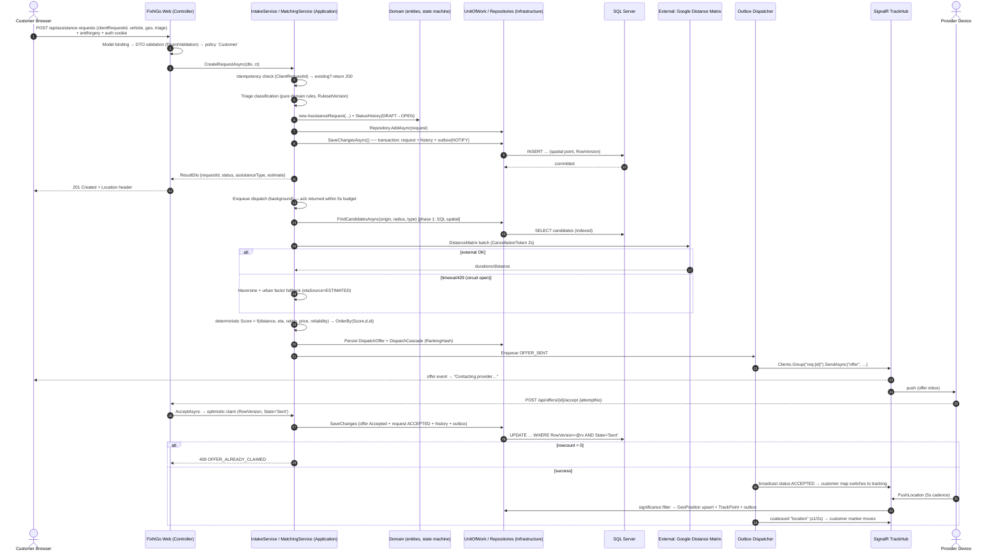

# FixNGo — System Analysis & Design Document

## Foundational Technical Sections (Expanded Edition)

**An Integrated Vehicle Roadside Assistance and Car Care Platform**

| Field | Value |
|---|---|
| Document ID | FixNGo-SAD-T1 |
| Version | 1.0 (Expanded) |
| Base document | FixNGo Software Requirements Specification (SRS) v1.0, 12 Sep 2026 |
| Supersedes/Extends | Draft SAD §§1–3, 5–6 (initial structure) |
| Prepared for | DEPI — Digital Egypt Pioneers Initiative |
| Audience | Software engineers, database designers, QA/verification teams, reviewers |
| Technology baseline | .NET (ASP.NET Core), Entity Framework Core, SQL Server, SignalR, Google Maps API, Stripe, Firebase Cloud Messaging |
| Traceability | All requirements carry `FR-xx` / `NFR-xx` tags traceable to the SRS |

> **How to read this document.** Section 1 establishes *why* the system exists and the measurable
> objectives it must satisfy. Section 2 defines *who* may do *what* (the authorization contract).
> Section 3 specifies *what* the system does, module by module, at a granularity directly usable
> for implementation and test-case authoring. Section 4 specifies *how well* it must perform,
> survive, and protect data. Section 5 specifies *how it is built*: layers, patterns, dependency
> injection, a traced end-to-end request lifecycle, and the external-service integration contract.
> Requirement IDs (`FR-`, `NFR-`, `FRAn-` (module-level), `BR-` (business rule), `G-` (goal))
> form a single traceability namespace used by the QA test matrix.

---

# Table of Contents

1. Problem Statement & Business Objectives
2. System Actors & Detailed Permission Matrix
3. Functional Requirements (Granular Modules A–I)
4. Non-Functional Requirements (Enterprise Grade)
5. Software Architecture & Design Patterns (Deep Technical Specification)
- Appendix A: Traceability Matrix (Module ↔ FR ↔ NFR ↔ Goal)
- Appendix B: Enumeration Catalogues
- Appendix C: Assumptions, TBDs & Deferred Scope

---

# 1. Problem Statement & Business Objectives

## 1.1 Problem Statement

A vehicle breakdown is not merely an inconvenience; it is an acute, multi-dimensional failure
event in which the affected person is simultaneously *impaired* (cannot continue their journey),
*ambiguous* (usually does not know what is wrong), *unprotected* (exposed to traffic and
environmental hazard), and *uninformed* (has no reliable channel to obtain help, price, or
arrival time). FixNGo addresses the failure across three orthogonal dimensions: **psychological**,
**operational**, and **safety**. Each dimension is broken down below because each one drives a
specific, traceable design constraint in Sections 3–5.

### 1.1.1 Psychological Dimension — The Stressed, Ambiguous Decision Maker

| # | Sub-problem | Detailed description | Design consequence |
|---|---|---|---|
| P-1 | **Acute stress degradation** | Under a sudden breakdown or accident the driver enters a sympathetic nervous-system stress response: attention narrows (tunnel vision), working memory shrinks (from a nominal 4±1 information chunks to roughly 2–3 under load), and the cost of each additional decision rises. Multi-form registration, open-ended text input, and dense dashboards become unusable exactly when they are most needed. | Emergency intake must be a *guided, closed-choice* flow with a bounded number of taps (≤3 interactions, ≤60 s — see §4.4), pre-filled context (vehicle, location), large touch targets, and no free-text requirement for the primary path (FR-13, FR-14, NFR-13). |
| P-2 | **Fault ambiguity / inability to describe the problem** | Drivers typically cannot name the fault: "the car won't start" may be a discharged battery, a starter, an alternator, or immobilizer fault. Because they cannot name it, they cannot search for it, cannot judge whether a mechanic or a tow truck is needed, and cannot judge whether a quote is plausible. | The system, not the driver, must classify the problem. A rules-based *triage engine* converts closed answers into a canonical `AssistanceType` (FR-14, FR-16, Module C) and always offers an `UNKNOWN` escape path with a safe default (tow/inspection). |
| P-3 | **Decision paralysis & repeated failed help-seeking** | Today's path is a sequence of phone calls, hold times, and dead ends ("we don't go that far", "we're closed"). Each failed attempt raises the activation energy for the next attempt, and many drivers simply wait, hoping the problem self-resolves. | Single-submission request model: one intake produces one durable request object that the *system* iterates over candidates (negotiation/fallback cascade, Module D), not the driver. |
| P-4 | **Verification anxiety & trust deficit** | The driver must admit an unknown individual into a vulnerable situation (stranded, often alone, at night). There is no proof that a self-described "mechanic" is legitimate, insured, or competent. Symmetric risk exists for providers (called to remote locations, unpaid jobs). | Admin-gated verification lifecycle (FR-02, FR-05, NFR-10) with a visible verified badge, provider identity surface (name, rating, completed jobs), and auditable account history (Module A, I). |
| P-5 | **Price anxiety / captive-customer exploitation fear** | A stranded driver is a captive customer: fear of arbitrary mark-ups ("what will they charge when they arrive?") is a rational concern, and lack of any price signal delays the request as much as the fault itself. | Transparent, formula-based cost estimation surfaced *before* dispatch (FR-18, Module H cost model), an itemized invoice after completion (FR-37), and rating pressure on fairness. |
| P-6 | **Absence of progress information** | After help is requested there is no feedback loop: no "help is on the way", no ETA, no status. Perceived waiting time is dominated by uncertainty, not by duration; abandonment and repeated calling follow. | Real-time tracking, ETA, and a machine-driven status state machine (FR-23–FR-26, Module E) with push notifications on every transition. |

### 1.1.2 Operational Dimension — Fragmentation on Both Sides of the Market

| # | Sub-problem | Detailed description |
|---|---|---|
| O-1 | **Fragmented discovery** | Help is found through search engines, call logs, roadside signage, and word-of-mouth. None of these channels expose *current availability*, *distance*, or *capability match*: a towing company is found for a flat tire, a tyre shop for a dead battery. |
| O-2 | **No dispatch layer** | Providers dispatch by answering phones while driving, or do not dispatch at all — the nearest worker happens to get the call rather than the *best-suited available* worker. Idle time and travel distance are unmanaged; no provider can see a queue of requests. |
| O-3 | **No system of record** | Services leave no artifact: no receipt, no invoice, no service history attached to the vehicle, no proof of work for warranty or insurance claims, no earnings records for providers, no expense records for fleets. |
| O-4 | **Verification vacuum** | Registration of a service business is informal; there is no document vetting, no approval gate, no revocation path, and therefore no platform-level guarantee about who arrives. |
| O-5 | **Asymmetric information between the parties** | The customer cannot compare providers (rating, distance, ETA, estimated cost); the provider receives no structured job context (which vehicle, what fault, what media, where exactly). Both sides renegotiate facts that the system should already know. |
| O-6 | **Manual, cash-centric settlement** | Payment is negotiated at the roadside, cash-only, unaudited, unreceipted; disputes have no data to be resolved against; platform takes no commission and cannot fund operations. |
| O-7 | **Maintenance discontinuity** | Emergency repair and long-term car care are disconnected: the breakdown is not linked to a follow-up booking, and recurring issues are invisible because history is not kept per vehicle. |

**Synthesis (statement of the problem).** *Roadside breakdown assistance today is a manual,
phone-based, unverified, price-opaque, information-poor process that fails precisely at the
moment of maximum user stress and maximum physical risk. It imposes a high cognitive load on an
impaired user, offers no dispatch intelligence to providers, produces no records for either
party, and provides no visibility — of who is coming, when, at what cost — once help is
requested. In parallel, preventive car care is disconnected from emergency repair, so vehicles
migrate from breakdown to breakdown without a maintained history.*

### 1.1.3 Safety Dimension — Risk Exposure as a Function of Time

Define the *time-to-help* decomposition:

```
T_total = T_recognize + T_locate + T_describe + T_search + T_verify + T_contact + T_dispatch + T_travel
```

| Term | Legacy process | FixNGo target | Owner module |
|---|---|---|---|
| `T_recognize` | User-dependent (unchanged) | Unchanged (out of system scope) | — |
| `T_locate` | Describe landmarks verbally, often wrong | GPS automatic; manual pin fallback (FR-11, FR-12) | C |
| `T_describe` | Free-text phone description of an unknown fault | Closed-choice triage, ≤4 questions (FR-13, FR-14) | C |
| `T_search` | Sequential phone calls, dead ends | Server-side candidate search + cascade (FR-17) | D |
| `T_verify` | No verification possible | Pre-verified provider pool (FR-05, NFR-10) | A |
| `T_contact` | Phone tag, repeated dialing | Single confirm → push notification → accept/reject (FR-19–FR-21) | D, E |
| `T_dispatch` | Unbounded | Server-side matching budget **p95 ≤ 5 s** (NFR-01) | D |
| `T_travel` | Unknown; no ETA | ETA computed and continuously refreshed (FR-18, FR-25) | D, E |

**Safety exposure model (design assumption).** Hazard exposure `H` of a stationary vehicle on a
carriageway grows monotonically with the time the vehicle and its occupants remain stationary in
a live lane or unprotected hard shoulder:

```
H(t) ≈ λ_lane · t_stationary  +  H_environment(visibility, time-of-day, weather)  +  H_person(passengers, injury)
```

Because `T_recognize` is irreducible, every engineering effort concentrates on collapsing
`T_locate … T_dispatch`. Concrete safety requirements derived from this model:

| ID | Requirement | SRS trace |
|---|---|---|
| S-1 | Accident/injury answers short-circuit triage into **P0 priority**, suppress negotiation delays, and surface official emergency numbers immediately. | NFR-05, NFR-06 |
| S-2 | A request may **never** be cancelled by a single tap: a confirmation modal with explicit consequence text is mandatory, and cancellation of a P0/P1 request additionally requires a second confirmation. | NFR-07 |
| S-3 | The intake screen displays persistent, admin-configurable emergency contacts (per-country catalogue, not hard-coded). | NFR-06 |
| S-4 | Location precision must be exact enough for a provider to find a vehicle on a highway (≤ 25 m accuracy target; manual pin guarantees a usable coordinate even when GPS is unavailable). | FR-11, FR-12 |
| S-5 | Provider identity (name, photo, plate/equipment ID, rating) is shown to the customer *before* arrival so the customer can verify the right vehicle/person. | NFR-10, NFR-12 |
| S-6 | Every status transition is timestamped and auditable, so an abandoned or interrupted service is detectable (stalled-state watchdog) rather than silent. | NFR-15 |

### 1.1.4 Problem Boundaries (Explicit Non-Goals)

The following are **out of scope** for this version and are recorded to prevent scope creep
(deferred items are consolidated in Appendix C): AI-based fault diagnosis and insurance-company
integration (SRS §1.4 — future phase); hardware/telematics ingestion from vehicle ECUs; driver
licensing/identity verification of customers; multi-tenant provider franchises; native
iOS/Android binaries (the deliverable is a mobile-responsive web application per SRS §2.1/§2.4);
live telematics tracking of the *customer's* vehicle after service completion.

---

## 1.2 Project Goals and Success Metrics

Goals are expressed as a measurable matrix: every goal has a metric, an instrument that produces
the number, and an SRS trace. `Category` distinguishes business outcomes from technical
properties; `Priority` uses MoSCoW.

### 1.2.1 Dispatch & Matching Performance Goals

| ID | Goal (objective) | Category | Success metric | Target | Measurement instrument | Priority | Trace |
|---|---|---|---|---|---|---|---|
| **G-01** | Sub-5-second dispatch acknowledgement | Technical | Latency from `POST /api/assistance-requests` receipt to (a) HTTP 2xx response **and** (b) first candidate SignalR notification emitted to the customer | p50 ≤ 2.5 s, **p95 ≤ 5.0 s**, p99 ≤ 8.0 s (excl. client network), under 1,000 concurrent users | Distributed tracing (OpenTelemetry span `dispatch.total`), synthetic + k6 load runs, APM percentiles | Must | NFR-01 |
| **G-02** | Deterministic provider matching | Technical | Given an immutable request snapshot `R`, a candidate set `C`, and matching config version `V`, re-running the ranking produces a byte-identical ordered list | 100% reproducibility across 1,000 replayed rankings; zero ties resolved by unordered iteration | Golden-file ranking tests in CI; `MatchingConfigVersion` + `RankingHash` persisted per request | Must | FR-17, NFR-15 |
| **G-03** | Provider list within 10 seconds | Technical | Time from location+problem confirmation to rendered candidate list (incl. distance/ETA enrichment) | p95 ≤ 10 s; external distance-API budget capped at 2 s with local fallback | APM span `matching.enrich` | Must | NFR-02 |
| **G-04** | Live tracking freshness | Technical | Interval between consecutive accepted provider position updates persisted **and** pushed to the customer map | ≤ 5 s nominal, ≤ 10 s worst case under load | `TelemetryLagMs` gauge (server ingest → client receive), heartbeat monitor | Must | NFR-03 |
| **G-05** | Concurrency headroom | Technical | Supported simultaneous authenticated sessions without SLA breach | ≥ 1,000 concurrent (design target: 1,500 = 1.5× safety factor), no p95 degradation > 20% vs. 100-user baseline | k6 scenario `full-load-1000`; CPU < 65 %, SQL PLE stable, SignalR queue depth < 100 | Must | NFR-04 |
| **G-06** | Zero-loss request durability | Technical | Requests/status transitions persisted despite client interruption or retry | 0 lost transitions; 0 duplicate chargeable events (idempotency) | Idempotency-key audit; fault-injection tests (kill connection mid-POST) | Must | NFR-15 |

### 1.2.2 Trust, Safety & Compliance Goals

| ID | Goal | Category | Success metric | Target | Instrument | Priority | Trace |
|---|---|---|---|---|---|---|---|
| **G-07** | Verified-only fulfillment | Business/Technical | Share of requests fulfilled by `Verified` accounts | 100 %; zero requests dispatched to `Pending`/`Suspended` accounts (enforced in query, not UI) | Authorization test suite; DB constraint + repository filter audit | Must | FR-05, NFR-10 |
| **G-08** | Complete RBAC enforcement | Technical | Endpoints/actions returning 200/403 correctly per role in automated authorization matrix test | 100 % of endpoints covered; 0 horizontal-privilege (IDOR) findings | Automated authorization matrix test (every controller action × 4 roles), run per release; static analysis for missing `[Authorize]` | Must | FR-04, NFR-09 |
| **G-09** | Minimal PII exposure | Business/Technical | Fields of customer PII visible to a provider before/after acceptance | Pre-accept: none beyond display name + vehicle class; post-accept: name, location, vehicle info, relay contact **only** (NFR-12) | Field-level visibility tests; API response snapshot tests; review of provider-facing DTOs | Must | NFR-12 |
| **G-10** | Full payment auditability | Business | Payment events with an immutable, queryable audit record (actor, amount, state, correlation ID) | 100 %; 0 gaps in `AuditLog` for financial actions | Audit-log completeness query run daily; reconciliation job | Must | NFR-11 |
| **G-11** | Emergency prioritization | Business/Safety | P0 (injury/accident) requests routed with expedited policy vs. routine | 100 % of P0 requests use expedited path (no negotiation wait > 5 s, immediate broadcast); surfaced first in dashboards | Priority-tag assertions in tests; ops dashboard | Must | NFR-05 |
| **G-12** | Cancellation safety | Safety | Cancellations preceded by a confirmation step | 100 % of client paths; no API-level bypass | UI + API tests (API requires explicit `confirm=true` + reason) | Must | NFR-07 |

### 1.2.3 Resilience & Integration Goals

| ID | Goal | Category | Success metric | Target | Instrument | Priority | Trace |
|---|---|---|---|---|---|---|---|
| **G-13** | 24/7 availability | Technical | Monthly availability of the request-dispatch path | ≥ 99.9 % (≤ 43.2 min planned+unplanned downtime/month, excl. announced maintenance) | Synthetic probes every 60 s from ≥ 2 regions; status-page SLO | Must | NFR-14 |
| **G-14** | Weak-network / offline resilience | Technical | Intake and status actions completed over a connection that drops for ≤ 60 s | ≥ 95 % of interrupted operations complete on automatic replay with no user data loss and no duplicate side effects | Network-shaping tests (Chrome DevTools/`toxiproxy`); offline queue replay assertions | Must | NFR-15, SRS §2.5 |
| **G-15** | Remote-area functional tolerance | Business/Safety | Successful request completion from a low-signal location (1–2 bars, 300–800 kbps) with degraded media | Request submitted with manual pin + compressed ≤ 200 KB photos; degrades to text-only mode without failure | Field-simulated tests; payload-budget CI check | Must | SRS §2.5, NFR-15 |
| **G-16** | Third-party integration containment | Technical | External outage impact on core dispatch | Maps outage → Haversine/road-distance fallback, dispatch continues; payment gateway outage → cash path unaffected; FCM outage → in-app + polling fallback. No core flow hard-fails on a dependency outage. | Chaos tests (kill API keys / block hosts); circuit-breaker state assertions | Must | SRS §3.3, §2.7 |
| **G-17** | Integration quota & latency governance | Technical | External API calls within configured quotas with budgeted latency; 429/quota events alert before exhaustion | 0 unexpected quota exhaustion; external call budget ≤ 2 s per dispatch | Quota dashboards; per-key counters; alerting at 70 % of daily quota | Should | NFR-01, NFR-02 |
| **G-18** | Automated recovery | Technical | RPO/RTO for the SQL Server database | RPO ≤ 5 min, RTO ≤ 30 min | Backup/restore drill (quarterly), failover test report | Should | NFR-14, NFR-15 |

### 1.2.4 Product & Business Goals

| ID | Goal | Category | Success metric | Target | Instrument | Priority | Trace |
|---|---|---|---|---|---|---|---|
| **G-19** | Transparent pricing | Business | Requests showing an itemized estimate before provider confirmation | 100 % of non-P0 requests; invoice line-items match estimate variance rule (≤ ±10 % or customer-approved) | Invoice/estimate comparison report | Must | FR-18, FR-35, FR-37 |
| **G-20** | Low-cognitive-load emergency UX | Usability | Steps from app home to dispatched request | ≤ 3 interactions, ≤ 60 s for the standard path; 0 mandatory free-text fields | Task-based usability test (n ≥ 5 per release), click-path analytics | Must | NFR-13 |
| **G-21** | Bilingual market coverage | Business | UI fully localized AR/EN including RTL | 100 % of resource keys; 0 hard-coded strings (CI check); RTL visual-parity review pass | Pseudo-localization build; Crowdin/resource diff; RTL screenshot tests | Should | SRS §6 Localization |
| **G-22** | Two-sided liquidity (business viability) | Business | Median time from request creation to first provider accept | ≤ 60 s in served zones (business assumption, not a system guarantee) | Funnel analytics event `dispatch.latency_to_accept` | Should | FR-21 |
| **G-23** | Quality feedback loop | Business | Completed services with a customer rating | ≥ 60 % of completed services; average rating surfaced with ≥ 30-day window | Reporting dashboard (Module I) | Should | FR-39–FR-41 |
| **G-24** | Growth-capable architecture | Technical | Effort to add a new assistance type or a new provider category | ≤ 1 day (data-driven config, no schema change for new type; new *integration* ≤ 5 days behind existing abstraction) | Change-log lead-time metric | Should | NFR-16, NFR-17 |
| **G-25** | Extensibility for Phase 2 | Technical | AI diagnosis / insurance adapters can be added without modifying core modules | New capability plugs in behind `IDiagnosisAdvisor` / `IInsuranceClaim` interfaces; 0 changes to Module C dispatch contract | Architecture review; dependency-rule test (Domain references no Infrastructure) | Could | SRS §1.4, NFR-17 |

### 1.2.5 Goal → Constraint Summary (the five hard commitments)

1. **Sub-5 s dispatch** — a *server-side* budget (G-01) enforced by tracing in production, not a design aspiration; all work inside the dispatch path must fit the latency budget in §4.1.2.
2. **Deterministic matching** — matching is a pure function of persisted inputs + versioned config (G-02), so disputes, replays, and tests are decidable.
3. **Offline resilience** — every user-initiated action is idempotent and replayable, and the UI degrades rather than fails (G-14, G-15, §4.2).
4. **RBAC enforcement** — authorization is server-side, policy-based, matrix-tested on every release (G-08, §2.3).
5. **Third-party integrations** — every external dependency sits behind an interface with timeout, retry, circuit breaker, and a defined fallback (G-16, G-17, §5.5).

---

---

# 2. System Actors & Detailed Permission Matrix

## 2.1 Actor Model Overview

FixNGo has exactly **four first-class actors**. Every authenticated principal maps to exactly one
*primary role* (`Customer` | `Provider` | `ServiceCenter` | `Admin`); role inheritance is **not**
used (an Admin is never implicitly a Customer — if staff need to raise a test request they must
hold a separate customer identity or use a flagged impersonation session that is audited). This
flattened model keeps the authorization matrix total and testable.

```
                        ┌──────────────────────────────────────────────┐
                        │                FixNGo Platform               │
  ┌──────────────┐      │  ┌─────────┐  ┌──────────┐  ┌─────────────┐  │
  │  Customer    │─────▶│  │ Intake  │─▶│Matching  │─▶│ Fulfilment  │  │
  │  (Driver)    │◀─────│  │Module C │  │Module D  │  │ Module E/F  │  │
  └──────────────┘      │  └─────────┘  └──────────┘  └─────────────┘  │
  ┌──────────────┐      │  ┌─────────┐  ┌──────────┐  ┌─────────────┐  │
  │  Service     │─────▶│  │Dispatch │─▶│ Tracking │─▶│  Payment    │  │
  │  Provider    │◀─────│  │Queue    │  │Module E  │  │ Module H    │  │
  └──────────────┘      │  └─────────┘  └──────────┘  └─────────────┘  │
  ┌──────────────┐      │  ┌─────────┐  ┌──────────┐  ┌─────────────┐  │
  │  Service     │─────▶│  │Catalog  │─▶│ Booking  │─▶│  Invoicing  │  │
  │  Center      │◀─────│  │Module G │  │Scheduler │  │ Module H    │  │
  └──────────────┘      │  └─────────┘  └──────────┘  └─────────────┘  │
  ┌──────────────┐      │  ┌──────────────────────────────────────────┐│
  │  Admin       │─────▶│  │ Governance: verification, moderation,    ││
  │  (Staff)     │◀─────│  │ users, reports, audit, configuration     ││
  └──────────────┘      │  └──────────────────────────────────────────┘│
                        └──────────────────────────────────────────────┘
```

### 2.1.1 Actor Profiles

**A1 — Customer (Driver)**

| Attribute | Specification |
|---|---|
| Definition | A vehicle owner (or authorized driver) who requests roadside assistance, tracks fulfillment, pays, books maintenance, and rates outcomes. |
| Entry conditions | Self-service registration: email *or* phone + password; email/phone ownership verified via one-time code before the first assistance request (not at signup, to keep onboarding friction minimal — but mandatory pre-dispatch, see BR-A-07). |
| Domain boundary (owns) | `Customer` profile, `Vehicle` rows owned, `AssistanceRequest` raised, `Booking` made, `Payment` made, `Review` written. |
| Read scope (cross-owner) | Only aggregated, public-safe provider/center data (display name, verified badge, aggregate rating, services, prices, distance). Never another customer's data. |
| Write scope | Own profile & vehicles; own active request (confirm/cancel with confirmation); own bookings (cancel within policy); chat messages in own conversations; ratings on own completed services. |
| Privileged actions | None. Cannot self-verify others, cannot modify prices, cannot alter statuses outside the customer-side transitions (`CONFIRM`, `CANCEL`, `RATE`, `PAY`). |
| Primary UI surfaces | Home/emergency intake, map & tracking, chat, payments, service-centre search/booking, history (SRS §3.1). |
| Failure modes to design for | Stressed, distracted, possibly mobile-data-thin usage; GPS unavailable; abandoned session mid-request; accidental taps (confirmation gates required). |
| SRS trace | FR-01, FR-03, FR-04, FR-07…FR-20, FR-23…FR-32, FR-35…FR-44; NFR-13. |

**A2 — Service Provider**

| Attribute | Specification |
|---|---|
| Definition | Mechanic, tow operator, battery/tyre/fuel specialist, or individual offering roadside assistance through the platform. |
| Entry conditions | Registration with business/professional documents (upload) → account state `PendingVerification` → **Admin approval required** before receiving any dispatch (FR-02, FR-05, NFR-10). Identity & capability declaration (service types, coverage radius, price sheet) captured at onboarding. |
| Domain boundary (owns) | Provider profile, declared `ServiceCapability` set, availability flags, own dispatch queue responses, own status transitions, own earnings/history. |
| Read scope | Own data; customer job context **post-accept only** (name, pickup location, vehicle info, photos, in-app relay contact — NFR-12); public customer aggregate (first name + initial, rating) needed to evaluate a job. |
| Write scope | Own availability; accept/reject incoming offers; own request status transitions (`ACCEPTED → EN_ROUTE → ARRIVED → IN_SERVICE → COMPLETED`); own location telemetry (position stream); chat in own conversations; parts/materials cost entries (customer-approved); own profile/documents (re-verification on change). |
| Privileged actions | None self-granted: verification, suspension, capability changes beyond declared set require Admin. |
| Primary UI surfaces | Dashboard (incoming offers w/ customer location, vehicle, problem), accept/reject, status update, map navigation, earnings & ratings (SRS §3.1). |
| Failure modes to design for | Driving context (large targets, one-hand, minimal typing); intermittent connectivity (telemetry buffering); accidental accept (confirmation on `COMPLETED` only — irreversible money path); multi-device session conflicts. |
| SRS trace | FR-02…FR-05, FR-20…FR-26, FR-45; NFR-10, NFR-11. |

**A3 — Service Center**

| Attribute | Specification |
|---|---|
| Definition | A repair garage / maintenance business offering bookable services, prices, and working hours. |
| Entry conditions | Registration with commercial documents → `PendingVerification` → Admin approval (same gate as Provider). Must publish ≥ 1 service, ≥ 1 working-hours rule before becoming bookable. |
| Domain boundary (owns) | Center profile, `ServiceCatalog` (service/price/duration), `WorkingHours` + exception calendar, `BookingSlot` inventory, responses to booking requests. |
| Read scope | Own data; customer booking context (name, vehicle, contact relay); public customer aggregate for booking trust. |
| Write scope | Own catalog/prices/hours (within platform guardrails — price changes are logged); accept/reject bookings; move a booking to `COMPLETED`/`NO_SHOW`; upload center photos/certifications. |
| Privileged actions | None self-granted; verification/suspension Admin-only; **price manipulation after booking confirmation is forbidden** (BR-G-08). |
| Primary UI surfaces | Catalog manager, working-hours editor, booking inbox, daily agenda, earnings (SRS §3.1). |
| Failure modes to design for | Double-booking attempts under concurrency (slot lease, §3.G); after-hours edits; staff turnover (multiple sub-users per center — deferred, single-account model in v1). |
| SRS trace | FR-02…FR-05, FR-30…FR-34; NFR-10. |

**A4 — Admin**

| Attribute | Specification |
|---|---|
| Definition | Platform staff who verify providers/centers, manage accounts, moderate reviews, handle complaints, monitor reports and configuration. |
| Entry conditions | Provisioned by seed/script only (no self-registration). **MFA mandatory** (TOTP), strong password policy, session absolute lifetime 8 h, all actions audited. |
| Domain boundary (owns) | Governance data only: verification decisions, moderation decisions, system configuration (pricing rules, emergency numbers, matching weights), report generation. Admin **owns no business transactions** (cannot create requests, take payments, or impersonate into money flows without an audited impersonation session). |
| Read scope | Broad-but-minimized: operational/aggregate views; full PII access only through a dedicated "break-glass" screen that itself is audited per access (not via ordinary list views). |
| Write scope | Verification status transitions; user suspend/restore; review hide/restore; complaint resolution; configuration version publishing (prices, radii, weights); forced password reset. |
| Privileged actions | Everything in the row above is privileged; every write must carry a mandatory `reason` string persisted to `AuditLog`. |
| Primary UI surfaces | Dashboard & KPIs, verification queue, user management, complaints/moderation, reports, configuration (SRS §3.1). |
| Failure modes to design for | Insider risk (least privilege + audit + no bulk export without approval), account takeover (MFA + IP anomaly alerts), accidental config damage (versioned config with rollback). |
| SRS trace | FR-04, FR-05, FR-42; NFR-09…NFR-12. |

### 2.1.2 Secondary / Non-Human Actors (system boundary completeness)

| Actor | Type | Interaction | Trust level |
|---|---|---|---|
| Anonymous visitor | Human | Registration, password reset, public service-center browsing (read-only catalog) | Untrusted, rate-limited, CAPTCHA on reset/signup. |
| Google Maps Platform (Geocoding, Distance Matrix, Maps JS) | External service | Geocoding, distance/ETA, map rendering | Trusted via API key + quota; circuit-broken (§5.5). |
| Stripe (payment gateway) | External service | PaymentIntent creation, confirmation, refunds, webhooks | Trusted via signed webhooks; idempotent handlers (§3.H). |
| Firebase Cloud Messaging (FCM) | External service | Push delivery of dispatch/status events | Best-effort; in-app SignalR + polling are the primary channels. |
| SignalR real-time channel | Infra | Bidirectional position/status/chat transport | Same auth principal as HTTP; hub methods authorize per group. |
| Background workers (`BackgroundService`) | System | Slot-lease reaper, matching cascade driver, watchdog, notification fan-out, report rollups | In-process trusted; all work idempotent and journaled. |
| Fraud/abuse monitor (rule-based) | System | Rate-limit and anomaly counters; flags for Admin review | Read-only flags; human decision. |

---

## 2.2 Identity, Role & Claim Model

### 2.2.1 Roles (fixed enumeration)

```
Customer | Provider | ServiceCenter | Admin
```

Stored in ASP.NET Identity `AspNetRoles`; assigned at registration or by Admin; **exactly one**
role per user (application-level invariant, enforced in `UserManager.AddToRoleAsync` wrapper).

### 2.2.2 Claims catalogue (persisted on the principal)

| Claim type | Values | Purpose | Set by |
|---|---|---|---|
| `role` | `Customer`, `Provider`, `ServiceCenter`, `Admin` | Coarse authorization (`[Authorize(Roles=…)]`, policies) | Identity |
| `uid` | user GUID string | Stable subject for audit/log correlation | Identity |
| `verification` | `Pending`, `UnderReview`, `Verified`, `Suspended`, `Revoked` | Gate dispatch/booking capabilities **server-side** without extra DB round-trips in hot paths | Identity claim refresh on status change |
| `capability` | comma-set, e.g. `TOWING,MOBILE_MECHANIC` | Fast pre-filter in the dispatch pipeline (authoritative copy still in DB) | Onboarding / Admin edit |
| `locale` | `ar-EG`, `en` | UI language & notification language | User profile |
| `mfa` | `true`/`false` | Step-up checks for Admin routes | Identity |
| `sid` | session GUID | One-session-per-device enforcement & "log out everywhere" | SignInManager |

Claims are **re-stamped** from the database on `SecurityStampValidator` interval (15 min) and
immediately on verification-state changes, so a suspended provider loses dispatch capability
within ≤ 15 min even if their cookie is still valid (plus explicit session revocation on
suspension for ≤ 1 min convergence).

### 2.2.3 Named authorization policies (referenced by controllers/hubs)

| Policy name | Requirement(s) | Enforced on |
|---|---|---|
| `Self` | Authenticated, account `Active` | Baseline for all authenticated endpoints. |
| `Customer` | Role = Customer **and** verified contact (email/phone OTP passed) | Intake, booking, payment, review endpoints. |
| `ProviderActive` | Role = Provider **and** `verification = Verified` **and** `availability ∈ {Online, Busy}` (for accepting) | Offer intake, telemetry push, status transitions. |
| `ProviderSelf` | Role = Provider **and** resource owner | Earnings, own history, own profile. |
| `CenterActive` | Role = ServiceCenter **and** `verification = Verified` | Catalog, slots, booking responses. |
| `CenterSelf` | Role = ServiceCenter **and** resource owner | Center-owned resources. |
| `AdminMfa` | Role = Admin **and** MFA satisfied in current session (step-up within 5 min) | Verification queue, user management, config publishing, PII break-glass. |
| `VerifiedProviderOrCenter` | Role ∈ {Provider, ServiceCenter} **and** Verified | Document re-upload, capability edits. |

Resource ownership is checked separately with **resource-based authorization**
(`IAuthorizationService` + handlers), never inferred from route values alone.

---

## 2.3 Master Permission Matrix

Legend: **F** = Full (create/read/update/delete within own scope) · **O** = Own-scope only (same as F but hard-scoped to owner by query predicate) · **R** = Read-only · **A** = Approve/act on others' entities (governance) · **—** = Denied at API level (403), *and* hidden in UI. UI hiding is never the enforcement mechanism (see §2.6).

### 2.3.1 Account & Identity

| Capability | Customer | Provider | Service Center | Admin |
|---|---|---|---|---|
| Self-register | F | F (with documents) | F (with documents) | — (seeded only) |
| Login / logout / reset password | F | F | F | F |
| Edit own profile (name, contact, locale) | O | O | O | O |
| Change password / enable TOTP MFA | F | F | F | F (**MFA mandatory**) |
| View own sessions / log out everywhere | O | O | O | O |
| Upload verification documents | — | O (while not `Verified`) | O (while not `Verified`) | R (queue) |
| Approve / reject verification | — | — | — | **A** (reason mandatory) |
| Suspend / restore / revoke account | — | — | — | **A** (reason mandatory) |
| Force password reset of another user | — | — | — | **A** |
| List all users (search/filter) | — | — | — | **A** (minimized fields; PII via break-glass) |
| Delete own account (soft-delete, grace 30 d) | O | O | O | — (deactivate only, via governance) |

### 2.3.2 Vehicles (Module B)

| Capability | Customer | Provider | Service Center | Admin |
|---|---|---|---|---|
| Add vehicle | O | — | — | — |
| Edit / soft-delete own vehicle | O | — | — | — |
| Set default vehicle | O | — | — | — |
| View vehicle attached to an accepted job | — (own always) | R (job-scoped projection) | R (booking-scoped projection) | R (minimized) |
| View per-vehicle service history | O | R (only services they performed) | R (only services they performed) | R |
| Link a service record to a vehicle | — (implicit on completion) | O (own completions) | O (own completions) | — |

### 2.3.3 Emergency Requests & Matching (Modules C, D)

| Capability | Customer | Provider | Service Center | Admin |
|---|---|---|---|---|
| Create assistance request | O | — | — | — (may create on behalf, audited impersonation only) |
| Confirm location / triage answers / media | O | — | — | — |
| Receive candidate list w/ rating, distance, ETA, estimate | O (own request) | — | — | R |
| Confirm provider selection | O (own, except P0 auto-broadcast) | — | — | — |
| Receive incoming offer | — | R (`Verified`+eligible only) | — | R |
| Accept / counter / reject offer | — | O | — | — |
| Cancel request (double-confirm + reason) | O (own) | O (reject only, within window) | — | **A** (force-close, audited) |
| Reassign / escalate / flag priority | — | — | — | **A** |
| View full request timeline | O (own) | O (assigned) | — | R |
| Modify triage answers after dispatch | O (append-only addendum, not overwrite) | R | — | R |

### 2.3.4 Tracking, Status & Communication (Modules E, F)

| Capability | Customer | Provider | Service Center | Admin |
|---|---|---|---|---|
| Publish own GPS telemetry | — | O (only while assigned & active request) | — | — |
| Subscribe to request position stream | O (own request) | O (assigned request) | — | R |
| Transition request status | `CONFIRM`, `CANCEL`, `ACK_COMPLETE` | `ACCEPT`, `EN_ROUTE`, `ARRIVED`, `IN_SERVICE`, `COMPLETE` | — | force-transition (audited) |
| Send chat messages in own conversation | O | O | O (booking threads) | R (moderation view) |
| Share GPS pin in chat | O | O | — | — |
| Initiate voice call hand-off | O → provider | O → customer | — | — |
| Block/mute a counterparty (abuse) | O | O | O | **A** |
| Export/delete conversation (data request) | O (own) | O (own) | O (own) | **A** |

### 2.3.5 Service Centers & Bookings (Module G)

| Capability | Customer | Provider | Service Center | Admin |
|---|---|---|---|---|
| Search/filter service centers | R | R | — | R |
| View center catalog, hours, prices, rating | R | R | O (own) | R |
| Book a slot | O | — | — | — |
| Accept / reject / propose-new-time booking | — | — | O (own) | — |
| Cancel booking (per policy window) | O (own) | — | O (own) | **A** |
| Manage services & prices | — | — | O (own; changes audited) | **A** (overrides/sanctions) |
| Manage working hours & exception days | — | — | O (own) | — |
| View center agenda / bookings | — | — | O (own) | R |
| Mark no-show / complete | — | — | O (own) | **A** |

### 2.3.6 Payments, Ratings, History, Admin (Modules H, I + governance)

| Capability | Customer | Provider | Service Center | Admin |
|---|---|---|---|---|
| View cost estimate of own request | O | O (assigned) | — | R |
| Choose payment method (cash/online) | O | — | — | — |
| Create online payment (PaymentIntent) | O | — | — | — |
| View invoice / receipt | O (own) | O (own earnings) | O (own earnings) | R |
| Issue refund | — | — | — | **A** (dual-control for > threshold) |
| Enter parts/materials cost lines | — | O (requires customer approval) | O (booking-scoped) | R |
| Write a review (1–5 + text) | O (one per completed request) | — | — | — |
| Report a review | O | O | O | — |
| Hide/restore review, resolve complaint | — | — | — | **A** |
| View own service history / earnings | O | O | O | R |
| View platform reports/KPIs | — | — | own only | **A** |
| Publish configuration (pricing, radii, weights, emergency numbers) | — | — | — | **A** (versioned + rollback) |
| Read `AuditLog` | — | — | — | **A** (read-only, break-glass, itself audited) |

### 2.3.7 Deny-by-Default Rule

Every action not explicitly marked **F/O/R/A** above is **denied**. New endpoints must be added to
this matrix *and* to the automated authorization test before merge; the CI pipeline fails if a
controller action lacks an explicit `[Authorize(Policy=…)]` or a matrix entry (G-08).

---

## 2.4 Field-Level Data Visibility Matrix (PII Minimization — NFR-12)

| Data field | Customer | Provider (pre-accept) | Provider (post-accept) | Service Center (booking) | Admin (normal view) | Admin (break-glass, audited) |
|---|---|---|---|---|---|---|
| Full name | own | **masked** (`Haneen A.`) | full | full (booking party) | masked | full |
| Email | own | — | relayed address only (no raw) | relayed | masked | full |
| Phone | own | — | in-app relay / masked | in-app relay | masked | full |
| Home/work address | own | — | only if part of job location | only pickup/drop context | — | full |
| Live GPS of customer | own | request pin only (≤ 25 m) | full live pin | — | — | full |
| Vehicle plate | own | — | full (needed to identify car) | full (needed for service) | masked | full |
| Vehicle VIN | own | — | — | on request | — | full |
| Payment instrument data | own (Stripe hosted field) | never | never | never | never | never (not stored) |
| National ID / license number | own | own doc only | own doc only | own doc only | — | full |
| Rating history | public aggregate only | own | own | own | full | full |

Rules: masked values are produced by the **server-side DTO mapper**, not by client-side hiding;
raw PII is never present in logs, URLs, or analytics events (§4.3).

---

## 2.5 Authentication Flows

### 2.5.1 Customer registration & first dispatch (self-service)

```
1. POST /account/register {name, email|phone, password}
   -> Identity created (role Customer, verification=Active, contactVerified=false)
   -> anti-abuse: rate limit 5/hour/IP, 10/day/device-fingerprint, CAPTCHA after 3 failures
2. OTP channel sent (email 6-digit / SMS 6-digit, TTL 5 min, max 3 verifies, 3 resends)
3. POST /account/verify-contact {code}  -> contactVerified=true, security stamp re-issued
4. (Optional) TOTP enrolment -> recovery codes shown once
5. Login -> auth cookie (see §2.5.5) with claims role=Customer, locale
6. FIRST DISPATCH GATE: POST /assistance-requests is rejected with 412
   {code:"CONTACT_NOT_VERIFIED"} until step 3 completes (BR-A-07)
   (keeps signup frictionless while guaranteeing reachability before money/jobs move)
```

### 2.5.2 Provider / Service Center registration & admin-gated verification

```
1. POST /account/register {business profile, service types, coverage radius, password}
   -> role=Provider | ServiceCenter, verification=Pending, capabilities saved
   -> account can log in but dispatch/booking endpoints return 403 {code:"NOT_VERIFIED"}
2. POST /onboarding/documents (multipart, max 5 files, 8 MB each,
   accepted: pdf/jpg/png, MIME + magic-byte sniffing, AV scan async)
   -> VerificationSubmission row, state=Submitted
3. Admin queue: GET /admin/verification-queue (filter by state/age)
   -> Admin opens submission -> documents rendered via short-lived signed URL (5 min, single IP)
   -> DECIDE:  Approve {reason} -> verification=Verified, security stamp re-issued,
                    claim capability refreshed, notification (FCM+in-app)
               Reject  {reason}  -> verification=Revoked, reason delivered to applicant
               RequestMoreInfo{reason} -> state=NeedsInfo (applicant can re-upload)
4. Document expiry watchdog (background): flags expiring licenses/insurances at T-30 d,
   auto-transitions to verification=Suspended at expiry (BR-A-11).
5. Capability/price-sheet changes after verification do NOT re-gate dispatch,
   but exceeding declared radius or adding an unverified service type does
   (returns 409 {code:"CAPABILITY_NOT_VERIFIED"}).
```

State machine (both Provider and ServiceCenter):

```
                submit docs            approve                suspend(reason)
  [New] ─────────────────▶ [PendingVerification] ──▶ [Verified(Active)] ───────▶ [Suspended]
     │                              │    ▲                    │  ▲                  │
     │                              │    │ re-upload /        │  │ restore(reason)   │ restore
     │                              ▼    │ admin re-review    │  └───────────────────┤
     │                        [Rejected/Revoked] ◀────────────┘                     │
     │                              │      revoke (policy breach, expiry, fraud)    │
     └──────────────────────────────┴───────────────────────────────────────────────▶[Archived]
```

Transitions are executed **only** by `IVerificationService` with an `AuditLog` entry carrying
actor, from-state, to-state, reason, and evidence hash.

### 2.5.3 Admin provisioning

Seeded via `dotnet ef` seed / one-time CLI with a generated 24-char password, forced change on
first login, TOTP enrolment mandatory before any `AdminMfa` policy resource is reachable
(step-up challenge returns 401 with `mfa_required=true`).

### 2.5.4 Password reset & account recovery

- `POST /account/forgot-password` always returns 200 (no account enumeration), sends a
  DataProtection-tokenized link/OTP (TTL 30 min, single use, bound to user ID + purpose).
- On successful reset: security stamp changes → all cookies/sessions invalidated, refresh of
  Identity tokens, `AuditLog PASSWORD_RESET`.
- Lockout: 5 failed attempts → 15 min lock with progressive backoff (5→15→30→60 min), Admin
  unlock with reason; lockout counters persist (DB) so app restarts don't reset them.

### 2.5.5 Session management

| Parameter | Value | Rationale |
|---|---|---|
| Transport | Auth cookie: `HttpOnly`, `Secure`, `SameSite=Lax`, `Path=/`, non-`__Host-` prefixed name | Web-first delivery; Lax protects against CSRF on POST while allowing top-level navigation from notification links |
| Sliding expiration | 30 min renewed on activity | Balance UX vs. stolen-cookie window |
| Absolute expiration | 8 h (12 h for Provider shift comfort — configurable) | Bound long-lived sessions |
| Concurrency | Max 2 active sessions per user (3rd login evicts oldest via `sid` claim tracking) | Limits credential sharing; enables "log out everywhere" |
| Anti-forgery | ASP.NET Core antiforgery tokens on every non-GET form + `X-CSRF-TOKEN` header for fetch/AJAX; validated server-side | NFR-08 |
| Re-validation | `SecurityStampValidator` every 15 min; immediate revocation events (suspend/revoke) pushed via `IUserSecurityStampStore` + cache invalidation | ≤ 15 min privilege-removal bound (G-07/G-08) |
| SignalR transport auth | Same cookie (same-origin WebSocket) **or** short-lived JWT (5 min TTL) for cross-origin/API clients; hub validates role+ownership per method, not just on connect | Prevents connection smuggling into another request's group |
| Logout | `SignOutAsync` + `sid` tombstone + antiforgery token rotation; "log out everywhere" clears all `sid`s | |

### 2.5.6 Authentication failure taxonomy (stable error codes)

| Code | HTTP | Meaning |
|---|---|---|
| `INVALID_CREDENTIALS` | 401 | Wrong identifier/password (uniform message) |
| `ACCOUNT_LOCKED` | 423 | Lockout active; `retryAfterSeconds` provided |
| `CONTACT_NOT_VERIFIED` | 412 | OTP not completed (dispatch gate) |
| `NOT_VERIFIED` | 403 | Role lacks `verification=Verified` |
| `MFA_REQUIRED` | 401 | Step-up needed for Admin resource |
| `SESSION_EVICTED` | 401 | Session superseded by newer login |
| `RATE_LIMITED` | 429 | Per-IP/identity throttle; `Retry-After` header |

---

## 2.6 Security Constraints Applicable to All Actors

1. **Server-side enforcement only.** Every protected action re-checks role + ownership +
   verification inside the application service/handler. UI visibility is cosmetic.
2. **Deny by default.** Controllers without an explicit policy fail startup analysis
   (an ASP.NET Core filter convention rejects unattributed actions in non-development builds).
3. **No client-trusted input.** Role, userId, price, radius, ETA, and status transitions are
   never accepted from the client; the client may only *request* a transition, which the server
   validates against the state machine (§3.E).
4. **IDOR prevention.** All owner-scoped queries include `WHERE OwnerUserId = @uid`
   (enforced by repository query filters, `GlobalQueryFilter` on owned aggregates) and are
   covered by automated cross-user access tests.
5. **Rate limiting.** Per-identity and per-IP token buckets: auth endpoints 10/min,
   intake 5/min, telemetry 1/2 s per device, chat 30/min, search 30/min; returns 429 + `Retry-After`.
6. **Audit everything privileged.** Actor, action, entity, before/after, reason, correlation ID,
   IP, user-agent — immutable (no UPDATE/DELETE grant on `AuditLog`), §4.3.
7. **Secrets never in code/config files.** API keys, Stripe secrets, connection strings live in
   user-secrets (dev) / Key Vault (staging/prod) with managed identity access; rotation runbook
   defined; no secret appears in repository, logs, or client bundles (client holds only publishable
   Maps key restricted by HTTP referrer + API-referrer allowlist).

---

---

# 3. Functional Requirements (Granular Modules)

Each module below follows the same contract so that it can be lifted directly into a backlog item:

* **Objective & scope** — what the module owns; explicit exclusions.
* **FRAn-nn** — module-level atomic requirements (refinements of SRS `FR-xx`).
* **BR-nn** — business rules (invariants enforced in code/DB, never only in UI).
* **Data model** — entities with key attributes, keys, and constraints.
* **State model** — where applicable (state machine table).
* **API surface** — REST endpoints with method, auth policy, request/response summary.
* **Validation & error codes** — stable codes for client handling and test assertions.
* **Edge cases** — the situations QA must probe.
* **Acceptance criteria** — Given/When/Then statements bound to the SRS FR.

---

## Module A — Authentication, Identity & Multi-Role Authorization

**Objective.** Provide a single identity substrate for the four actors, with role-scoped
authorization, admin-gated verification for providers/service centers, hardened session
management, and a complete audit trail of identity events. **Scope:** registration, login/logout,
OTP contact verification, MFA, password reset, verification workflow, role/claim administration,
session lifecycle. *Excluded:* content moderation (Module I), financial auth (Module H).

**SRS trace:** FR-01…FR-06, NFR-08…NFR-10, NFR-12, NFR-17.

### A.1 Requirements

| ID | Requirement | Priority | SRS |
|---|---|---|---|
| FRA-01 | The system shall allow Customer self-registration with `FullName`, `Email` **or** `PhoneNumber`, and `Password`; at least one contact channel is mandatory, both may be supplied. | Must | FR-01 |
| FRA-02 | The system shall allow Provider and ServiceCenter registration capturing business identity, declared service capabilities, coverage radius, and verification documents; the account is created in state `PendingVerification`. | Must | FR-02 |
| FRA-03 | The system shall authenticate all users via ASP.NET Core Identity (`SignInManager`) with cookie-based sessions; login supports identifier = email *or* phone. | Must | FR-03 |
| FRA-04 | The system shall enforce role-based access control (§2.2/§2.3): every protected endpoint declares a named policy; unauthorized access returns `403` (`FORBIDDEN`) without leaking resource existence (`404` for foreign-owned resources). | Must | FR-04, NFR-09 |
| FRA-05 | The system shall allow Admin to transition a Provider/ServiceCenter through `PendingVerification → Verified / NeedsInfo / Rejected`; only `Verified` principals can be returned by dispatch/booking queries. | Must | FR-05, NFR-10 |
| FRA-06 | The system shall allow password reset via single-use, time-boxed OTP/link sent to a verified channel, invalidating all sessions on completion. | Must | FR-06 |
| FRA-07 | The system shall support multi-factor authentication (TOTP) — **mandatory for Admin**, optional for other roles with recovery codes. | Must | NFR-08/09 |
| FRA-08 | The system shall verify customer contact channels via OTP (6 digits, TTL 5 min) before the first assistance request or payment can be created. | Must | FR-01, NFR-10 |
| FRA-09 | The system shall re-issue the security stamp and evict sessions on: password change, email/phone change, role change, verification change, "log out everywhere". | Must | NFR-09 |
| FRA-10 | The system shall record every identity event (register, login success/failure, lockout, reset, MFA, verification decision, role change) in `AuditLog` with correlation ID. | Must | NFR-11 |
| FRA-11 | The system shall apply progressive lockout (5 failures → 15 min, doubling to 60 min) with per-IP and per-identity rate limits; responses are enumeration-safe (uniform messages/timing). | Must | NFR-08 |
| FRA-12 | The system shall never store or log raw passwords, OTP secrets in plain text (hashed via Identity's PBKDF2/Argon2 ID-format), or MFA secrets outside DataProtection-encrypted columns. | Must | NFR-08 |
| FRA-13 | The system shall allow Admin to suspend/restore/revoke accounts and force password resets, each with a mandatory reason persisted in the audit trail. | Must | FR-05 |
| FRA-14 | The system shall support soft deletion of Customer accounts with a 30-day grace period during which login restores the account; after expiry, PII is anonymized per retention policy while financial records are retained. | Should | §6 legal |

### A.2 Business rules

| ID | Rule | Enforcement point |
|---|---|---|
| BR-A-01 | A user holds exactly one primary role. | `AccountService.CreateAsync` transactional guard |
| BR-A-02 | `Admin` role can only be assigned by another Admin or by the seed process. | `RoleManager` wrapper + authorization test |
| BR-A-03 | Providers/Centers cannot receive dispatch/bookings unless `verification = Verified`. | Repository query predicate (not UI filter) + policy check |
| BR-A-04 | A verification decision must carry a non-empty `reason` (≥ 5 chars) and an actor; decisions are append-only (no edit, only superseding decision). | `IVerificationService` + DB CHECK + audit |
| BR-A-05 | Contact change (email/phone) requires re-OTP and sets `contactVerified=false` until verified. | Profile service |
| BR-A-06 | Password policy: ≥ 10 chars, at least 3 of 4 char classes, not in top-100k breached list, not equal to identifier; max 128 chars (DoS guard). | `IPasswordValidator<T>` |
| BR-A-07 | `POST /api/assistance-requests` requires `contactVerified = true`, else `412 CONTACT_NOT_VERIFIED`. | Request creation handler |
| BR-A-08 | Admin MFA challenge expires after 5 min of inactivity on `AdminMfa` resources (step-up re-prompt). | Policy handler |
| BR-A-09 | Document uploads are scanned; a positive AV verdict auto-transitions submission to `RejectedMalware` and alerts Admin. | Async pipeline |
| BR-A-10 | Session concurrency ≤ 2 per identity; the newest login wins. | `sid` claim + `SessionRegistry` (distributed cache) |
| BR-A-11 | Expiring verification documents suspend the account on expiry date (auto), with a T-30-day reminder. | Background watchdog |
| BR-A-12 | Suspension immediately revokes active dispatch eligibility even for in-flight offers (offers become `Expired` with reason `PROVIDER_SUSPENDED`). | Matching service pre-check + cache invalidation |

### A.3 Data model (key entities)

| Entity | Key attributes | Constraints |
|---|---|---|
| `User` (Identity `ApplicationUser`) | `Id (guid)`, `NormalizedUserName`, `NormalizedEmail`, `PhoneNumber`, `PasswordHash`, `SecurityStamp`, `ConcurrencyStamp`, `FullName`, `Locale`, `ContactVerifiedAtUtc`, `LockedUntilUtc`, `CreatedAtUtc`, `SoftDeletedAtUtc` | Unique index on `NormalizedEmail` **and** `NormalizedPhoneNumber` (where not null); CHECK: at least one contact non-null |
| `UserRole` / `Role` | as ASP.NET Identity | Unique `(UserId, RoleId)`; single-role app invariant |
| `UserClaim` | `ClaimType`, `ClaimValue` | Indexed by type for stamp refresh |
| `VerificationSubmission` | `Id`, `SubjectUserId`, `Kind (Provider\|Center)`, `State`, `SubmittedAtUtc`, `DecidedAtUtc`, `DecidedByUserId`, `Reason`, `EvidenceHash` | Index `(SubjectUserId, State)`; append-only |
| `VerificationDocument` | `Id`, `SubmissionId`, `BlobPath`, `OriginalName`, `Mime`, `SizeBytes`, `ScanState`, `ExpiryDate` | Blob stored in object storage, never in DB |
| `AuditLog` | `Id (bigint identity)`, `AtUtc`, `ActorUserId`, `ActorRole`, `Action`, `EntityName`, `EntityId`, `FromState`, `ToState`, `Reason`, `OldJson`, `NewJson`, `CorrelationId`, `IpAddress`, `UserAgent` | **No UPDATE/DELETE grant**; index `(AtUtc)`, `(ActorUserId, AtUtc)`, `(CorrelationId)`; partition by month for scale |
| `SessionRecord` | `UserId`, `Sid`, `IssuedAtUtc`, `LastSeenAtUtc`, `DeviceHint`, `RevokedAtUtc` | Unique `(UserId, Sid)`; supports "log out everywhere" |

### A.4 API surface

| Method & path | Policy | Notes |
|---|---|---|
| `POST /api/account/register` | Anonymous + rate-limit | Returns `201` + OTP challenge ID |
| `POST /api/account/verify-contact` | Anonymous | Consumes OTP, sets `ContactVerifiedAtUtc` |
| `POST /api/account/login` | Anonymous + CAPTCHA-after-N | Cookie set; returns claims summary |
| `POST /api/account/logout` | Self | Clears cookie + sid tombstone |
| `POST /api/account/forgot-password` · `POST /api/account/reset-password` | Anonymous + rate-limit | Always `200` on forgot |
| `POST /api/account/mfa/enroll` · `POST /api/account/mfa/verify` | Self | TOTP + recovery codes |
| `POST /api/onboarding/documents` | `VerifiedProviderOrCenter` (pre-verify: role + not-yet-verified variant) | Multipart, ≤ 5 × 8 MB |
| `GET /api/admin/verification-queue` | `AdminMfa` | Filter by state/age |
| `POST /api/admin/verification/{id}/decision` | `AdminMfa` | `{decision, reason}`; stamps security |
| `POST /api/admin/users/{id}/suspend\|restore\|revoke` | `AdminMfa` | `{reason}` mandatory |
| `GET /api/admin/audit-logs` | `AdminMfa` + break-glass | Read-only, paged, filtered |

### A.5 Edge cases & acceptance criteria

**Edge cases:** duplicate email vs. phone uniqueness when the other channel already exists; OTP requested repeatedly (resend throttle, cooldown 30 s); login with locked account revealing lock status only *after* correct password (avoid enumeration); verification decided twice concurrently (optimistic `ConcurrencyStamp` — second decision fails with `409 STATE_CHANGED`); cookie rejected by browser (SameSite) during cross-site notification redirect; user suspended while an offer is on screen (offer must expire, not hang).

**AC-A-1** *Given* a registered, unverified-contact customer, *When* they attempt to create an assistance request, *Then* the API returns `412 CONTACT_NOT_VERIFIED` and no request row is created. *(FRA-08, BR-A-07)*
**AC-A-2** *Given* a `PendingVerification` provider, *When* the matching query executes, *Then* they are excluded from all candidate lists; and when they attempt `POST /offers/{id}/accept`, *Then* `403 NOT_VERIFIED`. *(FRA-05, BR-A-03)*
**AC-A-3** *Given* an Admin approves a submission, *When* the decision commits, *Then* the provider's session claims refresh within ≤ 15 min (or immediately on next stamp validation) and an `AuditLog` row exists with `from/to` states and reason. *(FRA-09, FRA-10, BR-A-04)*
**AC-A-4** *Given* 5 consecutive wrong passwords, *When* the 5th attempt processes, *Then* the account locks for 15 minutes, subsequent correct credentials are rejected with `423 ACCOUNT_LOCKED`, and lockout survives an application restart. *(FRA-11)*
**AC-A-5** *Given* an automated authorization test matrix (4 roles × every endpoint), *When* executed in CI, *Then* mismatches against §2.3 produce zero failures. *(FRA-04, G-08)*

---

## Module B — Vehicle Fleet & Profile Management

**Objective.** Maintain the customer's multi-vehicle fleet as the contextual anchor for every
assistance request, booking, and service record; guarantee that historical service data remains
attached to the correct vehicle across its lifetime. **Scope:** CRUD, metadata, default vehicle,
per-vehicle history linkage. *Excluded:* request creation (C), payment (H).

**SRS trace:** FR-07…FR-09.

### B.1 Requirements

| ID | Requirement | Priority | SRS |
|---|---|---|---|
| FRB-01 | The system shall allow a Customer to register one or more vehicles with: `Make`, `Model`, `Year`, `PlateNumber`, plus `Color`, `BodyType`, `FuelType`, `Transmission`, optional `Vin`, optional `Mileage`, optional nickname. | Must | FR-07 |
| FRB-02 | The system shall allow update and soft-delete of vehicle records; hard delete is prohibited when the vehicle is referenced by any request/booking/service record (FK restrict → UI offers *archive* instead). | Must | FR-08 |
| FRB-03 | The system shall maintain an immutable per-vehicle service history composed of completed assistance requests, completed bookings, and manually recorded prior services; entries cannot be edited after completion (corrections append a superseding record). | Must | FR-09 |
| FRB-04 | The system shall allow exactly one *default* vehicle per customer (auto-selected at intake, customer-switchable). | Must | FR-07 |
| FRB-05 | The system shall expose a vehicle projection (make/model/year/plate) to a Provider only after request acceptance and to a ServiceCenter only when booked (§2.4). | Must | NFR-12 |
| FRB-06 | The system shall normalize and validate plate numbers (uppercase, strip separators, support Egyptian formats: `أ ب ج ١٢٣٤`, `123 أ ب ج`) and detect duplicate plates **per owner**. | Should | FR-07 |
| FRB-07 | The system shall enforce fleet limits per tier (default: 5 vehicles; configurable) to bound abuse. | Should | — |
| FRB-08 | The system shall support vehicle archiving (inactive) that hides it from intake but retains history. | Should | FR-08 |

### B.2 Business rules

| ID | Rule |
|---|---|
| BR-B-01 | `Year ∈ [1980, currentYear + 1]`; `Make`/`Model` resolved against a versioned vehicle catalogue (seeded, searchable, supports Arabic/English names) to prevent free-text divergence. |
| BR-B-02 | A request must reference exactly one *active* vehicle of the requesting customer; the referenced vehicle cannot be changed after dispatch (only the details projection is re-readable). |
| BR-B-03 | Plate uniqueness is enforced within an owner: `UNIQUE(OwnerUserId, NormalizedPlate) WHERE DeletedAtUtc IS NULL`. |
| BR-B-04 | Deleting a vehicle with `EXISTS(request, booking, serviceRecord)` is blocked with `409 VEHICLE_IN_USE`; the client is offered archive. |
| BR-B-05 | Service history rows are written only by the system (completion handlers), never by client PUT; customers may attach *notes/photos* to their own history rows (append-only). |
| BR-B-06 | VIN, when supplied, is validated by check-digit algorithm and unique globally (case-insensitive) among non-deleted rows. |

### B.3 Data model

| Entity | Key attributes | Constraints |
|---|---|---|
| `Vehicle` | `Id`, `OwnerUserId`, `MakeId`, `ModelId`, `Year`, `PlateRaw`, `PlateNormalized`, `Color`, `BodyType`, `FuelType`, `Transmission`, `Vin`, `Nickname`, `IsDefault`, `MileageLastReported`, `ArchivedAtUtc`, `DeletedAtUtc`, `RowVersion` | `UNIQUE(OwnerUserId, PlateNormalized)` filtered; `UNIQUE(Vin)` filtered; partial unique `UNIQUE(OwnerUserId) WHERE IsDefault = 1` (enforced transactionally) |
| `VehicleMake` / `VehicleModel` | `Id`, `NameEn`, `NameAr`, `CategoryId` | Seed data, versioned |
| `ServiceRecord` | `Id`, `VehicleId`, `Source (Request\|Booking\|Manual)`, `SourceId`, `PerformedAtUtc`, `Odometer`, `Summary`, `TotalCost`, `ProviderUserId`, `CenterId` | `UNIQUE(Source, SourceId)` prevents duplicate linkage; `VehicleId` FK RESTRICT |
| `VehicleNote` | `Id`, `VehicleId`, `AuthorUserId`, `Body`, `CreatedAtUtc` | Append-only |

### B.4 API surface

| Method & path | Policy | Notes |
|---|---|---|
| `GET /api/vehicles` | `Customer` | Own list; default flagged |
| `POST /api/vehicles` | `Customer` | Validates catalogue + plate normalization |
| `PUT /api/vehicles/{id}` | `Customer` + owner | Concurrency via `RowVersion` (`409 VERSION_CONFLICT`) |
| `DELETE /api/vehicles/{id}` | `Customer` + owner | Soft-delete; `409 VEHICLE_IN_USE` if referenced |
| `POST /api/vehicles/{id}/make-default` | `Customer` + owner | Transactional swap of `IsDefault` |
| `GET /api/vehicles/{id}/history` | `Customer` + owner (Provider/Center: scoped endpoints) | Paged; includes cost + rating references |
| `GET /api/vehicle-catalog/makes?q=` · `/models?makeId=` | Anonymous | Search endpoint for intake UI, localized |

### B.5 Edge cases & acceptance criteria

**Edge cases:** default vehicle archived (promote the next active vehicle in the same transaction); plate entered with mixed Arabic/Indic digits (normalize `٠-٩` → `0-9` before uniqueness check); duplicate registration race (two concurrent POSTs with the same plate → one fails on unique index with `409 DUPLICATE_PLATE`); vehicle referenced by an in-flight request when deletion is attempted.

**AC-B-1** *Given* a customer with 3 vehicles, *When* they open the intake screen, *Then* the default vehicle is preselected and switchable in one tap without leaving the flow. *(FRB-04, FRB-01, G-20)*
**AC-B-2** *Given* a vehicle referenced by a completed request, *When* the customer attempts deletion, *Then* `409 VEHICLE_IN_USE` is returned and the record remains; archive succeeds instead. *(FRB-02, BR-B-04)*
**AC-B-3** *Given* a completed assistance request, *When* the completion handler commits, *Then* exactly one `ServiceRecord` row exists linked to the request (`UNIQUE(Request, id)`) and appears in that vehicle's history. *(FRB-03, BR-B-05)*

---

## Module C — Emergency Assistance & Smart Intake Engine

**Objective.** Convert a distressed driver's raw situation into a **structured, prioritized,
machine-classified assistance request** with a trustworthy location, in minimal interaction
steps, tolerating GPS failure and weak networks. **Scope:** intake orchestration, location
acquisition/fallback, guided triage, fault classification, priority scoring, assistance
recommendation, media upload, request lifecycle creation/cancellation, status checks.
*Excluded:* candidate discovery (D), live tracking (E).

**SRS trace:** FR-10…FR-16, NFR-05, NFR-06, NFR-07, NFR-13.

### C.1 Requirements

| ID | Requirement | Priority | SRS |
|---|---|---|---|
| FRC-01 | The system shall allow an authenticated, verified-contact Customer to create an assistance request for one of their active vehicles. | Must | FR-10 |
| FRC-02 | The system shall acquire the customer's location via browser Geolocation API with `enableHighAccuracy: true`, a 10 s acquisition timeout, and a 25 m accuracy target; the returned fix carries `accuracyM`, `source=GPS`, `capturedAtUtc`. | Must | FR-11 |
| FRC-03 | The system shall provide a manual map-pin fallback when GPS is unavailable, denied, or inaccurate (`accuracyM > 100`): the customer drops a pin (reverse-geocoded address preview, editable) and confirms; the fix is flagged `source=MANUAL`. | Must | FR-12 |
| FRC-04 | The system shall present a closed-choice problem taxonomy: `FLAT_TIRE`, `DEAD_BATTERY`, `OUT_OF_FUEL`, `MECHANICAL`, `ACCIDENT`, `LOCKED_OUT`, `UNKNOWN` — one primary selection (multi-select allowed only for `UNKNOWN` + one other). | Must | FR-13 |
| FRC-05 | The system shall administer a conditional follow-up questionnaire (triage) — max 4 questions on the standard path, branching on prior answers (§C.3). | Must | FR-14 |
| FRC-06 | The system shall accept up to 5 media attachments (photo/video ≤ 25 MB total, ≤ 8 MB/file; JPEG/PNG/HEIC/WEBP/MP4; MIME + magic-byte validation; async AV scan) with client-side compression to ≤ 200 KB per image before upload on low bandwidth. | Must | FR-15 |
| FRC-07 | The system shall compute a canonical `AssistanceType` recommendation from classification rules (§C.4) and display it with confidence (`HIGH`/`LOW`) and a one-tap override to any other type. | Must | FR-16 |
| FRC-08 | The system shall assign a priority class `P0`–`P3` (§C.3.2) that drives dispatch policy, queue order, and UI treatment. | Must | NFR-05 |
| FRC-09 | The system shall surface admin-configurable emergency contact numbers (per-country catalogue) whenever triage detects injury/accident, and always offer a "Call emergency services" affordance. | Must | NFR-06 |
| FRC-10 | The system shall require an explicit confirmation step (typed `CANCEL` or modal double-tap with consequence text) before cancelling an active request; P0/P1 additionally require a reason. | Must | NFR-07 |
| FRC-11 | The system shall expose request status inspection (`GET /api/assistance-requests/{id}`) returning lifecycle state, timestamps, assignment, and ETA. | Must | FR-43, FR-44 |
| FRC-12 | The system shall persist the intake as a draft client-side (IndexedDB/localStorage) after each step, resuming after crash/reload/network loss. | Must | NFR-15, G-14 |
| FRC-13 | The system shall make intake idempotent: a client-generated `ClientRequestId` (GUID) is unique-indexed; retried POSTs return the original request (`200` + existing body) instead of duplicating. | Must | NFR-15, G-06 |
| FRC-14 | The system shall de-duplicate open requests: a customer with an `OPEN/ACCEPTED/IN_SERVICE` request receives `409 REQUEST_ALREADY_ACTIVE` with the existing request ID. | Must | — |
| FRC-15 | The system shall record the full triage input (answers, geo fix, media refs, classification result, ruleset version) immutably on the request for audit/dispute replay. | Must | NFR-15, G-02 |
| FRC-16 | The system shall allow status inspection *without* SignalR (polling endpoint, 5 s ETag conditional requests) so tracking/status survives WebSocket failure. | Must | NFR-03, NFR-15 |

### C.2 Data model

| Entity | Key attributes | Constraints |
|---|---|---|
| `AssistanceRequest` | `Id`, `ClientRequestId`, `CustomerId`, `VehicleId`, `ProblemCategory`, `AssistanceType`, `PriorityClass`, `Status`, `LocationLat`, `LocationLon`, `LocationAccuracyM`, `LocationSource (GPS\|MANUAL)`, `LocationCapturedAtUtc`, `AddressText`, `TriageJson`, `RulesetVersion`, `MediaJson`, `CreatedAtUtc`, `ConfirmedAtUtc`, `CancelledAtUtc`, `CancelReason`, `AssignedProviderId`, `RowVersion`, `RankingHash`, `MatchingConfigVersion` | `UNIQUE(ClientRequestId)`; spatial `GEOGRAPHY` column `Location` with spatial index; CHECK `PriorityClass ∈ P0..P3`; index `(CustomerId, Status)` filtered to active; index `(Status, PriorityClass, CreatedAtUtc)` for ops views |
| `TriageAnswer` (or JSON doc) | `RequestId`, `QuestionCode`, `AnswerCode`, `AnsweredAtUtc` | Append-only; JSON variant acceptable for v1 with schema versioned |
| `RequestMedia` | `Id`, `RequestId`, `BlobPath`, `Kind`, `SizeBytes`, `Mime`, `ScanState`, `CapturedAtUtc` | Max 5 rows per request (enforced in service + trigger) |
| `RequestStatusHistory` | `Id`, `RequestId`, `FromStatus`, `ToStatus`, `ActorUserId`, `ActorRole`, `AtUtc`, `Note`, `Source (Client\|System\|Worker)` | Append-only, never updated; drives timeline UI and audit |
| `EmergencyContact` | `Id`, `CountryCode`, `Service`, `Number`, `LabelEn`, `LabelAr`, `Active` | Admin-configurable (§2.3.6) |

### C.3 Guided triage (decision logic)

#### C.3.1 Question flow (conditional, max 4 on standard path)

```
Q0 [auto]  Location fix (GPS) ── fails/low-accuracy? ──▶ MANUAL PIN step (FRC-03)
Q1        "Is anyone injured?"        YES ─▶ priority=P0, flag INJURY, show emergency contacts (FRC-09),
                                         assistance candidate set = {ACCIDENT_SUPPORT} ∪ {TOWING}
           NO ─▶ Q2
Q2        "Is the vehicle in a dangerous place?"
           (highway lane/hard shoulder, tunnel, level crossing, flood water, fire risk, rail)
           YES ─▶ priority ≤ P1, flag HAZARD_LOCATION, force visible hazard warning + reflective-triangle hint text
           NO ─▶ priority base P2
Q3        "Does the engine start?"     YES ─▶ Q4        NO ─▶ Q5
Q4        "Can the vehicle move under its own power?"
           YES ─▶ {OUT_OF_FUEL if fuel-related; else MECHANICAL (runnable)} 
           NO  ─▶ {DEAD_BATTERY if starter clicks/no crank; else MECHANICAL (immobile)}
Q5        (shown when engine does not start)
           "What do you notice?" ▸ [clicking/no crank] [flat tyre] [smoke/steam] [odd sound] [nothing at all] [not sure]
           clicking/no crank ─▶ DEAD_BATTERY
           flat tyre        ─▶ FLAT_TIRE
           smoke/steam      ─▶ MECHANICAL + flag OVERHEAT, priority ≤ P1, TOWING strongly suggested
           not sure/other   ─▶ UNKNOWN (confidence LOW)
Q6 (only if LOCKED_OUT chosen or doors won't open) "Are keys inside?" YES ─▶ LOCKED_OUT
Q7 (only if ACCIDENT chosen) "Is the vehicle blocking traffic / drivable?" → sets HAZARD_LOCATION + TOWING
```

Rule: **injury short-circuits** all remaining questions (P0 immediately, minimal steps — G-11, G-20).

#### C.3.2 Priority classes

| Class | Trigger | Dispatch policy | Cancellation | UI treatment |
|---|---|---|---|---|
| **P0 — Critical** | `INJURY = true` or `ACCIDENT + blocking traffic` | Expedited: broadcast to top-N candidates simultaneously, negotiation wait ≤ 5 s, admin alert, no radius gating | Double confirm + reason | Red banner, emergency contacts pinned |
| **P1 — Severe** | `HAZARD_LOCATION = true` or `OVERHEAT` or immobile on a major road | Normal path with accelerated cascade (radius steps shortened by 50 %) | Double confirm | Amber banner, hazard guidance |
| **P2 — Standard** | Default (immobile, safe location) | Normal path | Double confirm | Standard |
| **P3 — Minor** | Movable vehicle, low-risk (e.g., lockout in a secure lot) | Normal path; may be queued behind P0/P1 | Single confirm + undo 10 s | Standard, de-emphasized |

#### C.3.3 Classification → recommendation mapping

| Detected category signals | Recommended `AssistanceType` | Confidence |
|---|---|---|
| `FLAT_TIRE` + spare present | `TIRE_CHANGE` | HIGH |
| `FLAT_TIRE` + no spare / damaged wheel | `TOWING` (to center) | HIGH |
| `DEAD_BATTERY` + clicking/no crank | `JUMP_START` | HIGH |
| `DEAD_BATTERY` + jump failed (after provider check) | `BATTERY_REPLACEMENT` (provider escalation) | HIGH |
| `OUT_OF_FUEL` | `FUEL_DELIVERY` | HIGH |
| `LOCKED_OUT` | `LOCKOUT_SERVICE` | HIGH |
| `MECHANICAL` + runnable | `MOBILE_MECHANIC` | MEDIUM |
| `MECHANICAL` + immobile / `OVERHEAT` / smoke | `TOWING` | HIGH |
| `ACCIDENT` (any) | `TOWING` (+ `ACCIDENT_SUPPORT` if P0) | HIGH |
| `UNKNOWN` | `DIAGNOSTIC` with `TOWING` suggested as fallback | LOW (customer override required for non-default selection) |

Every rule is data-driven (`ClassificationRule` rows, `RulesetVersion` stamped on the request) so
QA can replay historical triage inputs against a new ruleset (G-02, G-24).

### C.4 State model (request lifecycle — shared with Modules D/E)

| From \ To | `DRAFT` | `OPEN` | `MATCHING` | `OFFERED` | `ACCEPTED` | `EN_ROUTE` | `ARRIVED` | `IN_SERVICE` | `COMPLETED` | `PAID` | `RATED` | `CANCELLED` | `EXPIRED` |
|---|---|---|---|---|---|---|---|---|---|---|---|---|---|
| DRAFT (client) | — | ✔ (confirm) | | | | | | | | | | ✔ (discard) | |
| OPEN | | — | ✔ (auto) | | | | | | | | | ✔ (customer) | ✔ (timeout) |
| MATCHING | | | — | ✔ (candidate sent) | | | | | | | | ✔ | ✔ (cascade exhausted) |
| OFFERED | | | ✔ (all rejected → back) | — | ✔ (provider accept) | | | | | | | ✔ | ✔ (offer TTL) |
| ACCEPTED | | | | | — | ✔ (provider or auto ≥ 60 s after accept) | | | | | | ✔ (both, policy) | |
| EN_ROUTE | | | | | | — | ✔ (provider / geofence auto) | | | | | ✖ (must ARRIVED→…) | |
| ARRIVED | | | | | | | — | ✔ (provider) | | | | ✖ | |
| IN_SERVICE | | | | | | | | — | ✔ (provider, +parts) | | | | |
| COMPLETED | | | | | | | | | — | ✔ (payment settle) | | | |
| PAID | | | | | | | | | | — | ✔ (or auto-expire 7 d → `RATED` skipped) | | |
| RATED | terminal | | | | | | | | | | | | |
| CANCELLED / EXPIRED | terminal (audit retains reason/actor) | | | | | | | | | | | | |

*Rules:* transitions are **server-validated**; illegal transitions return `409 INVALID_TRANSITION`.
Every transition writes `RequestStatusHistory` in the same transaction as the state change.
Geofence auto-`ARRIVED` (provider within 50 m for ≥ 15 s) is advisory: it proposes the transition,
the provider's client confirms (never auto-fires money-affecting states).

### C.5 API surface

| Method & path | Policy | Notes |
|---|---|---|
| `POST /api/assistance-requests` | `Customer` | Body: `clientRequestId`, `vehicleId`, location, triage, `assistanceType?`; idempotent (FRC-13) |
| `GET /api/assistance-requests/{id}` | Owner/assigned/Admin | ETag for polling (FRC-16) |
| `GET /api/assistance-requests?status=&page=` | `Customer` / `Provider` / `Admin` (scoped) | History (FR-43/44) |
| `PATCH /api/assistance-requests/{id}/triage` | Owner, pre-dispatch only | Append-only addendum post-dispatch |
| `POST /api/assistance-requests/{id}/media` | Owner | Resumable upload for weak links |
| `DELETE /api/assistance-requests/{id}/media/{mediaId}` | Owner | Pre-dispatch only |
| `POST /api/assistance-requests/{id}/cancel` | Owner (+assigned provider may reject) | `{confirm:true, reason?}`; NFR-07 |
| `GET /api/triage/questions?category=` | `Customer` | Server-driven questionnaire (localized) |
| `GET /api/emergency-contacts?country=` | Anonymous | FRC-09 |
| `POST /api/geo/reverse-geocode` | Authenticated + rate-limit | Cached; used by manual pin |

### C.6 Validation & error codes

| Code | HTTP | Condition |
|---|---|---|
| `CONTACT_NOT_VERIFIED` | 412 | BR-A-07 |
| `VEHICLE_NOT_FOUND` / `VEHICLE_ARCHIVED` | 404 / 409 | Invalid vehicle reference |
| `LOCATION_MISSING` | 422 | No fix and no manual pin supplied |
| `LOCATION_ACCURACY_LOW` | 422 (`confirmRequired=true`) | `accuracyM > 100` without explicit customer confirmation |
| `TRIAGE_INCOMPLETE` | 422 | Required question for selected category unanswered |
| `MEDIA_TOO_LARGE` / `MEDIA_TYPE_UNSUPPORTED` / `MEDIA_QUOTA_EXCEEDED` | 413 / 415 / 409 | FRC-06 |
| `REQUEST_ALREADY_ACTIVE` | 409 | FRC-14 (returns `activeRequestId`) |
| `CANCEL_NOT_CONFIRMED` | 422 | Missing `confirm:true` (NFR-07) |
| `INVALID_TRANSITION` | 409 | State machine violation |
| `RATE_LIMITED` | 429 | Intake throttle |

### C.7 Edge cases

* GPS returns `accuracyM = 400` on a highway → must force manual pin or double-confirmation of a low-accuracy fix (never silently dispatch to a 400 m circle).
* Customer starts intake offline → draft persists; on reconnect, idempotent POST replays; OTP gate must be satisfied first.
* Injury question answered YES then user closes app → on resume, P0 state restored from draft/server with emergency banner intact.
* Media upload interrupted at 80 % → resumable chunk session (5 min TTL) or restart from scratch with no orphan blobs (garbage-collect unlinked blobs after 24 h).
* Two devices of the same customer submit simultaneously with different `ClientRequestId`s → FRC-14 returns `409 REQUEST_ALREADY_ACTIVE` for the second.
* Ruleset updated between draft and submit → the submitted request stamps the *current* ruleset version (no mid-flight mixing).

### C.8 Acceptance criteria

**AC-C-1** *Given* a customer with GPS disabled, *When* they proceed to location, *Then* the manual-pin step appears, requires an explicit pin confirm, and the created request carries `source=MANUAL` with a valid `GEOGRAPHY` point. *(FRC-03, FR-12)*
**AC-C-2** *Given* triage answer "anyone injured = yes", *When* the answer commits, *Then* remaining questions are skipped, `PriorityClass = P0`, emergency contacts render immediately, and the created request is ordered first in every provider view. *(FRC-05, FRC-08, FRC-09, NFR-05)*
**AC-C-3** *Given* the browser drops the connection after `clientRequestId` is generated, *When* the client retries the identical POST, *Then* exactly one request row exists and the response body is identical (byte-stable idempotency). *(FRC-13, G-06)*
**AC-C-4** *Given* an active request, *When* `POST …/cancel` is called without `confirm:true`, *Then* `422 CANCEL_NOT_CONFIRMED` and status is unchanged. *(FRC-10, NFR-07)*
**AC-C-5** *Given* SignalR is unreachable, *When* the client polls `GET /{id}` with ETags every 5 s, *Then* status/ETA remain correct and requests return `304` when unchanged. *(FRC-16)*

---

## Module D — Geospatial Provider Matching & Routing Engine

**Objective.** Given a completed intake, produce an **ordered, deterministic candidate list** of
eligible providers, enrich it with distance/ETA/estimate, drive the offer→accept/counter/reject
negotiation with timeouts and a radius-expansion cascade, and finalize assignment under
concurrency-safe conditions. **Scope:** eligibility filtering, geo query, scoring, enrichment,
negotiation loop, fallback, assignment, estimate computation. *Excluded:* live tracking (E),
payment settlement (H).

**SRS trace:** FR-17…FR-22, NFR-01, NFR-02.

### D.1 Requirements

| ID | Requirement | Priority | SRS |
|---|---|---|---|
| FRD-01 | The system shall query providers filtered by: `verification = Verified`, `availability = Online`, `availabilityWindow` open, capability contains the request's `AssistanceType`, not currently assigned to an active job, and within the active search radius of the request location. | Must | FR-17 |
| FRD-02 | The system shall rank eligible providers by a deterministic weighted score (§D.3) using distance, ETA, average rating, price competitiveness, acceptance rate, and recency; ties break by (distance ASC, providerId ASC) — no unordered iteration anywhere in the pipeline. | Must | FR-17, G-02 |
| FRD-03 | The system shall display for each candidate: display name, verified badge, rating (avg + count), straight-line distance, ETA, and estimated cost range, computed for the request's location. | Must | FR-18 |
| FRD-04 | The system shall allow the customer to select a provider and confirm, or enable **auto-dispatch** (default for P0/P1) that walks the ranked list automatically. | Must | FR-19, NFR-05 |
| FRD-05 | The system shall push a structured offer to the selected provider with TTL (default 20 s; P0 = 5 s) and notify the customer that a provider is being contacted. | Must | FR-20 |
| FRD-06 | The system shall allow the provider to `ACCEPT`, `REJECT` (with reason code), or `COUNTER` (adjusted price within platform bounds, max 2 counters per request). | Must | FR-21 |
| FRD-07 | On rejection/timeout/counter-exhaustion the system shall advance to the next candidate automatically, notify the customer ("contacting the next available provider"), and never leave the request unattended until the cascade exhausts. | Must | FR-22 |
| FRD-08 | The system shall expand the search radius in a cascade: `5 → 10 → 20 → 50 km` (P2/P3) or `5 → 15 → 30 km` (P0/P1, faster growth) when the candidate set is empty or fully exhausted, up to a global dispatch timeout (P0 60 s, P1 120 s, P2/P3 240 s). | Must | FR-17, NFR-01 |
| FRD-09 | The system shall compute distance/ETA via Google Distance Matrix in batched calls (≤ 25 origins/destinations per call) with a hard 2 s budget and **Haversine-derived fallback ETA** (urban factor 1.35 × distance / 30 km/h) when the API fails, times out, or is quota-blocked. | Must | FR-18, NFR-02, G-16 |
| FRD-10 | The system shall guarantee the dispatch acknowledgment path completes within the G-01 budget: persistence ≤ 300 ms, candidate query ≤ 500 ms, enrichment ≤ 2,000 ms (async precompute allowed), offer dispatch ≤ 500 ms, remainder = margin. | Must | NFR-01 |
| FRD-11 | The system shall enforce assignment atomicity: only one provider can hold `ACCEPTED` for a request (optimistic `RowVersion` + conditional update; loser gets `409 OFFER_ALREADY_CLAIMED`). | Must | FR-21, NFR-15 |
| FRD-12 | The system shall cancel in-flight offers for a request when it is cancelled/expired/superseded, and notify affected providers (`OFFER_VOIDED`). | Must | NFR-15 |
| FRD-13 | The system shall produce a user-visible explanation for an empty result ("no providers within 50 km — we're expanding the search / call fallback") with a manual refresh and an escalation option to Admin. | Should | NFR-13 |
| FRD-14 | The system shall persist `MatchingConfigVersion`, scoring inputs, and `RankingHash` with the request so any historical ranking can be replayed byte-identically. | Must | G-02 |
| FRD-15 | The system shall compute the customer-facing cost estimate (§D.5) from the versioned pricing configuration and attach it to every offer and candidate card. | Must | FR-18, G-19 |

### D.2 Candidate eligibility & geospatial query

```
SELECT p.*
FROM Providers p
  JOIN GeoPosition g   ON g.ProviderId = p.Id AND g.IsCurrent = 1
  JOIN ServiceCapability sc ON sc.ProviderId = p.Id AND sc.AssistanceType = @type
WHERE p.VerificationState = 'Verified'
  AND p.AvailabilityState = 'Online'
  AND NOT EXISTS (SELECT 1 FROM AssistanceRequests r
                  WHERE r.AssignedProviderId = p.Id AND r.Status IN (…active…))
  AND g.RecordedAtUtc >= DATEADD(minute, -5, SYSUTCDATETIME())      -- staleness guard
  AND g.Location.STDistance(@origin) <= @radiusM                     -- Haversine/SQL pre-filter
ORDER BY g.Location.STDistance(@origin);                             -- stable order
```

* Two-phase execution: **phase 1** SQL spatial pre-filter with a bounding box + `STDistance`
  (spatial index-assisted, target ≤ 150 ms at 50k providers); **phase 2** application-side scoring
  with Distance Matrix enrichment for the top 25 pre-ranked candidates only (bounded external cost).
* Provider positions older than 5 minutes are treated as *unknown* (excluded from ETA math but
  still listed with `distanceUnknown` if the provider is `Online` — never fabricate an ETA).
* `AssistanceType` capability is mandatory; a provider without the capability is never offered an
  incompatible job (prevents "tow truck for a jump start" mismatches, O-1).

### D.3 Deterministic scoring function

```
w = { distance: 0.35, eta: 0.25, rating: 0.20, price: 0.10, reliability: 0.10 }   // versioned config
norm_distance = 1 − min(d_km, R)/R                 // R = active radius
norm_eta      = 1 − min(eta_min, 60)/60
rating        = avgRating / 5        (0 when ratingCount < 3 → use 0.5 prior, documented)
price         = 1 − (providerEstimate − minEstimate) / max(minEstimate, maxEstimate − minEstimate)
reliability   = acceptanceRate·0.7 + (1 − cancellationRate)·0.3

Score = Σ wᵢ · termᵢ                    // rounded to 6 decimals BEFORE ordering
ORDER BY Score DESC, d_km ASC, ProviderId ASC   // total order ⇒ reproducible (G-02)
```

Determinism safeguards: no `RAND()`, no `GETDATE()` inside scoring inputs (time-dependent values
are bucketed to the request's `CreatedAtUtc`), no reliance on unordered collections, weights and
normalization windows come from `MatchingConfig` (versioned rows), and the resulting order +
inputs hash is stored as `RankingHash`.

### D.4 Negotiation & fallback cascade (state machine)

```
REQUEST: MATCHING
  │  build ordered candidates C[1..n] (persisted queue position)
  ▼
OFFER(c) ─── TTL(20s / 5s P0) ──▶ TIMEOUT ───────────────┐
  │                                                       │
  ├─ ACCEPT ─▶ ACCEPTED (atomic claim, RowVersion)        │
  ├─ REJECT(reason) ─▶ next candidate ───────────────────┤
  ├─ COUNTER(price') ── bounds check ─▶ customer approve? ─┤
  │        (auto-approve within ±10 % for P0/P1;          │
  │         else customer decision ≤ 15 s, else next) ────┤
  │        counters ≥ 2 ─▶ next candidate ────────────────┤
  ▼                                                       ▼
  candidates exhausted? ── NO ─▶ back to OFFER(next)      │
  │ YES                                                   │
  ├─ radius step advanced? ── YES ─▶ requery (5→10→20→50) │
  │ NO                                                    │
  └─▶ EXPIRED {reason: NO_PROVIDERS_AVAILABLE}            │
        → notify customer with fallback panel (emergency
          contacts, retry, manual call directory, Admin escalation)
```

Orchestration runs in a **background dispatch worker** (not the HTTP request thread) after the
initial `202/201` acknowledgment, so the 5 s budget (G-01) is measured to *first offer emitted*,
while the whole cascade may legitimately continue to the global timeout. All offer timers are
driven by a distributed scheduler (delayed queue / `BackgroundService` with persistent store) so
that a web-node restart does not lose an offer (idempotent timer rehydration).

**Concurrency & failure handling:** offer delivery uses at-least-once semantics with a unique
`(RequestId, AttemptNo)` key; provider responses carry `attemptNo` so late/duplicate responses to
a superseded attempt are rejected with `409 OFFER_STALE`. If the worker dies mid-cascade, a
recovery scan resumes from the persisted `CascadeCursor` (G-06).

### D.5 Cost estimation model (customer-facing estimate — feeds Module H)

```
estimate_min = baseFee(type)
             + perKm × max(0, d_km − includedKm)
             + timeOfDaySurcharge (0 | night 22:00–06:00: +15 %)
estimate_max = estimate_min × (1 + tolerance)     // default tolerance 0.25 (TBD-01 configurable)
providerCounter ∈ [estimate_min × 0.8, estimate_max × 1.3]   // bounds enforced server-side
```

`baseFee`, `perKm`, `includedKm`, `tolerance`, and `surcharge` are rows in `PricingRule`
(versioned, Admin-published, effective-dated) — satisfies TBD-01 as a *configurable* model
(fixed vs. dynamic) rather than a hard-coded choice. Every estimate carries `pricingVersion`.

### D.6 Data model

| Entity | Key attributes | Constraints |
|---|---|---|
| `ProviderProfile` | `UserId`, `DisplayName`, `VerificationState`, `AvailabilityState`, `AcceptanceRate`, `CancellationRate`, `AvgRating`, `RatingCount`, `CoverageRadiusKm`, `HourlyFromUtc`, `HourlyToUtc`, `RowVersion` | FK → `User` (cascade delete restricted) |
| `ServiceCapability` | `ProviderId`, `AssistanceType`, `PriceOverride` | `UNIQUE(ProviderId, AssistanceType)` |
| `GeoPosition` | `ProviderId`, `Location GEOGRAPHY`, `RecordedAtUtc`, `IsCurrent`, `SpeedKph`, `Heading` | Spatial index; `IsCurrent` partial unique per provider; partition/trim policy: raw track retained 30 d (privacy), current row kept 1 row |
| `DispatchOffer` | `Id`, `RequestId`, `ProviderUserId`, `AttemptNo`, `RankPosition`, `State (Sent\|Accepted\|Rejected\|TimedOut\|Countered\|Voided)`, `SentAtUtc`, `ExpiresAtUtc`, `RespondedAtUtc`, `CounterPrice`, `ReasonCode` | `UNIQUE(RequestId, ProviderUserId, AttemptNo)`; index `(ProviderUserId, State, ExpiresAtUtc)` |
| `DispatchCascade` | `RequestId`, `Stage`, `RadiusKm`, `Cursor`, `GlobalDeadlineUtc`, `State`, `RankingHash`, `MatchingConfigVersion` | One row per request; drives worker recovery |
| `MatchingConfig` / `PricingRule` | versioned weights, radii, TTLs, fee schedule | Effective-dated; publish creates new version (rollback = republish prior) |

### D.7 API surface

| Method & path | Policy | Notes |
|---|---|---|
| `POST /api/assistance-requests/{id}/match` | Owner (or auto after create) | Starts cascade; returns `202` + `cascadeId` (idempotent per request) |
| `GET /api/assistance-requests/{id}/candidates` | Owner | Ordered list w/ rating, distance, ETA, estimate (FR-18) |
| `POST /api/assistance-requests/{id}/select-provider` | Owner | Manual selection (FR-19); queues offer at rank 1 |
| `GET /api/provider/offers?state=active` | `ProviderActive` | Provider inbox (also pushed via SignalR) |
| `POST /api/offers/{id}/accept` \| `/reject` \| `/counter` | `ProviderActive` + owner of offer | `{attemptNo, reasonCode?, counterPrice?}` (FR-21) |
| `POST /api/assistance-requests/{id}/cancel` | Owner | Invalidates offers (FRD-12) |
| `GET /api/admin/dispatch/{id}/timeline` | `AdminMfa` | Replay view: ranking, attempts, decisions, timings |

### D.8 Edge cases

* Provider goes offline mid-offer → offer voided on availability change event; cascade advances.
* Two providers accept the same offer attempt (network race) → conditional `UPDATE … WHERE State='Sent'` affects 1 row; the second receives `409 OFFER_ALREADY_CLAIMED`.
* Google Distance Matrix returns partial results (some rows `NOT_FOUND`) → fall back per-element to Haversine ETA, keep ordering stable, flag `etaSource=ESTIMATED`.
* Quota exhausted (HTTP 429) → circuit breaker opens for 60 s, all enrichment uses fallback, alert fired (G-16/G-17).
* All candidates rejected within 3 s (e.g., a bad-weather surge) → radius expands immediately rather than waiting for global timeout (empty-candidate shortcut).
* Counter price outside bounds → `422 COUNTER_OUT_OF_BOUNDS` (both directions).
* Request cancelled while an offer is being delivered → offer delivery checks state under the same transaction scope; delivered-but-cancelled offers self-void client-side on next sync.

### D.9 Acceptance criteria

**AC-D-1** *Given* the same persisted request, candidate set, and config version, *When* ranking is re-executed 1,000 times (and on a second node), *Then* the ordered list and `RankingHash` are identical. *(FRD-02, FRD-14, G-02)*
**AC-D-2** *Given* a valid intake, *When* `POST /match` is called, *Then* the first offer is emitted within p95 ≤ 5 s (measured server-side) and the customer receives a SignalR `dispatch.offer_sent` event. *(FRD-10, FRD-05, NFR-01, G-01)*
**AC-D-3** *Given* the first candidate rejects and the second times out, *When* the cascade advances, *Then* the customer sees a single "contacting next provider" state (no flicker to a terminal error), candidate #3 receives an offer, and each attempt is recorded with timestamps. *(FRD-06, FRD-07, FR-22)*
**AC-D-4** *Given* zero eligible providers in a 5 km radius, *When* the cascade runs, *Then* the radius expands through 10/20/50 km in order before `EXPIRED` is declared, with an explanatory fallback panel at exhaustion. *(FRD-08, FRD-13)*
**AC-D-5** *Given* Distance Matrix blocked (simulated), *When* candidates render, *Then* distance/ETA still populate from the fallback estimator within the 10 s budget and `etaSource` flags the fallback. *(FRD-09, NFR-02, G-16)*
**AC-D-6** *Given* two providers concurrently accept different attempts for one request, *When* both calls commit, *Then* exactly one becomes `ACCEPTED` and the other receives `409 OFFER_ALREADY_CLAIMED`. *(FRD-11, NFR-15)*

---

---

## Module E — Real-Time Telemetry & Live Tracking

**Objective.** Continuously transport the assigned provider's position and the request's status
to the customer (and both parties' devices) with bounded latency, survive transport failure, and
keep a queryable, privacy-bounded track record. **Scope:** SignalR hub topology, telemetry
ingest/persist/push pipeline, ETA recompute, status state machine enforcement, reconnection &
degradation, watchdogs. *Excluded:* chat content (F), candidate discovery (D).

**SRS trace:** FR-23…FR-26, NFR-01, NFR-03, NFR-15.

### E.1 Requirements

| ID | Requirement | Priority | SRS |
|---|---|---|---|
| FRE-01 | The system shall expose a SignalR hub (`/hubs/track`) authenticated by the session/JWT principal; a client may join a group **only** for a request it owns or is assigned to (hub-side authorization, not UI). | Must | FR-23, NFR-09 |
| FRE-02 | The system shall accept provider position pushes at a nominal cadence of one fix per 5 s (configurable 5–10 s; client-adaptive under load) and reject fixes for requests the sender is not assigned to. | Must | FR-24, NFR-03 |
| FRE-03 | The system shall persist every accepted fix (subject to a ≥ 5 m / ≥ 5 s change-of-significance filter) and push it to the request group within the freshness budget (p95 ≤ 5 s, hard cap 10 s from ingest to client render). | Must | NFR-03 |
| FRE-04 | The system shall recompute and broadcast `etaSeconds` at most every 30 s (or on significant deviation ≥ 2 min) using Distance Matrix, falling back to the deterministic estimator (FRD-09). | Must | FR-25 |
| FRE-05 | The system shall allow the provider to transition status (`EN_ROUTE`, `ARRIVED`, `IN_SERVICE`, `COMPLETED`) and shall transition `ACCEPTED → EN_ROUTE` automatically ≥ 60 s after acceptance if no manual update arrives (with provider-side notification that the transition occurred). | Must | FR-24, FR-26 |
| FRE-06 | The system shall enforce the request state machine (§C.4) **server-side**: illegal transitions are rejected with `409 INVALID_TRANSITION` and logged as a security event. | Must | FR-24, NFR-15 |
| FRE-07 | The system shall broadcast status changes to *all* participants (customer, provider, admin monitor, booking linkage) in a single transactional outbox event so a UI can never show a status the DB does not have. | Must | NFR-15 |
| FRE-08 | The system shall implement automatic reconnection (`localStorage`-backed SignalR retry: 0, 2, 5, 10, 30 s + jitter), on-reconnect **state resync** (full snapshot GET), and a visible degraded-mode indicator ("live updates paused — refreshing every 5 s"). | Must | NFR-15, G-14 |
| FRE-09 | The system shall provide a REST snapshot + polling fallback (`GET /{id}/track`) with ETag/304 semantics so tracking works when WebSockets are blocked (corporate proxy, captive portal). | Must | FR-23, NFR-15 |
| FRE-10 | The system shall detect stalled fulfillment: no telemetry from the assigned provider for ≥ 120 s while `EN_ROUTE`, or no state change for a configurable dwell threshold (e.g., 45 min `ARRIVED`, 3 h `IN_SERVICE`) → operator/customer alert + admin queue entry. | Should | NFR-15 |
| FRE-11 | The system shall retain raw track points for 30 days, then reduce to a per-request polyline summary; live positions of providers are visible only to the assigned customer (and admin), never exposed as an open "all providers on the map" feed. | Must | NFR-12 |
| FRE-12 | The system shall throttle hub group fan-out with a coalescing buffer: position events for the same request are coalesced to at most 1 push per 2 s when a client is slow (prevents SignalR backpressure collapse). | Must | NFR-04 |
| FRE-13 | The system shall notify both parties through FCM push on every significant transition (offer accepted, arrived, completed, payment required) with in-app SignalR as the primary channel and polling as the fallback. | Must | FR-20, SRS §3.4 |
| FRE-14 | The system shall scale horizontally: with multiple web nodes, position/status events replicate across nodes via a Redis backplane (or Azure SignalR Service), with sticky sessions not required. | Must | NFR-04, NFR-16 |

### E.2 Hub topology & message contracts

```
Hub: /hubs/track            (auth: cookie or short-TTL JWT)
  Methods (client → server)
    JoinRequest(requestId)            -> authorized: owner | assigned provider | admin monitor
    LeaveRequest(requestId)
    PushLocation(requestId, lat, lon, accuracyM, capturedAtUtc, seq)   // provider only
    Ping(requestId)                   // keepalive/liveness probe
  Events (server → client)  (targets: Group($"req:{requestId}"))
    location      {providerId, lat, lon, accuracyM, seq, serverAtUtc, etaSeconds?}
    status        {from, to, actorRole, atUtc, note?}
    eta           {etaSeconds, source: LIVE|ESTIMATED, atUtc}
    offer         {offerId, attemptNo, expiresAtUtc}                  // customer side
    chat.*       (Module F, separate hub)
    degraded      {mode: POLLING, pollIntervalSeconds}
  Groups: req:{id}   user:{userId}   provider:{id}   admin:ops
```

**Delivery semantics:** at-most-once for location (stale fixes are worthless — drop rather than
replay), at-least-once with idempotent consumption for `status` (client applies only if
`atUtc` is newer than its snapshot). Every message carries `seq` (per-request monotonic int
issued by the server) so clients can detect gaps and trigger resync.

### E.3 Telemetry pipeline (ingest → persist → push)

```
Provider client (5 s timer; pauses when tab hidden / accuracy < threshold)
   │  PushLocation (seq++, capturedAtUtc)
   ▼
Hub method: validate principal == assigned provider AND request.Status ∈ {ACCEPTED,EN_ROUTE,ARRIVED,IN_SERVICE}
   │  drop + count metric if invalid (security event on repeat abuse)
   ▼
Significance filter: |new − last| ≥ 5 m  OR  age since last stored ≥ 10 s  OR  status just changed
   │
   ├─▶ GeoPosition upsert (IsCurrent)  +  TrackPoint insert  [same transaction as outbox row]
   │
   └─▶ Transactional Outbox row (event: location) ─▶ Outbox Dispatcher (≤ 2 s cadence)
            │  coalesce by request (max 1/2 s)
            ▼
       IHubContext<TrackHub>.Clients.Group("req:{id}").SendAsync("location", payload)
            │  (cross-node via Redis backplane / Azure SignalR)
            ▼
       Customer map marker + polyline + ETA countdown (client-side interpolation between fixes)
```

*Why an outbox?* Position/status must never diverge between DB and clients: if the process dies
after `SaveChanges` but before `SendAsync`, the outbox dispatcher re-emits on restart (idempotent
by `seq`). This is the mechanism that satisfies **NFR-15 (no data loss on interruption)** and
**G-06**.

**ETA policy:** `etaSeconds` is recomputed by the dispatcher every 30 s while `EN_ROUTE` (max 1
external call/30 s/provider → bounded quota, G-17); client-side countdown interpolates linearly
between recomputes and marks `STALE` after 90 s without a fresh value (weak-network honesty).

### E.4 Status state machine (enforcement detail)

Transitions are implemented as a single method:

```csharp
public async Task TransitionAsync(Guid requestId, RequestStatus to, ClaimsPrincipal actor,
                                  string? note, CancellationToken ct)
{
    var request = await _requests.GetForUpdateAsync(requestId, ct);   // tracks RowVersion
    var allowed = _transitions[request.Status];                        // declarative table §C.4
    if (!allowed.Contains(to)) throw new ConflictException("INVALID_TRANSITION", new { request.Status, to });
    if (!_policy.CanTransition(actor.Role, request.Status, to, request, actor.UserId))
        throw new ForbiddenException("TRANSITION_NOT_PERMITTED");
    request.Status = to;                                               // audit + history appended
    await _history.AppendAsync(requestId, request.Status, to, actor.UserId, note, ct);
    await _outbox.EnqueueAsync(StatusChanged, request, ct);            // broadcast (FRE-07)
    await _uow.SaveChangesAsync(ct);                                   // atomic: state+history+outbox
}
```

Guards by transition: `COMPLETED` requires provider role **and** request `PaymentMode` already
selected (prevents orphan completion); `PAID` is set only by Module H; `RATED` only by Module I;
`CANCELLED` requires `confirm=true` from customer (P0/P1 + reason) — cross-module invariants are
owned by the application service, not by controllers.

### E.5 API surface

| Method & path | Policy | Notes |
|---|---|---|
| `/hubs/track` (WebSocket/SSE/LongPolling) | `Self` + per-group join authorization | Auto-negotiated transport |
| `POST /api/requests/{id}/location` | `ProviderActive` + assigned | REST fallback ingest (queued client-side when offline; replay with `seq`) |
| `GET /api/requests/{id}/track` | Owner/assigned/Admin | Snapshot: current position, polyline (last N points), eta, status, `seq` (ETag) |
| `POST /api/requests/{id}/status` | Role-scoped per §C.4 | `{to, note?}` → `409` on illegal move |
| `GET /api/requests/{id}/timeline` | Owner/assigned/Admin | Full `RequestStatusHistory` |
| `GET /api/provider/me/availability` · `POST …/availability` | `ProviderActive` | `Online/Busy/Offline` (affects D eligibility) |

### E.6 Edge cases

* Provider's phone loses GPS under a bridge → accuracy degrade: last known point is pushed with
  `accuracyM` reflected client-side (marker halo widens); staleness after 60 s → marker dashed.
* Customer's tab is backgrounded → browser throttles timers; on `visibilitychange` restore, client
  resyncs snapshot (single GET) instead of trusting a burst of stale pushes.
* Provider drives out of cell coverage → queued fixes replay on reconnect **in `seq` order** with
  `capturedAtUtc` preserved; server accepts replay within a 30-min window, marks track
  `REPLAYED`, and rejects duplicates by `seq`.
* Two assignments (should be impossible per D-11) → hub authorization fails for the loser; the
  client shows `409 OFFER_ALREADY_CLAIMED` and leaves the group.
* Hub flood (misbehaving client pushing 10 fixes/s) → per-connection token bucket drops excess
  with `location_throttled` feedback; repeat offenders are muted for 60 s + audit event.
* Backplane outage (Redis down) → nodes continue accepting HTTP ingest; hub falls back to
  node-local delivery + customer polling fallback ensures correctness (degraded, not broken).

### E.7 Acceptance criteria

**AC-E-1** *Given* a provider pushing fixes every 5 s, *When* the customer observes the map, *Then* marker movement is rendered with p95 latency ≤ 5 s and never exceeds 10 s (measured ingest→render). *(FRE-03, NFR-03, G-04)*
**AC-E-2** *Given* a provider with no assigned request, *When* they call `PushLocation` for another request, *Then* the fix is rejected, no row is written, and a security event is logged. *(FRE-02, NFR-09)*
**AC-E-3** *Given* WebSockets blocked, *When* the client falls back to polling, *Then* status/position remain correct within one poll interval and the UI shows degraded mode. *(FRE-08, FRE-09)*
**AC-E-4** *Given* the process crashes after the position write but before broadcast, *When* it restarts, *Then* the outbox dispatcher emits the pending event (no silent divergence between DB and client). *(FRE-07, G-06)*
**AC-E-5** *Given* a provider attempts an illegal transition (`ARRIVED → PAID`), *When* the call reaches the server, *Then* `409 INVALID_TRANSITION`, no state change, and a security event exists. *(FRE-06)*

---

## Module F — Communication Subsystem

**Objective.** Provide reliable, auditable, privacy-bounded communication between customer and
provider during an active job — in-app chat with durable history, precise location pin sharing,
and a voice-call hand-off — without leaking personal contact details. **Scope:** chat transport,
message store, presence/typing, pin sharing, call hand-off, moderation hooks, rate limits.
*Excluded:* push notification transport (E/§5.5), group/community messaging.

**SRS trace:** FR-27…FR-29.

### F.1 Requirements

| ID | Requirement | Priority | SRS |
|---|---|---|---|
| FRF-01 | The system shall allow the customer and the assigned provider to place a voice call to each other from the app using a relay-masked number when possible, or a deep-linked `tel:` hand-off as fallback; the raw personal number is not revealed before acceptance (NFR-12). | Must | FR-27 |
| FRF-02 | The system shall provide an in-app chat bound to a request (and separately to a booking), delivered via SignalR with at-least-once semantics, durable server-side storage, and offline queueing on both clients. | Must | FR-28 |
| FRF-03 | The system shall allow either party to share their **exact location** as a structured message type (GPS pin with accuracy + capturedAt), rendered as an interactive map card, not as a text string. | Must | FR-29 |
| FRF-04 | The system shall scope conversation access strictly to participants of an *active* request/booking (plus admin moderation view); conversations close when the request reaches a terminal state (read-only after 24 h, deletable per policy). | Must | FR-28, NFR-09 |
| FRF-05 | The system shall support message types: `TEXT`, `LOCATION`, `IMAGE` (≤ 8 MB), `SYSTEM` (status/proxy notices). `SYSTEM` messages are server-generated only and cannot be spoofed by clients. | Must | FR-28 |
| FRF-06 | The system shall enforce chat hygiene: max 1 message / 2 s, max 30 messages / min per conversation, text ≤ 2,000 chars, profanity/spam blocklist (localized AR+EN) with shadow-fail for offenders, and a block/mute capability. | Should | NFR-13 |
| FRF-07 | The system shall expose delivery/read receipts (`sent`, `delivered`, `read`) and typing indicators as ephemeral hub events (never persisted). | Should | FR-28 |
| FRF-08 | The system shall persist all messages for the audit/moderation window (90 days default, configurable), searchable by Admin only; message edits/deletes are soft with `deletedByModeration` retention. | Must | NFR-11, FR-42 |
| FRF-09 | The system shall degrade gracefully: if SignalR is down, messages queue locally (IndexedDB), send as `PENDING`, and reconcile by client-generated `messageId` (idempotent upsert) on reconnect. | Must | NFR-15, G-14 |
| FRF-10 | The system shall ensure chat never blocks dispatch/tracking: chat hub failures must not affect `TrackHub` (separate hubs, separate resource budgets, bulkhead isolation). | Must | NFR-04 |

### F.2 Data model

| Entity | Key attributes | Constraints |
|---|---|---|
| `Conversation` | `Id`, `Kind (Request\|Booking)`, `RequestId`/`BookingId`, `CustomerUserId`, `ProviderUserId`/`CenterUserId`, `State (Active\|ReadOnly\|Closed)`, `CreatedAtUtc` | `UNIQUE(Kind, RequestId)` — one thread per job |
| `ChatMessage` | `Id (guid client-generated)`, `ConversationId`, `SenderUserId`, `Kind`, `Body`, `PayloadJson (pin/attachment)`, `ClientSeq`, `ServerSeq`, `CreatedAtUtc`, `DeliveredAtUtc`, `ReadAtUtc`, `State (Pending\|Sent\|Failed\|Removed)` | `UNIQUE(ConversationId, SenderUserId, ClientSeq)` (idempotent replay); index `(ConversationId, ServerSeq)` for paged history |
| `ConversationParticipant` | `ConversationId`, `UserId`, `MutedUntilUtc`, `BlockedAtUtc`, `LastReadSeq` | Supports receipts + mute |

### F.3 Message flow (weak-network-safe)

```
Sender client: build {messageId=guid, clientSeq=n, kind, body}
   -> persist locally as PENDING (IndexedDB) -> send via hub or HTTP fallback
   -> server: authorize participant + conversation State=Active
        insert ChatMessage (UNIQUE on sender+clientSeq)   // replay-safe
        outbox -> hub broadcast Group(conv:{id}) "message"
   -> sender receives echo -> mark SENT (serverSeq)
   -> receiver applies by serverSeq order, acks read -> "receipt" ephemeral event
Failure path: hub write timeout -> client retries SAME messageId; duplicate insert is ignored
              by the unique key -> response returns the canonical row -> UI reconciles.
```

### F.4 Location pin sharing (FR-29)

`LOCATION` messages carry `{lat, lon, accuracyM, capturedAtUtc, source}`; the receiver renders a
map card with "Open in map / Share to navigation" and a staleness badge if `capturedAtUtc` > 10
min old. Sharing always re-reads a *fresh* fix when available (never silently reshare a stale
pin without showing its age).

### F.5 Voice call hand-off (FR-27)

Primary: platform-relayed dialing (carrier/VoIP provider integration behind `ICallRelay` —
abstracted in §5.5; if no relay is configured, degrade). Fallback: `tel:` deep link with the
counterparty's **masked** number (`+20 10 XXX-5512`) while the relay maps the call, or an
in-browser WebRTC session for future phase. Call events (initiated/connected/duration) are logged
as `SYSTEM` messages for dispute resolution; audio content is never recorded or stored.

### F.6 API surface

| Method & path | Policy | Notes |
|---|---|---|
| `GET /api/conversations?requestId=` | Participant | Active/read-only thread |
| `GET /api/conversations/{id}/messages?afterSeq=` | Participant | Paged history (infinite scroll) |
| `POST /api/conversations/{id}/messages` | Participant + rate-limit | Idempotent by `messageId` |
| `POST /api/conversations/{id}/messages/{id}/read` | Participant | Receipt |
| `POST /api/conversations/{id}/mute` · `/block` | Participant | Abuse control (§2.3.4) |
| `POST /api/requests/{id}/call` | Participant + assigned | Returns relay dial token or masked `tel:` target |
| `/hubs/chat` | `Self` + conversation-group authorization | Messages, receipts, typing |

### F.7 Edge cases & acceptance criteria

**Edge cases:** message sent while conversation transitions `Active → ReadOnly` (accepted if
ingress began before the transition, otherwise `409 CONVERSATION_READ_ONLY`); customer messages a
provider after completion (allowed read-only for 24 h, send blocked); extremely long Arabic text
with bidi controls (validated + rendered with bidi-safe CSS); image upload on 300 kbps (client
downscales to ≤ 200 KB, shows progress, allows text-only send meanwhile); blocked counterparty
(send → `403 CONVERSATION_BLOCKED`, no existence leak beyond the active job).

**AC-F-1** *Given* an accepted request, *When* either party sends a message, *Then* it persists exactly once even with three reconnect-and-retry attempts (unique `(sender, clientSeq)`), and the other party receives it within p95 ≤ 2 s on a healthy connection. *(FRF-02, FRF-09)*
**AC-F-2** *Given* a customer shares a pin, *When* the provider receives it, *Then* it renders as an interactive card with accuracy and age shown, and "navigate" opens the external navigation app at those coordinates. *(FRF-03, FR-29)*
**AC-F-3** *Given* a non-participant account, *When* they attempt `GET /conversations/{id}/messages`, *Then* `404` (resource indistinguishability) and the attempt is audited. *(FRF-04, NFR-09)*
**AC-F-4** *Given* a completed request older than 24 h, *When* the customer tries to send, *Then* `409 CONVERSATION_READ_ONLY` while history remains readable. *(FRF-04)*

---

## Module G — Service Center Booking & Maintenance Hub

**Objective.** Let customers discover bookable service centers and reserve time slots with
**no double-booking under concurrency**, while centers manage catalog, prices, and working hours.
**Scope:** search/filtering, center profile, hours model, slot generation, slot leasing, booking
lifecycle, capacity. *Excluded:* emergency dispatch (D), payment capture (H).

**SRS trace:** FR-30…FR-34.

### G.1 Requirements

| ID | Requirement | Priority | SRS |
|---|---|---|---|
| FRG-01 | The system shall allow customers to search service centers by proximity (haversine/SQL spatial), free-text (`name`, `service`), with results paged and sorted by relevance/distance/rating. | Must | FR-30 |
| FRG-02 | The system shall support advanced filters: `serviceType`, `minRating`, `maxDistanceKm`, `priceRange`, `openNow`, `earliestAvailability`, `verifiedOnly` (always true in v1) — combinable server-side. | Must | FR-31 |
| FRG-03 | The system shall publish each center's working hours as recurring weekly rules plus exception days (holidays/special hours), localized, with `closed` granularity. | Must | FR-34 |
| FRG-04 | The system shall generate bookable slots from `WorkingHours × ServiceDuration × Capacity(bays/technicians)` for a rolling horizon (default 60 days) with per-slot state. | Must | FR-32 |
| FRG-05 | The system shall allow a customer to reserve a slot only while it is `Free`: reservation acquires a **5-minute lease** (`Held`) which converts to `Booked` on confirmation, or reverts to `Free` on expiry — enforced atomically (row-level conditional update + unique constraint), guaranteeing no double booking. | Must | FR-32, NFR-15 |
| FRG-06 | The system shall allow the service center to accept, reject (with reason), or propose an alternate slot for a booking request; auto-confirm mode is available for centers that pre-commit slots. | Must | FR-33 |
| FRG-07 | The system shall allow the center to manage services, prices, durations, and availability; price/duration changes apply only to *future* bookings (existing bookings retain their snapshot). | Must | FR-34 |
| FRG-08 | The system shall maintain a per-booking snapshot of services, prices, center name, and slot time so historical records are immutable to later catalog edits. | Must | FR-09, G-19 |
| FRG-09 | The system shall support cancellation with policy windows (e.g., free ≥ 24 h before, 50 % within 24 h, no refund after start — configurable per center within platform guardrails) and automatic slot release. | Must | NFR-07 (safety analogue) |
| FRG-10 | The system shall notify both parties on booking events (created/confirmed/rejected/rescheduled/cancelled) via SignalR + FCM, and show the customer a live booking status. | Should | SRS §3.4 |
| FRG-11 | The system shall surface center aggregates (average rating, review count, completed bookings) and prevent booking of centers in `Suspended`/`Pending` states. | Must | FR-31, NFR-10 |
| FRG-12 | The system shall enforce slot-hold fairness: a slot held by a customer cannot be held by another until lease expiry; the same customer cannot hold > 3 concurrent holds (anti-scalping). | Should | — |

### G.2 Business rules

| ID | Rule | Enforcement point |
|---|---|---|
| BR-G-01 | Only centers with `verification = Verified` and `active` status are returned by search and may hold bookings (BR-A-03 analogue). | Repository predicate + policy `CenterActive` |
| BR-G-02 | A slot may be materialized only inside declared working hours (minus breaks), never on an `ExceptionDay.IsClosed`, and only while occupied capacity < declared capacity for that window. | Slot generator (background) + regen on hours edit |
| BR-G-03 | At most one *live* booking (`Pending`/`Confirmed`) may reference a slot — enforced by partial unique index in addition to the atomic hold. | `UNIQUE(SlotId) WHERE Status IN (…)` |
| BR-G-04 | A hold lasts ≤ 5 minutes, reverts to `Free` on expiry, and a customer may hold ≤ 3 slots concurrently. | Atomic `UPDATE` guard + lease reaper (every 30 s) |
| BR-G-05 | Once `Confirmed`, the booking's services, prices, center name, and slot time are frozen (`*Snapshot` columns); later catalog edits cannot alter it. | Snapshot columns are write-once; no UPDATE path |
| BR-G-06 | Cancellation fees follow the center's policy window (≥ 24 h → 0 %; < 24 h → ≤ 50 %; after start → 100 %), clamped by platform guardrails. | Booking service computes fee at cancel time; fee ≤ paid amount invariant |
| BR-G-07 | Changes to working hours, durations, or capacity affect only *unbooked future* slots; existing bookings trigger a reschedule workflow instead of silent movement. | Regeneration job flags affected `Booked` rows |
| BR-G-08 | A center must never alter the price of an existing `Pending`/`Confirmed` booking — price changes apply exclusively to future bookings (post-confirmation manipulation is a governance violation). | No price setter exists for confirmed bookings; Admin sanction via §2.3.5 |

### G.3 Working hours & slot model

```
WorkingHour (recurring): CenterId, DayOfWeek, OpenFromLocal, OpenToLocal, SlotMinutes (default 30), BreakFrom?, BreakTo?
ExceptionDay:            CenterId, Date, IsClosed, OpenFrom?, OpenTo?
ServiceDefinition:       CenterId, Code, NameEn/Ar, DurationMinutes, Price, IsActive, MaxConcurrency (bays)

Slot generation (background, nightly + on-hours-change, horizon 60 days):
  for each date D in [today, today+60]:
     rules = ExceptionDay(D) ?? WorkingHour(DayOfWeek(D))
     if IsClosed → skip
     partition open window into blocks (minus breaks)
     for each block, for each start t stepping ServiceDuration:
         if count(bookings overlapping t) < Capacity(DayOfWeek, t) → materialize Slot {Free}

Slot: Id, CenterId, StartUtc, EndUtc, ServiceCode, Capacity, State (Free|Held|Booked|Blocked),
      HeldByUserId?, HeldUntilUtc?, Version
  UNIQUE(CenterId, StartUtc, ServiceCode)         -- structural anti-double-book
  INDEX (CenterId, StartUtc, State)               -- availability queries
```

**Slot acquisition (atomic hold):**

```sql
UPDATE BookingSlots
   SET State='Held', HeldByUserId=@u, HeldUntilUtc=DATEADD(minute,5,SYSUTCDATETIME()), Version=Version+1
 WHERE Id=@slotId AND State='Free' AND HeldUntilUtc IS NULL
   AND (SELECT COUNT(*) FROM BookingSlots h
         WHERE h.HeldByUserId=@u AND h.State='Held' AND h.HeldUntilUtc>SYSUTCDATETIME()) < 3;
-- @@ROWCOUNT = 1 → hold acquired; 0 → 409 SLOT_UNAVAILABLE (someone else won the race)
```

The **lease reaper** (`BackgroundService`, every 30 s) reverts expired `Held` rows to `Free`
inside a transaction and emits a notification to the holder. Booking creation then converts
`Held → Booked` with the customer's idempotency key; failure or abandonment leaves the lease to
expire naturally. This design satisfies **NFR-15** under concurrent load without requiring
`SERIALIZABLE` isolation for the whole booking transaction.

### G.4 Data model

| Entity | Key attributes | Constraints |
|---|---|---|
| `ServiceCenterProfile` | `UserId`, `Name`, `Address`, `Location GEOGRAPHY`, `Verified`, `AvgRating`, `RatingCount`, `GeoEnvelope` | Spatial index; FK verified gate |
| `CenterService` | `CenterId`, `Code`, `NameEn/Ar`, `DurationMinutes`, `Price`, `IsActive` | `UNIQUE(CenterId, Code)` |
| `WorkingHour` / `ExceptionDay` | as above | Per-center, localized labels |
| `BookingSlot` | as above | Unique + state CHECK |
| `Booking` | `Id`, `CenterId`, `CustomerUserId`, `SlotId`, `Status (Pending\|Confirmed\|Rejected\|Cancelled\|Completed\|NoShow)`, `RequestedAtUtc`, `DecidedAtUtc`, `DecisionReason`, `ServiceSnapshotJson`, `PriceSnapshot`, `CenterNameSnapshot`, `CancellationFee`, `IdempotencyKey`, `RowVersion` | `UNIQUE(IdempotencyKey)`; `UNIQUE(SlotId) WHERE Status IN ('Pending','Confirmed')` (partial unique — the DB's last line of defense against double booking); index `(CustomerUserId, Status)` |
| `BookingStatusHistory` | append-only transitions | Audit |

### G.5 State model (booking)

| From \ To | `Pending` | `Confirmed` | `Rejected` | `Cancelled` | `Completed` | `NoShow` |
|---|---|---|---|---|---|---|
| `Pending` | — | ✔ center accept (or auto-confirm) | ✔ center reject (reason) | ✔ customer/center | ✖ | ✔ center (late arrival) |
| `Confirmed` | ✖ | — | ✖ | ✔ (policy window) | ✔ center marks complete → payment | ✔ center |
| `Cancelled` | terminal (slot released, history retained) | | | | | |
| `Completed` / `NoShow` / `Rejected` | terminal | | | | | |

### G.6 Search pipeline (FR-30/31)

1. **Candidate set:** SQL spatial pre-filter `STDistance ≤ maxDistanceKm` (default 25 km) +
   `Verified` + `IsActive` service match; top 200 by distance.
2. **Filter stage:** server-side predicate composition (service type, price range, rating,
   open-now computed against working-hours for the requested datetime in the center's timezone,
   earliest availability = EXISTS `BookingSlot.State='Free'` within horizon).
3. **Rank stage:** deterministic score `0.5·normRating + 0.3·normDistance + 0.2·normAvailability`
   (ties: distance ASC, centerId ASC — same determinism discipline as D).
4. **Enrich stage:** rating counts, next-free slot (single grouped query), localized names;
   **no** external API calls in the search path (keeps p95 ≤ 1 s; search must not depend on
   Google Places quota).

### G.7 API surface

| Method & path | Policy | Notes |
|---|---|---|
| `GET /api/centers?q=&service=&rating=&distance=&sort=&page=` | Anonymous/`Self` | FR-30/31, paged |
| `GET /api/centers/{id}` | Anonymous/`Self` | Profile, services, hours, rating, next slots |
| `GET /api/centers/{id}/slots?from=&to=&serviceCode=` | `Customer` | Only `Free` slots (and `Held` by self) |
| `POST /api/centers/{id}/slots/{slotId}/hold` | `Customer` | Atomic lease; returns `heldUntilUtc` (FRG-05) |
| `POST /api/bookings` | `Customer` | `{slotId, holdToken, serviceCodes, idempotencyKey}` |
| `GET /api/bookings?role=customer\|center` | Scoped | Paged |
| `POST /api/bookings/{id}/confirm` \| `/reject` \| `/reschedule` | `CenterActive` + owner | `{reason?, proposedSlotId?}` (FR-33) |
| `POST /api/bookings/{id}/cancel` | Owner (either side) | Policy window → fee computation (FRG-09) |
| `POST /api/bookings/{id}/complete` | `CenterActive` + owner | Snapshot freeze → payment request (H) |
| `PUT /api/center/services` \| `/hours` | `CenterActive` + owner | Versioned; future-only effects (FR-34) |

### G.8 Edge cases

* Two customers tap "Book" on the same slot in the same second → exactly one `Held`; loser gets
  `409 SLOT_UNAVAILABLE` with the next 3 nearest free slots suggested (fast recovery UX).
* Customer abandons after hold → reaper frees at `HeldUntilUtc + ≤30 s`; the customer's retry
  then succeeds or receives a clear "slot expired, pick again" message (`409 HOLD_EXPIRED`).
* Center edits `DurationMinutes` of a service → regenerated slots affect only unbooked future
  slots; existing `Booked` slots are converted to `Blocked` padding to avoid overlaps.
* Daylight-saving/timezone change → all stored instants are UTC; working hours are evaluated in
  the center's IANA timezone with a stored `TimezoneId` (e.g., `Africa/Cairo`), and DST
  transitions are handled by the timezone library, not by raw offsets.
* Center closes a day retroactively → affected `Free` slots removed; `Booked` slots flagged for
  center-driven rescheduling workflow (batch propose-alternate).
* Holiday exception added after a booking exists → booking unaffected (snapshot rule, FRG-08).

### G.9 Acceptance criteria

**AC-G-1** *Given* N concurrent users holding the same slot, *When* all requests execute in parallel, *Then* exactly one returns success, N−1 return `409 SLOT_UNAVAILABLE`, and DB shows a single `Held/Booked` row. *(FRG-05, G-05)*
**AC-G-2** *Given* a hold that is never confirmed, *When* `heldUntilUtc` passes, *Then* within 30 s the slot is `Free` again and the holder received a notification. *(FRG-05)*
**AC-G-3** *Given* filters service type + min rating + distance, *When* search executes, *Then* all filters are applied server-side (verified by API contract tests showing no client-side filtering), results are deterministic, and p95 ≤ 1 s. *(FRG-01, FRG-02, FR-31)*
**AC-G-4** *Given* a center raises a price today, *When* a previously confirmed booking is viewed, *Then* its price/service snapshot is unchanged. *(FRG-07, FRG-08, G-19)*
**AC-G-5** *Given* a cancelled booking inside the free window, *When* cancellation commits, *Then* fee = 0, slot returns to `Free`, and both parties are notified. *(FRG-09)*

---

## Module H — Financial Transaction & Secure Payment Engine

**Objective.** Compute transparent, versioned costs; settle by cash or online gateway without ever
touching cardholder data on our infrastructure; produce immutable invoices and complete audit
records. **Scope:** cost computation (estimate/final), pricing versioning, cash & online flows,
Stripe integration, webhooks, invoicing, refunds, earnings/payout ledger, financial audit.
*Excluded:* provider payroll beyond the earnings ledger, tax filing, multi-currency FX (TBD-04).

**SRS trace:** FR-35…FR-38, NFR-08, NFR-11, NFR-12.

### H.1 Requirements

| ID | Requirement | Priority | SRS |
|---|---|---|---|
| FRH-01 | The system shall compute the total service cost from a versioned pricing configuration using: service base fee + distance component + parts/materials (provider-entered, customer-approved) + time-of-day surcharge − discounts + applicable VAT; the applied `pricingVersion` is stored on the transaction. | Must | FR-35, G-19 |
| FRH-02 | The system shall support **cash** settlement: provider marks "cash received" with customer acknowledgement; the transaction is recorded as `SettledCash` with actor, timestamp, and amount (never trust a bare flag — customer confirmation or shared PIN required above a threshold). | Must | FR-36 |
| FRH-03 | The system shall support **online** settlement via a payment gateway (Stripe per reference draft; provider-agnostic behind `IPaymentGateway` for TBD-02): server creates a `PaymentIntent` (amount in minor units, currency `EGP`, metadata: requestId/invoiceId), the client confirms through Stripe.js/Elements (**card data never touches our servers or logs**), and the server finalizes only on verified webhook. | Must | FR-38, NFR-08 |
| FRH-04 | The system shall be idempotent for all money operations: client `Idempotency-Key` unique-indexed; webhook handlers keyed by `(eventId)` unique constraint; retried webhooks and retried client calls converge to one state change (no double charge, no double settle). | Must | NFR-11, G-06 |
| FRH-05 | The system shall verify webhook signatures against the raw request body, enforce timestamp tolerance (≤ 5 min), process only allow-listed event types, and store every received event (raw, hashed) before handling. | Must | NFR-08 |
| FRH-06 | The system shall generate an invoice/receipt automatically upon settlement: sequential, gap-audited numbering (`INV-{YYYY}-{8-digit sequence}`), immutable line items, VAT breakdown, request/booking reference, PDF + HTML render, and delivery to the customer. | Must | FR-37 |
| FRH-07 | The system shall log **every** financial event (intent created, authorized, captured, failed, refunded, cash-settled, invoice issued) to `AuditLog` + `FinancialTransaction` with correlation IDs, actor, and gateway reference — queryable for audit (NFR-11). | Must | FR-38, NFR-11 |
| FRH-08 | The system shall never store PAN/CVV/expiry; gateway tokens and payment-method IDs only; database columns for payment data are limited to non-sensitive metadata (amount, currency, state, gateway refs, last4/display as returned by the gateway). | Must | NFR-08, PCI scope |
| FRH-09 | The system shall hold funds in the state machine `Pending → Authorized/Captured → Settled` (or `Failed`, `Refunded`, `PartiallyRefunded`), with transitions gateway-driven for online flows. | Must | FR-38 |
| FRH-10 | The system shall support full/partial refunds initiated by Admin (dual approval above a configured threshold), passed through the gateway with the same idempotency discipline, and reflected in the ledger. | Should | NFR-11 |
| FRH-11 | The system shall compute provider earnings: `platformCommissionRate` (configurable, default 10 %) × net amount, accrued at settlement, exposed in provider earnings history (FR-45). | Must | FR-45 |
| FRH-12 | The system shall keep the payment gateway outage from blocking cash flow: when the gateway circuit is open, the payment screen offers cash immediately and retries online settlement later from a persisted intent. | Must | G-16 |
| FRH-13 | The system shall enforce a settlement deadline: `COMPLETED` requests require payment (or cash confirmation) within 72 h; overdue items enter an Admin reconciliation queue — never silently written off. | Should | NFR-15 |

### H.2 Cost computation rules (normative)

```
// Inputs (all versioned at computation time)
base        = PricingRule.Base[assistanceType | serviceCode]
distanceFee = PricingRule.PerKm × max(0, distanceKm − PricingRule.IncludedKm)
surcharge   = PricingRule.NightSurcharge%  if localHour ∈ [22:00, 06:00) else 0
parts       = Σ approved parts/materials lines (provider-entered, customer-approved, receipt-attachable)
discount    = coupon/s promotional deduction (0 in v1)
subtotal    = (base + distanceFee + parts) × (1 + surcharge) − discount
vat         = subtotal × PricingRule.VatRate (Egypt standard 14%, configurable)
total       = round(subtotal + vat, 2)              // banker's rounding documented per currency
estimate    = interval [total_min, total_max] from tolerance band (D.5) shown pre-dispatch
finalAmount = total computed at completion; variance vs estimate:
              |Δ| ≤ estimate.tolerance → auto-accept
              Δ > tolerance → customer approval required before COMPLETED→PAID
```

Every computation writes a `CostComputation` row (inputs JSON, rules version, output, actor) —
recomputable for audits, satisfying **G-19** and dispute resolution.

### H.3 Online payment sequence (Stripe)

```
Customer taps "Pay online"
 1. POST /api/payments/intent {requestId, idempotencyKey}
      -> PaymentService validates COMPLETED status + amount from CostComputation
      -> IPaymentGateway.CreateIntentAsync(amountMinor=total×100, currency=EGP,
             metadata={requestId, invoiceId}, idempotencyKey=key)
      -> FinancialTransaction row {State=Pending, GatewayRef=intent.Id} + audit  [single UoW]
      -> returns {clientSecret, publishableKey}
 2. Client: stripe.confirmCardPayment(clientSecret, ...)   // card data → Stripe directly (NFR-08)
 3. Stripe webhook: payment_intent.succeeded (raw body)
      -> signature verified (tolerance 5 min) -> event row inserted (UNIQUE event.Id)
      -> if already processed (unique violation) → 200 ACK and stop          [idempotent]
      -> within transaction: FinancialTransaction.State=Captured
                             AssistanceRequest.Status=PAID (state machine)
                             Ledger: provider earnings + commission accrual
                             Invoice generated & numbered (gap-safe)
                             Outbox: notify customer (FcmPaymentReceipt), provider, admin metrics
      -> 200 ACK (fast: side effects done in-DB; FCM is outbox-dispatched)
 4. Failure paths: payment_intent.payment_failed -> State=Failed, retry affordance shown,
                   request remains COMPLETED with due balance (cash still available)
    Webhook absent > 90 s -> client polls GET /api/payments/{requestId}/status (truth from DB,
                   not from client-side Stripe.js result alone)
```

**Cash sequence:** provider taps "Collect cash" → customer device shows the exact amount →
customer confirms (biometric/PIN re-auth if amount > threshold) → `SettledCash` + invoice with
"CASH" method + audit rows for both actors. Mutual confirmation prevents disputes; if the customer
never confirms, the item enters the reconciliation queue (H-13) — the provider is not silently
paid nor silently unpaid.

### H.4 Data model

| Entity | Key attributes | Constraints |
|---|---|---|
| `CostComputation` | `Id`, `RequestId`/`BookingId`, `InputsJson`, `PricingVersion`, `EstimateMin`, `EstimateMax`, `FinalTotal`, `VatAmount`, `ComputedAtUtc`, `ComputedBy` | One final per request (`UNIQUE(RequestId) WHERE IsFinal=1`) |
| `PartsLine` | `RequestId`, `Description`, `Qty`, `UnitPrice`, `ApprovedByCustomerAtUtc`, `ReceiptBlobPath` | Approval required before inclusion in final |
| `FinancialTransaction` | `Id`, `RequestId`/`BookingId`, `Method (Cash\|Card)`, `State (Pending\|Captured\|SettledCash\|Failed\|Refunded\|PartiallyRefunded)`, `AmountMinor`, `Currency`, `GatewayRef`, `EventRef`, `IdempotencyKey`, `PricingVersion`, `CreatedAtUtc`, `SettledAtUtc` | `UNIQUE(IdempotencyKey)`; `UNIQUE(GatewayRef)`; `UNIQUE(RequestId)` for primary settlement; amounts as `bigint` minor units (never float) |
| `GatewayEvent` | `Id (gateway event id)`, `Type`, `RawBody`, `SignatureOk`, `ReceivedAtUtc`, `ProcessedAtUtc`, `HandlerError` | `UNIQUE(Id)`; raw retained 400 d for replay/dispute |
| `Invoice` | `Id`, `Number`, `RequestId`, `CustomerUserId`, `LinesJson`, `SubtotalMinor`, `VatMinor`, `TotalMinor`, `Method`, `IssuedAtUtc`, `PdfBlobPath`, `CancelledAtUtc?` | `UNIQUE(Number)`; issued rows immutable (no UPDATE grant — correction = credit note) |
| `EarningsLedger` | `Id`, `UserId`, `RequestId`, `GrossMinor`, `CommissionMinor`, `NetMinor`, `OccurredAtUtc`, `PayoutBatchId?` | Append-only accounting ledger; sum invariants checked nightly |
| `Refund` | `Id`, `TransactionId`, `AmountMinor`, `Reason`, `RequestedBy`, `ApprovedBy`, `GatewayRef`, `State` | Dual approval when `AmountMinor > Threshold` |

### H.5 API surface

| Method & path | Policy | Notes |
|---|---|---|
| `GET /api/requests/{id}/estimate` | Owner/assigned | Interval + pricing version (FR-18) |
| `POST /api/requests/{id}/parts-lines` | `ProviderActive` + assigned | Requires customer approval endpoint |
| `POST /api/requests/{id}/parts-lines/{lineId}/approve` | Owner | Gate for final cost |
| `POST /api/requests/{id}/complete` | Provider | Freezes cost computation → `COMPLETED` |
| `GET /api/requests/{id}/invoice` | Owner/assigned/Admin | HTML + PDF link (signed, 5 min) |
| `POST /api/payments/intent` | `Customer` + owner | Idempotency-Key header required |
| `GET /api/payments/{requestId}/status` | Owner | DB truth (H.3 step 4) |
| `POST /api/webhooks/stripe` | Anonymous + signature | Raw-body verify; never antiforgery-validated |
| `POST /api/admin/refunds` | `AdminMfa` (dual approval > threshold) | Audited |
| `GET /api/provider/earnings?from=&to=` | `ProviderSelf` | FR-45 |

### H.6 Edge cases

* Duplicate webhook delivery (Stripe retries until 2xx) → unique event ID short-circuits → `200` with no side effects.
* Webhook arrives **before** the local intent row (rare ordering) → handler stores event as `Deferred`, reconciler matches when intent appears (≤ 60 s).
* Customer pays twice with two devices → two intents, but only one settlement `UNIQUE(RequestId)`; the second capture is auto-refunded by the reconciliation job with audit trail.
* Amount changed after intent creation (parts approved late) → old intent cancelled (`cancel` API), new intent issued; client re-confirms; never capture a stale amount.
* Gateway outage during checkout → circuit open → UI switches to cash path with "retry online" persisted (H-12).
* Invoice sequence gap (failed issuance mid-transaction) → sequence allocation uses a dedicated transactional counter with retry; nightly job verifies contiguity and reports gaps (G-10).
* Currency/locale display: stored minor units in EGP; display via `CultureInfo` (`ar-EG` / `en`) with Intl-style formatting; multi-currency deferred (TBD-04).

### H.7 Acceptance criteria

**AC-H-1** *Given* a completed request with a given parts line and distance, *When* the cost is computed, *Then* the total equals the documented formula exactly for 100 golden test vectors across pricing versions. *(FRH-01, G-19)*
**AC-H-2** *Given* the same `idempotencyKey` posted twice, *When* both requests arrive, *Then* one `FinancialTransaction` exists, both responses reference the same gateway intent, and no double capture occurs. *(FRH-04, G-06)*
**AC-H-3** *Given* a webhook with an invalid signature/timestamp, *When* it reaches the endpoint, *Then* it is rejected `400`, stored with `SignatureOk=false`, and no state changes. *(FRH-05, NFR-08)*
**AC-H-4** *Given* a settled payment, *When* the invoice is fetched, *Then* numbering is sequential with no duplicates, line items match the cost computation, VAT is itemized, and the document is immutable thereafter. *(FRH-06, G-10)*
**AC-H-5** *Given* an outage of the gateway for 30 min, *When* customers attempt online payment, *Then* cash settlement proceeds normally, online attempts queue for retry, and zero requests are lost. *(FRH-12, G-16)*
**AC-H-6** *Given* an audit query for any financial action, *When* executed, *Then* actor, timestamp, amount, state, and correlation ID are present for 100 % of events sampled. *(FRH-07, NFR-11, G-10)*

---

## Module I — Rating, Review & Audit System

**Objective.** Capture structured quality signals on completed services, present trustworthy
aggregates, moderate abuse, and maintain the operational audit surface (distinct from the
financial ledger of H). **Scope:** ratings, reviews, aggregates, reporting/moderation, complaint
handling, operational audit queries. *Excluded:* Identity audit rows (A.3), financial audit (H.4).

**SRS trace:** FR-39…FR-45, NFR-11.

### I.1 Requirements

| ID | Requirement | Priority | SRS |
|---|---|---|---|
| FRI-01 | The system shall allow a Customer to rate a completed service 1–5 stars **per dimension** — overall (required), timeliness, courtesy, work quality, price fairness (optional sub-scores) — plus an optional text review (≤ 1,000 chars). | Must | FR-39, FR-40 |
| FRI-02 | The system shall permit **exactly one** review per completed request per customer, submitted within 30 days of completion (after which the window closes and the request is marked `RATED_EXPIRED`). | Must | FR-39 |
| FRI-03 | The system shall compute and display a provider's/center's average rating with count, using a recency-weighted aggregate for ranking (`(30-day-window weight 1.0 → 365-day 0.6)`) while the displayed headline average remains the plain mean (transparency over optimization). | Must | FR-41 |
| FRI-04 | The system shall withhold a review from public aggregates until it passes automated screening (profanity/spam/PII-regex/links) and, if flagged, until Admin moderation resolves it; authors see their own pending review. | Should | FR-42 |
| FRI-05 | The system shall allow any participant to **report** a review (abuse, off-topic, retaliatory) with a reason; reported items enter the Admin queue and are hidden only while under active review. | Should | FR-42 |
| FRI-06 | The system shall allow the Admin to hide/restore a review and resolve complaints with a mandatory reason, fully audited. | Must | FR-42 |
| FRI-07 | The system shall prevent retaliation: providers cannot see which customer wrote a specific review (they see content but customer identity is masked), and cannot review customers. | Must | NFR-12 |
| FRI-08 | The system shall record service history entries for customers and earnings history for providers from completed/paid events (FR-43…FR-45), all read-only with filters (date, type, vehicle, cost). | Must | FR-43…FR-45 |
| FRI-09 | The system shall maintain an operational audit log (identity events, verification, moderation, config changes, access to break-glass PII) with retention ≥ 24 months, immutability, and Admin-only access. | Must | NFR-11 |
| FRI-10 | The system shall compute quality KPIs (avg rating, review rate, response rate, cancellation rate, complaint rate) for admin dashboards with daily rollups (pre-aggregated, not per-request scans). | Should | FR-42 |
| FRI-11 | The system shall support a quality-based intervention rule: a provider whose 30-day rolling average falls below 2.5 with ≥ 5 reviews triggers an automatic review flag (`AtRisk`) for Admin assessment (suspension requires a human decision). | Could | NFR-10 |

### I.2 Rating matrix & aggregation

```
Review row (per request):
  RequestId UNIQUE            -- FRI-02 enforced by DB
  OverallStars 1..5 CHECK
  TimelinessStars?, CourtesyStars?, QualityStars?, PriceStars?   (each 1..5 or NULL)
  Text? (≤1000), Locale, State (PendingScreening|Published|Hidden|Removed), FlagsJson, ReportedCount

Provider aggregate (materialized nightly + on publish):
  AvgOverall = AVG(OverallStars) WHERE State='Published'
  AvgByDimension, ReviewCount, ReviewRate = Published / Completed30d
  RecencyWeightedForRank = SUM(w(age) × OverallStars) / SUM(w(age))    -- ranking only (D scoring uses 30d window)
```

Recompute strategy: publish/unhide/hide events incrementally update a cached aggregate row inside
the same transaction (`ProviderProfile.AvgRating`, `RatingCount` with `RowVersion`), then a
nightly job reconciles from source rows (drift detection alerts if |cache − source| > 0.01).

### I.3 Moderation workflow

```
submit → State=PendingScreening
   ├─ automated screen PASS → Published (aggregate updated immediately)
   └─ FLAG (profanity/PII/link spam/repeat-sender) → State=Hidden(awaiting) + Admin queue
         Admin: Restore(reason) → Published | Remove(reason) → State=Removed (author notified, audited)
report → ReportedCount++ ; ReportedCount ≥ 2 → auto-Hide pending review (never auto-Remove)
```

### I.4 Data model

| Entity | Key attributes | Constraints |
|---|---|---|
| `Review` | as above + `TargetType (Provider\|Center)`, `TargetUserId`, `AuthorUserId`, `CreatedAtUtc`, `EditedAtUtc?` | `UNIQUE(RequestId)`; CHECK stars ranges; index `(TargetUserId, State, CreatedAtUtc)` |
| `ReviewReport` | `Id`, `ReviewId`, `ReporterUserId`, `ReasonCode`, `Note`, `CreatedAtUtc` | `UNIQUE(ReviewId, ReporterUserId)` |
| `Complaint` | `Id`, `AuthorUserId`, `SubjectType/Id`, `ReasonCode`, `Body`, `State (Open\|Investigating\|Resolved\|Rejected)`, `AssignedAdminId`, `Resolution` | Audited |
| `ProviderAggregate` | `TargetUserId`, `AvgOverall`, `ByDimensionJson`, `ReviewCount`, `RecencyWeighted`, `ComputedAtUtc` | Reconciled nightly |
| `DailyQualityRollup` | `Date`, `Scope`, `KPIsJson` | Partition by month |
| `AuditLog` | (as A.3) | Immutable; retention 24 months |

### I.5 API surface

| Method & path | Policy | Notes |
|---|---|---|
| `POST /api/requests/{id}/review` | Owner (customer), completed, in window | Idempotent; `409 REVIEW_EXISTS` |
| `GET /api/providers/{id}/reviews?sort=` | Anonymous/`Self` | Published only; paged; localized |
| `POST /api/reviews/{id}/report` | Authenticated + reason | Rate-limited |
| `GET /api/admin/reviews?state=flagged` | `AdminMfa` | Moderation queue |
| `POST /api/admin/reviews/{id}/restore\|remove` | `AdminMfa` | `{reason}` mandatory |
| `GET /api/admin/complaints` · `POST /{id}/resolve` | `AdminMfa` | FR-42 |
| `GET /api/me/history` | `Customer` | FR-43/44 (date, type, location, cost, rating) |
| `GET /api/provider/me/history` · `/earnings` | `ProviderSelf` | FR-45 |
| `GET /api/admin/audit-logs` | `AdminMfa` + break-glass | FRI-09 |
| `GET /api/admin/reports/quality` | `AdminMfa` | FRI-10 rollups |

### I.6 Edge cases

* Review edited within window → edits allowed once within 7 days, `EditedAtUtc` shown, screening re-runs.
* Provider disputed a review → creates a `Complaint`; the review remains visible unless auto-hidden by report threshold (transparency preserved, dispute tracked separately).
* Customer reviews the wrong provider (provider changed mid-request) → review binds to `AssignedProviderId` snapshot at completion, never a mutable FK.
* Aggregate drift (concurrent publish) → `RowVersion` optimistic update + nightly reconciliation.
* Anonymous-looking reviews (retaliation) → FRI-07 masking; provider sees "Customer A." only.
* Arabic/English review text mixing RTL/LTR → stored as-is with `Locale`, rendered with bidi isolation; profanity screen runs on both locales.

### I.7 Acceptance criteria

**AC-I-1** *Given* a completed request, *When* the customer submits a review twice, *Then* the second returns `409 REVIEW_EXISTS` and exactly one row exists (DB unique, not just UI). *(FRI-02)*
**AC-I-2** *Given* a review flagged by screening, *When* aggregates are computed, *Then* it is excluded until published; after Admin restore it is included and the aggregate matches a source-of-truth recomputation within 0.01. *(FRI-03, FRI-04)*
**AC-I-3** *Given* a provider viewing their reviews, *When* the list renders, *Then* no customer email/phone/full identity fields are present in the API payload (contract-tested). *(FRI-07, NFR-12)*
**AC-I-4** *Given* any admin governance action, *When* queried, *Then* `AuditLog` contains actor, reason, before/after, and correlation ID — and no code path can update or delete audit rows. *(FRI-09, NFR-11)*

---

---

# 4. Non-Functional Requirements (Enterprise Grade)

Each requirement below is written as an *auditable* NFR: **statement → budget/table →
implementation mechanism → verification method**. Statements without a measurement are treated as
unverifiable and are rejected in review.

## 4.1 Performance & Scalability

### 4.1.1 Statements (SRS NFR-01…NFR-04)

| ID | NFR statement (SRS) | Verification |
|---|---|---|
| NFR-01 | Assistance request processed within 5 s under normal network conditions | Server-side p95 on `dispatch.total` span (G-01) |
| NFR-02 | Nearby providers displayed within 10 s of confirming location+problem | p95 on `candidates.rendered` (G-03) |
| NFR-03 | Provider live location updated on the tracking map every 5–10 s | p95 ingest→render latency (G-04) |
| NFR-04 | ≥ 1,000 concurrent users without noticeable degradation | Load test: p95 degradation ≤ 20 % vs 100-user baseline (G-05) |

### 4.1.2 Latency budgets (engineering breakdown)

**Dispatch path (NFR-01): p95 ≤ 5,000 ms**

| Stage | Budget (p95) | Mechanism if over budget |
|---|---|---|
| TLS + HTTP + antiforgery + auth/claims | 150 ms | Keep-alive, warm nodes |
| Model binding + FluentValidation | 50 ms | Reject early (no DB work) |
| Request persist (EF Core insert + triage + media refs) | 300 ms | Batched insert, no synchronous `.Result`, media blobs referenced only (binary upload is a separate resumable channel) |
| Candidate spatial pre-filter | 500 ms | Spatial index, covering query, `AsNoTracking`, prepared plan; else cached materialized candidate view |
| Distance/ETA enrichment (external) | 2,000 ms hard cap | Batched Distance Matrix; per-call `CancellationTokenSource(2 s)`; circuit breaker → Haversine fallback |
| Ranking + cascade persist + first offer enqueue | 200 ms | In-memory sort over ≤ 25 candidates |
| Offer dispatch + SignalR emit + outbox | 300 ms | Outbox dispatcher with 500 ms flush cadence |
| Serialization + response write | 100 ms | DTO projection, no cyclical graphs |
| **Total** | **≤ 3,600 ms** | **~1,400 ms headroom** |

**Candidate list (NFR-02): p95 ≤ 10,000 ms** — same as above with client render allowance (≤ 1.5 s) and list hydration; if enrichment exceeds budget, the first page renders with `etaSource=PENDING` and back-fills (progressive enrichment) rather than blocking.

**Telemetry (NFR-03):** server budget per fix: hub auth 10 ms → validate 10 ms → significance filter 5 ms → persist 60 ms → outbox ≤ 2,000 ms cadence → hub emit 50 ms → network ≤ 2,000 ms ⇒ worst observed ≤ 10 s, nominal ≈ 4–5 s (G-04).

### 4.1.3 Load model & capacity plan

| Dimension | Design point | Derivation |
|---|---|---|
| Concurrent sessions | 1,000 (target 1,500 @ 1.5×) | NFR-04 |
| Active dispatch sessions | ≤ 50 concurrent (≈ 5 % of users) | Assumption; drives SignalR group fan-out |
| Tracking messages | 1,000 providers × 1 fix / 5 s = **200 msg/s** steady-state | NFR-03; coalescing caps burst at 1 fix / 2 s / request |
| HTTP steady-state | ~50 rps average, ~200 rps peak (poll fallback stress) | ETag/304 keeps polling cheap (no body render) |
| DB write rate | ~250 writes/s peak (positions 40/s + history/messages/audit) | Single SQL Server primary with indexed narrow writes |
| Storage growth | ≤ 25 GB/year (track points dominate; 30-day retention + nightly summary) | RPO/RTO backups on top |
| Scale-out rule | Web tier scales horizontally at CPU > 65 % or p95 > 80 % of budget; each additional node ≈ +500 concurrent sessions | Verified by k6 ramp tests |

### 4.1.4 Performance mechanisms (mandatory implementation checklist)

1. **Async all the way** — no sync-over-async; `await` on every I/O; enforced by analyzer rules (CA2012/CA1849 as warnings-as-errors).
2. **Read-path optimization** — `AsNoTracking()` for projections, DTO select at the SQL layer (`Select(dto => new …)`) to avoid materializing full entities, keyset pagination (`WHERE Id > @lastId`) for timelines/chat, `SplitQuery` only where a genuine 1:N explosion exists (avoid N+1 by repository contract tests that count SQL commands).
3. **Indexes** — every filter/sort column covered: `(CustomerId, Status)` (filtered to active), `(Status, PriorityClass, CreatedAtUtc)`, spatial index on all `GEOGRAPHY` columns, `(ConversationId, ServerSeq)`, `(CenterId, StartUtc, State)`, `(TargetUserId, State, CreatedAtUtc)`; index usage reviewed quarterly via Query Store.
4. **Caching (two-tier)** — `IMemoryCache` for request-scoped hot data (triage rules, config versions, locale resources); distributed cache (Redis) for cross-node shares: verification claims, aggregate ratings, config snapshots, `IsCurrent` provider positions for the map (write-through on telemetry). Cache keys are versioned (`cfg:matching:v17`) so a config publish invalidates atomically. **Never cache authorization decisions longer than the stamp-validation interval (15 min).**
5. **Bounded external calls** — hard budgets (2 s) + batch limits (25) + per-minute quota counters; enrichment is parallelized with `Task.WhenAll` over ≤ 4 concurrent batches, failures degrade per-element.
6. **Response hygiene** — gzip/brotli compression, ETag/304 on polls, response caching headers on anonymous catalogs, CDN for static assets + media blob delivery via signed URLs (origin offload).
7. **DB resilience** — EF Core execution strategy with retry on transient faults (retry 3, backoff 2 s, jitter) **outside** user-initiated transactions; connection pool monitoring; `CommandTimeout = 15 s` with cancellation plumbed from `HttpContext.RequestAborted`.
8. **Backpressure** — SignalR `MaximumReceiveMessageSize = 64 KB`; per-connection send queue limits; coalescing (FRE-12); chat rate limits (FRF-06).

### 4.1.5 Scalability roadmap (NFR-16)

| Phase | Load | Required change (by design, none in domain code) |
|---|---|---|
| P1 (launch) | ≤ 1,000 concurrent | 2× web nodes + LB, single SQL primary, Redis cache+backplane |
| P2 (regional growth) | 1k–10k | Read replicas for history/report queries; Azure SignalR Service instead of self-hosted backplane; partitioned `AuditLog`/`TrackPoint` by month; sharded media storage |
| P3 (multi-country) | 10k+ | Event-driven decoupling (outbox → message broker for notifications/reports), CQRS read models for dashboards, geo-sharded telemetry |

Vertical scaling never becomes a *requirement*: no layer may assume a single node (no static
mutable state, no in-process job queue without a persistent backing store, no `lock`-based
coordination across requests).

### 4.1.6 Verification

* CI: k6 scenarios — `smoke (20 VU)`, `load (200 VU)`, `stress (1,500 VU)`, `soak (2 h @ 300 VU)`;
  budgets asserted in code (`thresholds: http_req_duration{p95:<5000}` for the dispatch scenario).
* Nightly synthetic: create→match→track→complete happy path with SLO assertions; alert on budget
  burn rate (burn > 2× in 1 h → page).
* DB: Query Store regression gate — no query plan regression (duration/reads +20 %) allowed
  without review.

---

## 4.2 Reliability & Network Resilience

### 4.2.1 Statements (SRS NFR-14, NFR-15; §2.5 weak-connection constraint)

| ID | NFR statement | Verification |
|---|---|---|
| NFR-14 | Available 24/7 (breakdowns happen at any time) | Synthetic probes; SLO ≥ 99.9 % (G-13) |
| NFR-15 | Requests and statuses processed accurately without data loss, even if the connection is briefly interrupted | Idempotency + outbox + fault-injection tests (G-06, G-14) |
| NFR-16 | Scalable growth in users/providers/centers | §4.1.5 load phases |
| §2.5 | Must work with limited/unstable connections (remote/desert roads) | Network-shaping test suite (G-15) |

### 4.2.2 Availability architecture

* **SLO:** 99.9 % monthly on the dispatch availability probe (create request + candidate query).
  Error budget consumed triggers release freeze until re-accumulated.
* **Statelessness:** web nodes hold no unique state; LB round-robins; SignalR via backplane ⇒
  rolling deploys with zero dispatch downtime (drain + graceful shutdown, `IHostApplicationLifetime`).
* **Health probing:** `/health/live` (process) and `/health/ready` (DB + cache + gateway ping),
  wired to LB and orchestrator; failing readiness removes the node from rotation before requests fail.
* **Database:** SQL Server with automated backups (full daily + differential 6 h + transaction log
  every 15 min), point-in-time restore ≥ 7 days, **RPO ≤ 5 min / RTO ≤ 30 min** (G-18), quarterly
  restore drills; optional HA pair for production.
* **Graceful degradation:** failures below never produce a 500 to the customer on a critical path:

| Dependency failure | Detected by | Behavior (degraded mode) |
|---|---|---|
| Google Maps Distance Matrix | timeout 2 s / 4xx / 429 | Circuit breaker opens (5 failures / 30 s) → Haversine+urban-factor ETA, `etaSource=ESTIMATED`, ranking proceeds (G-16) |
| Maps JS / tiles on client | script load failure | Static fallback list view with distance/ETA text; manual navigation via external app link |
| Payment gateway | breaker + webhook silence | Online payment disabled with "pay by cash" default + retry queue (FRH-12) |
| FCM push | delivery errors | In-app SignalR + polling remain authoritative; push queued for retry (3× backoff) |
| Redis cache | connection loss | Fall through to DB reads (load spike risk → alert); authorization never fails open (claims re-read from DB) |
| Redis backplane | connection loss | Node-local hub delivery + client polling fallback (`degraded` event) |
| SQL primary | connection failures | Execution-strategy retries → failover/secondary per config → request returns `503` with retry-after (nothing partially committed) |

### 4.2.3 Client-side offline/weak-connection design (G-14, G-15)

1. **Draft persistence** — intake state persisted to IndexedDB after every step (FRC-12); reload/crash resumes exactly where the driver left off.
2. **Idempotent command replay** — every mutating client call carries a client-generated
   `Idempotency-Key`/`ClientRequestId`; the server upserts rather than duplicates (FRC-13, FRH-04);
   retries use exponential backoff with full jitter (0.5 s → 30 s cap, max 10 attempts) while the UI
   shows an honest "sending…" state with a local queue indicator.
3. **Outbound queue ordering** — chat messages and telemetry carry `clientSeq`; replay is ordered
   and deduplicated by unique keys (F.3, E.3).
4. **Transport fallback ladder** — WebSocket → SSE → Long Polling → plain HTTP polling every 5 s
   (SignalR automatic transport negotiation + custom polling for REST snapshots).
5. **Bandwidth budgeting** — images compressed client-side to ≤ 200 KB; telemetry ≤ 200 bytes/fix;
   text-only mode auto-selected when `navigator.connection.effectiveType` ∈ {slow-2g, 2g, 3g} or
   RTT > 800 ms; a persistent low-bandwidth banner explains degraded richness (never silent failure).
6. **Conflict resolution** — server state is authoritative; last-writer-wins only for cosmetic
   fields; status/money fields use the state machine (no merge logic for them).
7. **Stalled-intent safety** — a request stuck > 5 min without any signal (no telemetry, no chat, no
   status change) triggers the watchdog (FRE-10) → customer prompt ("Do you still need help?") with
   one-tap re-escalation; prevents silent abandonment on dead connections.

### 4.2.4 Correctness under failure (exactly-once *effects*, at-least-once *transport*)

| Mechanism | Protects |
|---|---|
| Client idempotency keys + unique constraints | Duplicate request creation, duplicate payment intent |
| Transactional outbox + idempotent dispatcher | Event lost between commit and broadcast (E.3) |
| Webhook event-ID uniqueness | Duplicate gateway events (H.3) |
| Optimistic `RowVersion` + conditional updates | Double assignment (D-11), double slot hold (G.2), rating/aggregate races |
| Single UoW transaction spanning state + history + outbox | Half-applied transitions (NFR-15: no data loss/corruption) |
| Append-only histories (`RequestStatusHistory`, `AuditLog`, `EarningsLedger`) | Tamper-evident replay for disputes |

### 4.2.5 Verification

* Fault injection: `toxiproxy` latency/timeout/partition profiles against Maps, gateway, Redis;
  process kill during in-flight transactions; browser offline toggles at each intake step;
  duplicate-webhook fuzzing (deliver each event 3×).
* Assertions: zero duplicate rows for idempotent endpoints; zero lost status transitions; UI never
  reaches an unhandled error page on dependency loss (screenshot/UX test).

---

## 4.3 Security & Compliance

### 4.3.1 Statements (SRS NFR-08…NFR-12, §6 legal)

| ID | NFR statement | Control summary |
|---|---|---|
| NFR-08 | Encrypt sensitive data (passwords, payment info) in transit **and** at rest | TLS 1.2+/HSTS; PBKDF2 (Identity) passwords; TDE + Always Encrypted for selected PII; no card data stored (SAQ-A) |
| NFR-09 | Restrict features by role | Policy-based RBAC (§2.2/2.3) + resource-based authorization + matrix tests (G-08) |
| NFR-10 | Verify providers/centers before receiving requests | Admin-gated lifecycle enforced in queries (BR-A-03) |
| NFR-11 | Log all payment transactions for auditing | `FinancialTransaction` + immutable `AuditLog` (FRH-07, FRI-09) |
| NFR-12 | Share customer PII only as necessary | Field-level visibility matrix (§2.4), DTO masking, contract tests (G-09) |
| §6 legal | Valid business/professional documentation required for verification | Document upload + expiry watchdog (A.2) |

### 4.3.2 Control matrix (threat → control → test)

| # | Threat (OWASP-aligned) | Control | Test |
|---|---|---|---|
| SEC-01 | Credential stuffing / brute force | Progressive lockout, per-IP/per-identity rate limits, breached-password list, CAPTCHA after N failures, enumeration-safe messages (FRA-11) | Auth fuzz suite |
| SEC-02 | Session hijack / fixation | HttpOnly+Secure+SameSite cookies, security-stamp rotation, sid eviction, absolute/sliding expiry, "log out everywhere" (§2.5.5) | Cookie attribute assertions |
| SEC-03 | CSRF | Antiforgery tokens on all unsafe methods; SameSite=Lax; custom-header requirement for AJAX | Automated CSRF probe |
| SEC-04 | XSS (incl. chat/review content) | Razor encoding by default, strict CSP (`script-src 'self'`, nonces, no `unsafe-inline`), chat/review output encoding + sanitization, HTML payload forbidden | CSP header checks + XSS payload corpus in chat/review |
| SEC-05 | SQL injection | EF Core parameterized LINQ only; raw SQL limited to vetted constants; dynamic sort allow-list (no client-supplied column identifiers) | SAST + SQLi corpus |
| SEC-06 | Broken object-level authorization (IDOR) | Owner-scoped repository predicates + resource handlers + cross-user matrix tests (§2.6) | Automated 4-role × foreign-ID probes |
| SEC-07 | Mass assignment / overposting | Explicit request DTOs (never binding domain entities); `[BindNever]` on privileged fields | Contract tests |
| SEC-08 | Privilege escalation | Server-side policy checks per action; single-role invariant; Admin MFA step-up; no client-trusted claims | Authorization matrix CI (G-08) |
| SEC-09 | Payment fraud / double charge | Idempotency keys, webhook signature + timestamp tolerance, one-settlement unique constraint, amount re-derivation server-side (never trust client amount) | Duplicate-payment fuzz (AC-H-2) |
| SEC-10 | Tampering with audit trails | No UPDATE/DELETE grants on `AuditLog`/`EarningsLedger`; append-only app layer; DB login separation (app principal has INSERT/SELECT only on those tables) | DB role privilege test |
| SEC-11 | Secret leakage | Key Vault / user-secrets; no secrets in repo or client bundle; Maps key referrer-restricted; Stripe publishable key only client-side; secret scanning in CI (gitleaks) | CI secret scan gate |
| SEC-12 | DoS / resource exhaustion | Rate limits, payload size caps (media 8 MB/file, message 64 KB), request body limits, timeout on all external calls, CDN absorption, ImageSharp/resize limits for uploads | Load + fuzz |
| SEC-13 | Malicious uploads | MIME + magic-byte validation, extension allow-list, async AV scan, blobs stored outside webroot behind signed short-lived URLs (BR-A-09) | Upload corpus |
| SEC-14 | PII exposure in logs/telemetry | Serilog enrichment scrubbing (email/phone/token patterns redacted), no full request bodies logged, correlation IDs instead of identifiers where possible | Log-sampling redaction test in CI |
| SEC-15 | Supply-chain compromise | `dotnet restore` lock files, Dependabot/renovate, SAST (Roslyn analyzers + CodeQL), SBOM generation per release | CI gates |

### 4.3.3 Data protection profile

| Data class | Examples | In transit | At rest | Access rule |
|---|---|---|---|---|
| **Auth secrets** | Password hash, OTP/MFA seeds | TLS | PBKDF2 (≥ 100k iterations) / HMAC TOTP seed encrypted with Data Protection keys | Never readable by any app feature; no log emission |
| **Payment** | Card PAN/CVV | TLS + Stripe.js (PCI SAQ-A scope) | **Not stored** — gateway tokens only | No column, no log, no support tool |
| **Strong PII** | Email, phone, national-ID docs, VIN | TLS | TDE (DB/file) + Always Encrypted or column-level encryption for ID documents | Field-level matrix (§2.4); break-glass for Admin (audited) |
| **Operational PII** | Name, plate, address, location history | TLS | TDE | Role-scoped; location history 30-day retention then summary |
| **Public-ish** | Ratings, service catalogs, provider display names | TLS | TDE | Public read; moderation state respected |
| **Keys/secrets** | Connection strings, API keys, webhook secrets | — | Key Vault, rotated ≥ yearly or on compromise; separate dev/staging/prod | Managed identity access; rotation runbook |

### 4.3.4 Logging, audit & retention

* **Structured logs** (Serilog → centralized sink): level, timestamp UTC, correlation ID, user ID
  (hashed), action, outcome; **no** secrets/PII/locations of customers in application logs.
* **Audit log** (business): who/what/when/from→to/reason/IP/correlation — immutable, Admin-only
  read, 24-month retention, monthly export to WORM storage for compliance (NFR-11).
* **Security events** (auth failures, policy denials, rate-limit trips, break-glass access): 90-day
  hot retention + alerting rules (e.g., 5+ denials/minute per identity → security queue).
* **Data subject lifecycle:** export of a customer's data (profile, requests, reviews) via Admin
  tool; soft-delete with 30-day grace then anonymization, retaining only invoice/financial rows as
  required by tax law (Egyptian Personal Data Protection Law No. 150/2020 alignment: consent at
  registration, purpose-limited processing, breach notification runbook ≤ 72 h internal escalation).

### 4.3.5 Security verification gates (release-blocking)

1. Automated authorization matrix (all endpoints × 4 roles) — zero mismatches.
2. SAST + dependency vulnerability scan (critical = block, high = triage within 5 days).
3. Secret scan (zero findings).
4. Manual threat-model review for any new endpoint touching money, PII, or roles.
5. Annual penetration test before production scale-up; remediation of criticals before launch.

---

## 4.4 Usability & Accessibility

### 4.4.1 Statements (SRS NFR-13, NFR-18, §6 localization)

| ID | NFR statement | Verification |
|---|---|---|
| NFR-13 | Simple, fast interface requiring minimal steps in emergencies | Task test: ≤ 3 interactions / ≤ 60 s to dispatch (G-20) |
| NFR-18 | Works on mobile phones, tablets, desktop browsers | Cross-browser/device matrix (Chrome, Edge, Firefox, Safari × 360/768/1280/1440 px) |
| §6 | Arabic and English support | 100 % resource coverage, RTL parity (G-21) |

### 4.4.2 Emergency UX specification (low-cognitive-load contract)

| Requirement | Specification | Rationale (§1.1.1) |
|---|---|---|
| UX-01 Emergency entry point | Single persistent primary action ("Get Help") on home, ≥ 64 px tall, within thumb reach, visible without scrolling | P-1, G-20 |
| UX-02 Minimal path | Path = [Get Help] → [Confirm location (pre-filled)] → [Pick problem icon] → [triage ≤ 4 yes/no] → [Confirm] ⇒ 3 taps + ≤ 4 questions; injury answer short-circuits | P-1/P-2, FRC-05 |
| UX-03 Closed choices only | Icon + label for each fault category; no free-text required on the critical path; "Not sure" always available | P-2 |
| UX-04 Pre-filled context | Vehicle default preselected; GPS fix attempted automatically with a visible accuracy indicator | P-2, FRC-02 |
| UX-05 Error prevention | Cancel requires confirmation (NFR-07); destructive actions have undo (10 s) where feasible; no swipe-to-delete on money/status | Safety S-2 |
| UX-06 Honest states | Every wait shows a named state ("Contacting nearby providers…", "Provider accepted — arriving in 8 min"); never a bare spinner > 3 s without text | P-6 |
| UX-07 Large targets & reach | Touch targets ≥ 48 × 48 CSS px, ≥ 8 px spacing; primary actions in the lower half (one-handed use) | P-1 |
| UX-08 Night & glare | Dark theme auto after sunset + manual toggle; high-contrast mode; ≥ 4.5:1 text contrast (7:1 for status text); no critical info conveyed by color alone (icon + text) | Safety |
| UX-09 Text & numerals | Base font ≥ 16 px, line-height ≥ 1.5; status labels sentence-case; digits legible at arm's length | P-1 |
| UX-10 Panic-proof navigation | During an active P0/P1 request, nav reduces to 3 destinations (Track / Chat / Help); no promotional content | P-1 |
| UX-11 Stuck-state recovery | Draft resume on relaunch (FRC-12); watchdog prompts (§4.2.3) | P-3, NFR-15 |
| UX-12 Onboarding economy | First-run requires nothing beyond credentials; vehicles added lazily at first request | P-1 |

### 4.4.3 Accessibility (WCAG 2.1 AA baseline)

* **Keyboard:** full operation of intake, chat, booking, and admin flows without a mouse; visible
  focus ring (≥ 3 px, contrast ≥ 3:1); logical tab order; skip-to-content.
* **Screen readers:** semantic HTML/ARIA labels on all controls; map interactions mirrored by a
  text alternative list (candidates, status, ETA readable by NVDA/VoiceOver); `aria-live="polite"`
  for status changes, `assertive` only for P0 alerts; all icon-only buttons labelled.
* **Motion & seizure:** no flashing > 3 Hz; `prefers-reduced-motion` respected (no autoplay
  animations of the tracker marker).
* **Forms:** programmatic labels, inline error association (`aria-describedby`), error summary at
  top, no timeout-based session loss without a 60 s warning + extension.
* **Zoom/reflow:** usable at 200 % zoom and 320 px width without horizontal scrolling.
* **Maps:** not the only channel — distance/ETA/status are always available as text.

### 4.4.4 Localization (Arabic / English — G-21)

| Aspect | Specification |
|---|---|
| Routing & culture | URL-segment culture (`/ar-eg/...`, `/en/...`), `RequestLocalizationOptions` with provider order: route → cookie → `Accept-Language`; `CultureInfo.DefaultThreadCurrentCulture` set per request; UTC for storage, localized display formats |
| Resource model | `.resx` satellite assemblies (`FixNGo.en.resx`, `FixNGo.ar.resx`); **zero hard-coded strings** enforced by an analyzer/CI scan; plurals & placeholders via ICU message formatting (`{count, plural, ...}`) to avoid broken concatenation in Arabic |
| RTL | Full bidirectional UI: logical CSS properties (`margin-inline-start`), `dir="rtl"` document flow, mirrored layouts for drawers/icons (back arrow flips), bidi-safe rendering for plates/IDs (isolated spans); Google Maps locale + RTL controls |
| Numerals & dates | Arabic-Indic vs Western digits selectable per locale preference; dates localized (`dd MMM yyyy` / `d MMMM yyyy`), times 12/24 h per locale; timezone display localized, storage UTC |
| Content | Provider/center names, vehicle catalogue, fault taxonomy, triage questions, error codes, emails/pushes all localized; bilingual fallback = English (no missing-key UI) |
| Typography | Arabic-capable font stack (e.g., Noto Sans Arabic / Cairo) with ≥ 1.6 line-height; Latin fallback; no letter-spacing tricks that break Arabic shaping |
| QA | Pseudo-localized build (accented + 40 % expansion) to catch truncation/hard-coded strings; RTL screenshot diff suite; native-speaker review of emergency-critical strings (triage, cancel confirm, emergency numbers) |

---

## 4.5 Compatibility, Maintainability & Testability (SRS NFR-16…NFR-18)

| ID | NFR | Specification | Verification |
|---|---|---|---|
| NFR-16 | Scalability | Horizontal scale-out per §4.1.5; no single-node assumptions | Ramp tests per phase |
| NFR-17 | Maintainability | Modular N-tier with strict dependency direction (§5.1); one module = one folder + one service interface + one test suite; config/data-driven extension points (assistance types, pricing, classification rules) | Architecture tests (NetArchTest), module-level definition-of-done |
| NFR-18 | Compatibility | Evergreen browsers (last 2 versions) Chrome/Edge/Firefox/Safari; responsive breakpoints 360/768/1024/1440; PWA-friendly caching for the customer shell (offline draft resume) | Device/browser matrix in CI (Playwright) |
| — | Testability | Every module has: unit tests for rules (pure functions where possible: classification, scoring, cost), integration tests for repositories (Testcontainers SQL Server), contract tests for external adapters (recorded/replayed HTTP), end-to-end happy path + failure-path suites | Coverage gate on business rules ≥ 85 %; mutation testing on scoring/cost rules |

---

---

# 5. Software Architecture & Design Patterns (Deep Technical Specification)

## 5.1 Architectural Style — N-Tier (Layered) Architecture

### 5.1.1 Style decision

FixNGo uses a **strict N-tier (layered) architecture** with a single presentation tier, an
application/domain logic tier, a data-access tier, and the database as the persistence tier,
supplemented by an explicit *integration tier* (adapters for external services) that lives beside
data access because it shares the same "impure I/O" character.

Why this style (vs. microservices/hexagonal-full/CQRS-first): the SRS requires modularity,
maintainability, and a team-scale .NET delivery (NFR-16/17); the domain is a single bounded
context (one dispatch/booking domain, one database) with strong transactional coupling between
request state, assignment, and payment. Layering gives the needed separation of *concerns* with
the lowest coordination cost, while the repository/UoW abstractions (§5.2) keep the option open
to swap persistence or extract services later (the "modular monolith" posture).

### 5.1.2 Logical layers

```
┌──────────────────────────────────────────────────────────────────────────────┐
│ PRESENTATION TIER  —  FixNGo.Web (ASP.NET Core MVC + Razor + responsive JS)  │
│ Controllers · ViewModels · Razor Views · wwwroot (map/chat/track clients)    │
│ SignalR hubs (transport endpoints) · antiforgery · localization middleware    │
│ NO business rules · NO EF Core · NO direct DB access                          │
└───────────────┬──────────────────────────────────────────────────────────────┘
                │  DTOs in/out, [Authorize] policies, ModelState
┌───────────────▼──────────────────────────────────────────────────────────────┐
│ APPLICATION / BUSINESS LOGIC TIER — FixNGo.Application (+ FixNGo.Domain)      │
│ Application services: IntakeService · MatchingService · DispatchCoordinator   │
│ TrackingService · ChatService · BookingService · PaymentService ·             │
│ RatingService · VerificationService · AccountService                          │
│ Domain: entities, value objects, enums, state-machine tables, domain events   │
│ Cross-cutting: validation (FluentValidation), authorization handlers,          │
│ mapping (server-side DTO masking), transaction boundary (UoW)                 │
│ Talks ONLY to: repository/UoW interfaces + external service interfaces         │
└───────────────┬──────────────────────────────────────────────────────────────┘
                │  IRepository<T> / IUnitOfWork  ·  IGeolocationProvider, IPaymentGateway, INotificationSender
┌───────────────▼──────────────────────────────────────────────────────────────┐
│ DATA ACCESS + INTEGRATION TIER — FixNGo.Infrastructure                        │
│ FixNGoDbContext (EF Core) · GenericRepository<T> + task-specific repositories │
│ Specifications (query objects) · migrations/seeders · transaction executor     │
│ Adapters: GoogleMapsAdapter · StripeAdapter · FcmAdapter · RedisCache         │
│ Outbox dispatcher · background services (dispatch worker, reapers, watchdogs)  │
└───────────────┬──────────────────────────────────────────────────────────────┘
                │  LINQ/SQL (parameterized) · HTTPS to external APIs
┌───────────────▼──────────────────────────────────────────────────────────────┐
│ PERSISTENCE TIER — SQL Server (+ Redis cache, Blob storage)                   │
│ Tables · spatial indexes · constraints/CHECKs · rowversion · audit grants      │
└──────────────────────────────────────────────────────────────────────────────┘
```

### 5.1.3 Solution structure & dependency rules

```
FixNGo.sln
├── src/
│   ├── FixNGo.Domain/             ← entities, VOs, enums, domain events (NO dependencies)
│   ├── FixNGo.Application/        ← services, DTOs, validators, interfaces (→ Domain only)
│   ├── FixNGo.Infrastructure/     ← EF Core, repositories, adapters, outbox (→ Application, Domain)
│   ├── FixNGo.Web/                ← controllers, hubs, views, DI composition root (→ Application, Infrastructure)
│   └── FixNGo.Contracts/          ← shared API DTOs / error codes (referenced by Web + tests)
├── tests/
│   ├── FixNGo.Domain.Tests/       │ unit: classification, scoring, cost, state machines
│   ├── FixNGo.Application.Tests/  │ unit with mocked repos/UoW
│   ├── FixNGo.Integration.Tests/  │ Testcontainers SQL Server + WebApplicationFactory
│   ├── FixNGo.Architecture.Tests/ │ NetArchTest layer/dependency rules
│   └── FixNGo.E2E.Tests/          │ Playwright (4 roles × critical journeys)
└── tools/ (db seed, load scripts, k6 scenarios)
```

**Dependency rules (enforced by `Architecture.Tests`):**

| # | Rule | Fails the build if… |
|---|---|---|
| R-1 | `Domain` references nothing (no EF, no HTTP, no framework) | `Domain.dll` references `Microsoft.EntityFrameworkCore` |
| R-2 | `Application` never references `Infrastructure` or `Web` | any such reference found |
| R-3 | Only `Infrastructure` imports EF Core namespaces | `Application`/`Web` contains `using Microsoft.EntityFrameworkCore` |
| R-4 | `Web` never references EF types or `DbContext` | `DbContext` appears in `FixNGo.Web` |
| R-5 | Controllers depend on application services/interfaces, not on repositories | `IRepository<` appears in a controller |
| R-6 | External SDK types (Stripe, Google) never appear above `Infrastructure` | `Stripe.` namespace outside Infrastructure |
| R-7 | Every public application-service method is reachable only through a policy-decorated controller/hub (covered by matrix test G-08) | authorization matrix mismatch |
| R-8 | No static mutable state / no `HttpContextAccessor` usage inside `Domain`/`Application` (except ambient correlation via interface) | analyzer finding |

### 5.1.4 Layer responsibilities (refined from draft §6.2)

| Layer | Owns | Explicitly does NOT own |
|---|---|---|
| Presentation | HTTP/WS transport, request/response DTO binding, antiforgery, culture negotiation, view state, hub connection management, *rendering* of maps/chat | Business rules, pricing, state transitions, queries against DB, PII decisions (uses server-mapped DTOs) |
| Application (BLL) | Use-case orchestration, validation, authorization decisions, state machine, matching/cascade policy, cost computation, transactions, events | SQL, ORM details, vendor SDKs, UI concerns |
| Domain | Entities/VOs (Vehicle, AssistanceRequest + `CanTransitionTo`), invariants, enums, classification/scoring **pure functions**, domain events | I/O of any kind |
| Infrastructure (DAL + integrations) | EF Core mapping/queries, repositories, outbox, background workers, adapters (Maps/Stripe/FCM), cache, blob storage | Business policy (adapters only execute what the application layer decided) |
| Persistence | Schema, constraints, indexes, triggers where set-based logic is unavoidable, encryption | Application logic in T-SQL beyond constraints/set-based maintenance |

---

## 5.2 Design Patterns

### 5.2.1 Generic Repository Pattern

**Intent:** decouple business services from data-access technology; give the application layer a
collection-oriented, testable data API; centralize query patterns (specifications) and owner-scoping
(IDOR defense lives in one place).

```csharp
// FixNGo.Application/Abstractions/Data/IRepository.cs
public interface IRepository<TEntity> where TEntity : class, IAggregateRoot
{
    Task<TEntity?> GetByIdAsync(Guid id, CancellationToken ct = default);
    Task<TEntity?> FirstOrDefaultAsync(ISpecification<TEntity> spec, CancellationToken ct = default);
    Task<IReadOnlyList<TEntity>> ListAsync(ISpecification<TEntity> spec, CancellationToken ct = default);
    Task<int> CountAsync(ISpecification<TEntity> spec, CancellationToken ct = default);
    Task<bool> ExistsAsync(ISpecification<TEntity> spec, CancellationToken ct = default);
    Task AddAsync(TEntity entity, CancellationToken ct = default);
    Task AddRangeAsync(IEnumerable<TEntity> entities, CancellationToken ct = default);
    void Update(TEntity entity);                      // change tracking only; no SaveChanges here
    void Remove(TEntity entity);                      // soft-delete pattern applied by SaveChanges interceptor
}

// Task-specific (rich) repository — for queries that don't fit generic shapes
public interface IAssistanceRequestRepository : IRepository<AssistanceRequest>
{
    Task<IReadOnlyList<AssistanceRequest>> ListActiveByCustomerAsync(Guid customerId, CancellationToken ct);
    Task<AssistanceRequest?> GetWithHistoryAsync(Guid id, CancellationToken ct);
    Task<AssistanceRequest?> GetForUpdateAsync(Guid id, CancellationToken ct);  // tracks RowVersion for optimistic concurrency
}

public interface IProviderRepository : IRepository<ProviderProfile>
{
    Task<IReadOnlyList<ProviderCandidate>> FindCandidatesAsync(
        GeoPoint origin, double radiusM, AssistanceType type, int take, CancellationToken ct);
}
```

**Specification pattern** keeps queries composable and reusable while remaining inside the
Infrastructure implementation:

```csharp
public sealed class VerifiedOnlineProvidersSpec : Specification<ProviderProfile>
{
    public VerifiedOnlineProvidersSpec(GeoPoint origin, double radiusM, AssistanceType type)
    {
        Where(p => p.VerificationState == VerificationState.Verified
                && p.AvailabilityState == AvailabilityState.Online
                && p.Capabilities.Any(c => c.AssistanceType == type));
        Include(p => p.Capabilities);
        ApplyOrderBy(p => p.CurrentPosition!.Location.Distance(origin));   // deterministic seed order
        ApplyPaging(0, 50);
        AsNoTracking();
    }
}
```

**Implementation notes**

* `GenericRepository<T>` wraps `DbContext.Set<T>()` and applies `IQueryable` translation of
  specifications; `Update`/`Remove` only manipulate the change tracker — **`SaveChangesAsync`
  belongs to the Unit of Work**, guaranteeing transactional alignment (§5.2.2).
* Owner-scoping: repositories accept an `ICurrentUser` and (for customer-scoped aggregates) add
  `Where(x => x.OwnerUserId == _currentUser.Id)` automatically — a belt-and-braces IDOR guard
  beneath controller-level checks (§2.6).
* **Bounded by design:** the repository is *not* a way to avoid thinking about queries. Heavy,
  set-based, or reporting queries go to read-model services (`IReportQueries`) with hand-written
  projections — the repository abstraction protects the *transactional* domain paths; report paths
  are explicitly exempt (documented exception, still parameterized and DB-agnostic in shape).
* Unit tests mock `IRepository<T>` + `IUnitOfWork`; integration tests replace them with the real
  EF implementations against Testcontainers SQL Server.

### 5.2.2 Unit of Work Pattern

**Intent:** make a use case's multiple repository operations **atomic** — exactly one commit point
per business action — and to own the transaction, concurrency token checks, outbox writes, and
domain-event dispatch.

```csharp
public interface IUnitOfWork : IAsyncDisposable
{
    IRepository<TEntity> Repository<TEntity>() where TEntity : class, IAggregateRoot;
    T Repository<T>() where T : class;                 // task-specific repositories
    Task<int> SaveChangesAsync(CancellationToken ct = default);
    Task<T> ExecuteAsync<T>(Func<CancellationToken, Task<T>> action,
                            IsolationLevel level = IsolationLevel.ReadCommitted,
                            CancellationToken ct = default);
    Task ExecuteAsync(Func<CancellationToken, Task> action, CancellationToken ct = default);
}

// FixNGo.Infrastructure/Data/UnitOfWork.cs  (Scoped lifetime — shares one DbContext)
public sealed class UnitOfWork : IUnitOfWork
{
    private readonly FixNGoDbContext _db;
    private readonly IEnumerable<IDomainEventDispatcher> _dispatchers;
    ...
    public async Task<int> SaveChangesAsync(CancellationToken ct)
    {
        // 1) apply invariants via SaveChanges interceptor (soft-delete, audit stamps, RowVersion)
        // 2) begin transaction (only if none active)
        // 3) SaveChangesAsync  -> state + history + outbox rows commit together
        // 4) dispatch domain events AFTER successful commit (outbox-safe pattern)
        // 5) on DbUpdateConcurrencyException -> map to ConflictException("VERSION_CONFLICT")
    }
}
```

**Transactional discipline (normative):**

1. **One UoW = one use case = one transaction.** Controllers never compose two UoWs.
2. State change + `RequestStatusHistory` + `OutboxMessage` + audit row commit **in the same
   transaction** (NFR-15: no half-applied transitions).
3. External side effects (FCM, hub broadcasts, gateway calls) are **never inside** the DB
   transaction: they are outbox-dispatched or executed after commit (retryable, idempotent).
4. `ExecuteAsync` provides an explicit transaction for multi-aggregate operations (e.g., slot hold
   → booking insert), with retry policy delegated to the EF execution strategy *outside* the
   explicit transaction (documented exception, standard EF guidance).
5. Concurrency: `rowversion` on `AssistanceRequest`, `Booking`, `Vehicle`, `ProviderProfile`;
   conflicts surface as `409 VERSION_CONFLICT` with the current resource for client merge/refresh.

**Pattern pairing (why both):** repositories hide *how* data is fetched; the UoW hides *when*
commit happens. Together they let `PaymentService` write `FinancialTransaction` + `Invoice` +
`EarningsLedger` + request status atomically while remaining unit-testable with an in-memory fake.

### 5.2.3 Supporting patterns (where and why)

| Pattern | Applied at | Notes |
|---|---|---|
| **Strategy** | `IPaymentGateway` (Stripe/Cash), `IGeolocationProvider` (Google/OSM), `IEtaEstimator` (API/haversine) | Selected by options/DI; enables G-16 fallbacks and TBD-02 swaps |
| **Adapter** | External SDKs (Stripe, Google, FCM) wrapped so no vendor type crosses the Infrastructure boundary (R-6) | Enables contract tests with recorded HTTP |
| **State Machine** | Request/booking/verification transitions as declarative tables + single transition service | §C.4, §G.5 — illegal moves are data errors, not code branches scattered around |
| **Specification** | Composable queries in repositories | §5.2.1 |
| **Repository + UoW** | All transactional domain paths | §5.2.1–5.2.2 |
| **Observer → outbox** | Domain events persisted then dispatched (reliable "publish") | Replaces in-process event dispatch that can lose events on crash (NFR-15) |
| **Decorator** | Caching decorator around `IReportQueries`; logging/authorization decorators around application services | Keeps services clean of cross-cutting noise |
| **Factory** | `IVehicleIntakeFactory` building the triage → request aggregate from client payload | Centralizes invariants (FRC-01…) |
| **Proxy/Decorator + Polly** | Resilience pipeline around external adapters | §5.5 |
| **Singleton service + channel** | Background dispatch coordinator, lease reaper, watchdog | Long-running, idempotent, recoverable from persisted state |
| **Idempotency key / dedup store** | Intake, payments, chat, telemetry | Exactly-once *effects* over at-least-once transport (§4.2.4) |
| **CQRS-lite** | Separate command services vs. `IReportQueries` read projections | No separate read store at launch; read models isolated so a future store swap is contained (G-25) |

---

## 5.3 Dependency Injection & Lifetime Management

### 5.3.1 Composition root

All registrations live in `FixNGo.Web/Program.cs` (or extension methods per feature slice). No
service locator (`IServiceProvider` pulled from types) anywhere; constructor injection only.

```csharp
builder.Services.AddFixNGoApplication();   // application services, validators, policies
builder.Services.AddFixNGoInfrastructure(builder.Configuration); // EF, repos, adapters, outbox, workers
builder.Services.AddFixNGoWebFeatures();   // hubs, view services, localization

// Example slice:
public static IServiceCollection AddFixNGoApplication(this IServiceCollection services)
{
    services.AddScoped<IIntakeService, IntakeService>();
    services.AddScoped<IMatchingService, MatchingService>();
    services.AddScoped<IPaymentService, PaymentService>();
    services.AddScoped<IAuthorizationService, FixNGoAuthorizationService>();
    services.AddScoped<IRequestStateMachine, RequestStateMachine>();
    services.AddValidatorsFromAssemblyContaining<IntakeValidator>();
    services.AddOptions<MatchingOptions>().BindConfiguration("Matching")
             .ValidateOnStart();                     // fail fast on bad config
    return services;
}
```

### 5.3.2 Lifetime table (normative)

| Service | Lifetime | Rationale / captive-dependency analysis |
|---|---|---|
| `FixNGoDbContext` | **Scoped** | One context per HTTP request/hub invocation; change tracking + transaction coherence. Never singleton (thread-safety, stale cache) |
| `IUnitOfWork` | **Scoped** | Must share the scoped `DbContext` |
| `IRepository<T>` / task repositories | **Scoped** | Delegate to the scoped context; avoid ambient singleton state |
| Application services (`IIntakeService`, `IMatchingService`, …) | **Scoped** | One use-case scope; safe to capture scoped repositories |
| Validators (FluentValidation) | **Transient** | Stateless, cheap, no captive risk |
| Controllers / Razor pages | **Transient** (framework default) | Per-request activation |
| SignalR hubs | **Transient** (framework) | Per-invocation; hub-scoped services (chat/track handlers) registered **Scoped** and resolved via `IServiceScopeFactory` inside long hub methods |
| Options (`IOptions<T>`) | **Singleton** (by design) | Immutable snapshot; config changes require restart or `IOptionsMonitor` where hot-reload is needed (pricing/matching use `IOptionsMonitor` + version publish) |
| `IOptionsMonitor<MatchingOptions>` / `PricingOptions` | **Singleton** | Hot-reload on config publish without restart |
| Adapter clients (`GoogleMapsClient`, `StripeClient` wrapper) | **Singleton** | HTTP clients are thread-safe; created via `IHttpClientFactory` (handler rotation) |
| `IHttpClientFactory`-named clients | framework-managed | Named clients: `"GoogleMaps"` (timeout 2 s), `"Stripe"` (timeout 20 s), `"Fcm"` |
| Resilience pipelines (circuit breakers) | **Singleton** | Breaker state must be shared across all calls |
| Redis `IConnectionMultiplexer` / cache | **Singleton** | Documented: connection is shared and thread-safe; never disposed per-scope |
| `IHubContext<THub>` | **Singleton** (framework) | Safe for cross-request pushes |
| Domain event / outbox dispatchers | **Scoped** (dequeue handler creates a scope per message) | Each message gets its own `DbContext` |
| `ICurrentUser` (claims accessor) | **Scoped** | Bound to `HttpContext` |
| Background services (`BackgroundService`) | **Singleton** (host) | Must create **explicit scopes** (`IServiceScopeFactory`) for any scoped dependency — the classic captive-dependency trap |
| Logging (`ILogger<T>`) | **Singleton** (framework) | |
| Memory cache `IMemoryCache` | **Singleton** | Per-process; distributed cache for cross-node |

**Captive-dependency guardrails**

1. Analyzer/review rule: a **singleton** type may not take a **scoped** constructor dependency
   (except `IServiceScopeFactory`/`IHttpContextAccessor` by explicit allow-list).
2. Background workers always write:
   ```csharp
   using var scope = _scopeFactory.CreateScope();
   var uow = scope.ServiceProvider.GetRequiredService<IUnitOfWork>();
   ```
3. `AddDbContext` with `ServiceLifetime.Scoped` (explicit, not relying on defaults).
4. `ValidateOnBuild` + `ValidateScopes` enabled in Development so captive dependencies fail at
   startup, not in production.

### 5.3.3 Loose coupling mechanics

* **Abstractions at every boundary:** application services depend on `I*` interfaces defined in
  `Application`; Infrastructure provides implementations; Web never sees implementations.
* **Feature-sliced registration** so adding a capability (G-24) = one interface + one
  registration + one module folder — no edits to unrelated code (Open/Closed).
* **Test doubles:** every interface is mockable; integration tests swap adapters for fakes
  (`FakePaymentGateway` that emits simulated webhooks — required for the AC-H suite).
* **Configuration over code:** classification rules, pricing, matching weights, radii, TTLs,
  emergency numbers are data/options, versioned and Admin-publishable (G-24, G-25).

---

## 5.4 End-to-End Request Data Flow

**Scenario:** a customer confirms location + problem for an emergency assistance request, the
system persists it, matches a provider, and the provider begins tracking — traced through every
layer, including failure paths.



### 5.4.1 Step-by-step narrative (with layer responsibilities)

| Step | Layer | What happens | Failure handling |
|---|---|---|---|
| 1 | Presentation | HTTPS request arrives; middleware pipeline: correlation-ID → request localization (culture) → **authentication cookie** → antiforgery check → rate limiter → routing → model binding → FluentValidation | 400 with field errors; 401/403 per policy; 429 + `Retry-After`; correlation ID echoed in every response |
| 2 | Presentation | Controller action verifies policy `Customer` + `contactVerified` claim, maps view-model → command DTO (server-side DTO, never entity binding) | 412 `CONTACT_NOT_VERIFIED` short-circuit (no BLL work) |
| 3 | Application | `IntakeService.CreateRequestAsync`: idempotency lookup by `ClientRequestId` (unique index) → returns existing row if found (FRC-13) | Duplicate POST converges to one row |
| 4 | Domain | `TriageClassifier.Classify(answers)` — pure function returns `AssistanceType` + `PriorityClass` + flags (ruleset version stamped) | Missing required answer → `422 TRIAGE_INCOMPLETE` (validation, no write) |
| 5 | Domain | `AssistanceRequest` aggregate constructed; `CanTransitionTo(OPEN)` enforced; invariants (one active request per customer) checked | `409 REQUEST_ALREADY_ACTIVE` |
| 6 | Application → UoW | `AddAsync` + `SaveChangesAsync`: EF change tracker generates INSERT; interceptor stamps audit fields; **single transaction** writes request + status history + outbox row | `DbUpdateConcurrencyException` → 409; transient SQL error → execution-strategy retry (outside explicit tx) |
| 7 | Presentation | `201 Created` with resource URI; the client immediately subscribes/keeps SignalR group for `requestId` | Response budget contributes to the 5 s p95 (§4.1.2) |
| 8 | Application (background) | Dispatch coordinator picks up the `OPEN` request from the outbox/job queue: repository phase-1 spatial query (§D.2) | If no candidates → radius cascade (D.4) |
| 9 | Application → Integration | `IGeolocationProvider.GetDistancesAsync` — resilience pipeline: 2 s timeout → retry (1×) → circuit breaker → fallback estimator | Degraded enrichment, ordering remains deterministic (fallback values are pure) |
| 10 | Domain/Application | Deterministic ranking; `RankingHash` persisted with `MatchingConfigVersion` (G-02) | Config missing → fail fast at startup (`ValidateOnStart`) |
| 11 | Infrastructure | Offer row + cascade cursor persisted; outbox row enqueued | Worker crash → recovery scan resumes from cursor (G-06) |
| 12 | Infrastructure → Presentation | Outbox dispatcher emits SignalR `offer` to `req:{id}` group (hub join was authorized at connect: owner only) | No client → still delivered to DB state; FCM push as secondary |
| 13 | Presentation | Provider's `POST /offers/{id}/accept` passes `ProviderActive` policy; `AttemptNo` checked for staleness | `409 OFFER_STALE` / `409 OFFER_ALREADY_CLAIMED` on races |
| 14 | Application → UoW | Atomic claim: conditional `UPDATE` on offer `State='Sent'` + request status `ACCEPTED` + history + outbox — all in one transaction | Rowcount 0 → 409 (no partial state) |
| 15 | Infrastructure | Outbox → hub broadcast `status`; provider client begins 5 s telemetry; each fix re-enters at step 6-style persistence then hub push (§E.3) | Replay/backpressure per §4.2.3 |
| 16 | Presentation (later) | Completion → payment (§H.3) → review (§I) continue the same state machine with the same UoW discipline | Watchdog/H-13 for stuck states |

### 5.4.2 Cross-cutting concerns along the path

| Concern | Mechanism |
|---|---|
| Correlation | `X-Correlation-Id` (or generated) flows through `ILogger` scope, `AuditLog.CorrelationId`, outbox messages, and external HTTP headers |
| Authorization | Policy at controller **and** resource handler; verification state from claims with DB re-check on write paths |
| Validation | Two gates: DTO-level (FluentValidation, fast-fail 400) and aggregate-level (domain invariants → domain exceptions mapped to 4xx) |
| Transactions | Single UoW commit; never hold a transaction open across external HTTP (rule: **no network calls inside a DB transaction**) |
| Events | Domain events → outbox rows → async dispatch (notifications, analytics, hub pushes) — all idempotent consumers |
| Observability | OpenTelemetry spans (`http`, `efcore`, `http.client` for Maps/Stripe), metrics (dispatch latency, telemetry lag, breaker state), structured logs with PII scrubbing |
| Errors | Single exception-handling middleware: domain/`ConflictException`/`ValidationException` → RFC-7807 `application/problem+json` with stable `code` used by clients (§3 error tables) |
| Security headers | HSTS, CSP, `X-Content-Type-Options`, frame-ancestors none, referrer policy; API never returns stack traces in non-dev |

---

## 5.5 External Service Integration Layer

### 5.5.1 Design rules (apply to *all* third parties)

1. **Interface in `Application`, adapter in `Infrastructure`** — vendor SDK types never leak
   upward (rule R-6).
2. **Options-bound configuration** (`IOptionsMonitor<T>`), validated at startup; secrets come from
   Key Vault/user-secrets, never from code or repo config.
3. **Named `HttpClient` + resilience pipeline**: per-dependency timeout, limited retry (only for
   idempotent verbs), circuit breaker, bulkhead (max concurrent calls), and a **mandatory
   fallback strategy** (§4.2.2 table) — no dependency may hard-fail a core flow (G-16).
4. **Budget & quota governance:** every adapter exposes counters (calls, latency, remaining quota)
   via metrics; alert at 70 % of daily quota (G-17).
5. **Contract tests:** adapters are tested against recorded/simulated HTTP (WireMock/`HttpMessageHandler`
   fakes) including failure modes (429, 5xx, timeout, malformed body).
6. **Outbound calls are never inside a DB transaction**; results are persisted after return, or
   scheduled via outbox for async delivery.

### 5.5.2 Interface contracts

```csharp
// ---- Geolocation / routing (Google Maps platform behind this port) ----
public interface IGeolocationProvider
{
    Task<GeoFix> ReverseGeocodeAsync(GeoPoint point, string locale, CancellationToken ct);
    Task<DistanceMatrixResult> GetDistancesAsync(
        GeoPoint origin, IReadOnlyList<GeoPoint> destinations, CancellationToken ct);
    Task<GeoPoint?> GeocodeAsync(string address, string locale, CancellationToken ct);
}
public sealed record DistanceMatrixResult(
    IReadOnlyList<DistanceElement> Elements,   // { index, distanceM, durationS, status }
    DistanceSource Source,                     // Google | HaversineFallback
    TimeSpan Elapsed);

// ---- ETA (composes IGeolocationProvider + fallback policy) ----
public interface IEtaEstimator
{
    Task<EtaResult> EstimateAsync(GeoPoint from, GeoPoint to, CancellationToken ct);
    // returns Source = Live | Estimated  — callers always receive something within budget
}

// ---- Payments (TBD-02: provider-agnostic) ----
public interface IPaymentGateway
{
    Task<CreateIntentResult> CreateIntentAsync(CreateIntentCommand cmd, CancellationToken ct);   // idempotent by cmd.IdempotencyKey
    Task<CancelResult>      CancelIntentAsync(string intentId, CancellationToken ct);
    Task<RefundResult>      RefundAsync(string intentId, long amountMinor, string idempotencyKey, CancellationToken ct);
    bool TryVerifySignature(string rawBody, string signatureHeader, DateTimeOffset receivedAt, out WebhookEvent evt);
}
public sealed record WebhookEvent(string Id, string Type, string IntentId, long? AmountMinor, string RawPayload);

// ---- Notifications (FCM + in-app fan-out) ----
public interface INotificationSender
{
    Task<NotificationResult> SendAsync(NotificationMessage msg, CancellationToken ct); // device tokens, locale, priority
}
public interface IPushTransport { Task<bool> SendAsync(string deviceToken, PushPayload payload, CancellationToken ct); }

// ---- Call relay (Module F) ----
public interface ICallRelay
{
    Task<DialToken> CreateDialTokenAsync(Guid conversationId, string fromRole, CancellationToken ct);
    // no-op implementation when unconfigured → app degrades to tel: hand-off (FRF-01)
}
```

### 5.5.3 Adapter specifications

**A. Google Maps adapter (`GoogleMapsAdapter`)**

| Aspect | Specification |
|---|---|
| Endpoints used | Distance Matrix (batch ≤ 25), Geocoding (reverse/forward), static place details (optional) |
| Timeouts | 2 s hard per call (`CancellationTokenSource`), Maps JS key restricted by HTTP referrer |
| Retry | 1× on 5xx/network, **never** on 4xx/429 (429 → open breaker for 60 s) |
| Fallback | Haversine distance × 1.35 / 30 km-h → `DistanceSource.HaversineFallback` (surfaced in API as `etaSource`) |
| Quota | Daily key quota + per-minute; counters exported as metrics; separate keys per environment |
| Caching | Reverse-geocode results cached (Redis, 24 h, key = rounded 5 decimals); distance results cached 120 s for identical origin/destination pairs (high hit-rate during matching) |
| Data minimization | Send only coordinates (no user identifiers) to the maps provider |
| Failure UX | Candidate list renders with `etaSource=ESTIMATED` + static fallback list (§4.2.2) |

**B. Payment gateway adapter (Stripe reference implementation, TBD-02-swappable)**

| Aspect | Specification |
|---|---|
| API surface used | PaymentIntents (create/cancel/refund), webhooks (`payment_intent.succeeded`, `payment_intent.payment_failed`, `charge.refunded`) |
| Client-side | Stripe.js/Elements only — card data never hits our servers (PCI SAQ-A; NFR-08) |
| Server-side | Amounts in minor units from `CostComputation` (never client-supplied); metadata carries `requestId`/`invoiceId` for reconciliation |
| Idempotency | Stripe `Idempotency-Key` = our `FinancialTransaction.IdempotencyKey` |
| Webhooks | Raw-body signature verification (`Stripe-Signature`, tolerance ≤ 5 min), `GatewayEvent` persisted before handling, unique event ID, `200` fast-ACK with in-DB side effects |
| Retry posture | Gateway client retries on 508/5xx/timeout with the *same* idempotency key; webhook handler is safe to re-run (idempotent) |
| Fallback | Circuit open → cash path (FRH-12); pending intents reconciled when breaker closes |
| Secrets | `Stripe:SecretKey` in Key Vault; publishable key in client config only |
| Testing | `FakePaymentGateway` in integration/E2E emits webhook events through the real endpoint — no network in CI |

**C. Firebase Cloud Messaging adapter**

| Aspect | Specification |
|---|---|
| Purpose | Best-effort alerting of status changes/offers when the app is backgrounded (SRS §3.4) |
| Payload | Minimal (`title`, `body` localized, `requestId`, `type`) — no PII in push payloads (visible on lock screens) |
| Delivery | Outbox-dispatched (never in-transaction); 3 retries with exponential backoff; failures logged, never user-facing |
| Fallback | In-app SignalR + polling remain authoritative (G-16) |
| Token hygiene | Device tokens stored per user, pruned on `NotRegistered` responses |

**D. SignalR real-time channel** (first-party, but integrated under the same discipline)

| Aspect | Specification |
|---|---|
| Hubs | `/hubs/track` (E), `/hubs/chat` (F) — separate bulkheads (FRF-10) |
| Auth | Cookie or 5-min JWT; **per-group authorization on join**, per-method authorization on every call |
| Scale-out | Redis backplane at launch → Azure SignalR Service at Phase 2 (FRE-14); no sticky sessions |
| Client | Auto-reconnect ladder + snapshot resync + polling fallback (FRE-08/09) |
| Backpressure | Coalescing (FRE-12), message size caps, per-connection send limits |

### 5.5.4 Resilience pipeline (shared implementation shape)

```csharp
// Registered per named client — .NET 8 resilience handler (Polly v8 equivalent)
services.AddHttpClient("GoogleMaps", c => c.BaseAddress = cfg["GoogleMaps:BaseUrl"])
    .AddResilienceHandler("maps", builder =>
    {
        builder.AddRetry(new RetryStrategyOptions
        {
            MaxRetryAttempts = 1,
            BackoffType = DelayBackoffType.Exponential,
            ShouldHandle = new PredicateBuilder().Handle<HttpRequestException>()
                                                 .HandleResult(r => (int)r.StatusCode >= 500)
        })
        .AddTimeout(TimeSpan.FromSeconds(2))
        .AddCircuitBreaker(new CircuitBreakerStrategyOptions
        {
            FailureRatio = 0.5, MinimumThroughput = 10, SamplingDuration = TimeSpan.FromSeconds(30),
            BreakDuration = TimeSpan.FromSeconds(60)
        });
    });
// Caller-side: result of any failure path MUST produce a domain-level fallback value,
// never an exception that propagates to the customer (G-16).
```

**Bulkheads:** max 4 concurrent Distance Matrix calls per node; max 8 concurrent gateway calls;
excess requests queue with a 1 s budget, then fall back — protecting the dispatch latency budget
(§4.1.2) from dependency-induced collapse.

### 5.5.5 Integration failure drill checklist (release-blocking for external features)

1. Block host → core flow completes with fallback (AC-D-5, AC-H-5).
2. Return 429 → breaker opens within N calls, quota alert fires, no user-facing 5xx.
3. Deliver webhook 3× → single settlement (AC-H-2).
4. Delay webhook > 90 s → client polling shows correct state (never trusts client-side only).
5. Revoke API key at runtime → alert within 5 min, degraded mode engaged, no crash-loop.

---

# Appendix A — Traceability Matrix (Module ↔ FR ↔ NFR ↔ Goal)

| Module | SRS FRs | SRS NFRs | Goals | Key sections |
|---|---|---|---|---|
| A — Auth/Identity/RBAC | FR-01…FR-06 | NFR-08, NFR-09, NFR-10, NFR-12 | G-07, G-08, G-09 | §2, §3.A, §4.3 |
| B — Vehicle Fleet | FR-07…FR-09 | NFR-12 | — | §3.B |
| C — Emergency Intake | FR-10…FR-16 | NFR-05, NFR-06, NFR-07, NFR-13, NFR-15 | G-11, G-14, G-20 | §1.1.3, §3.C |
| D — Matching/Routing | FR-17…FR-22 | NFR-01, NFR-02, NFR-15 | G-01, G-02, G-03, G-16, G-17 | §1.2.5, §3.D, §4.1.2 |
| E — Telemetry/Tracking | FR-23…FR-26 | NFR-03, NFR-04, NFR-15 | G-04, G-05, G-06 | §3.E, §4.2.4 |
| F — Communication | FR-27…FR-29 | NFR-09, NFR-12, NFR-15 | G-14 | §3.F |
| G — Service Center Booking | FR-30…FR-34 | NFR-10, NFR-15 | G-05 | §3.G |
| H — Payment/Invoicing | FR-35…FR-38 | NFR-08, NFR-11, NFR-12 | G-10, G-16, G-19 | §3.H, §4.3.3 |
| I — Rating/Review/Audit | FR-39…FR-45 | NFR-11 | G-23 | §3.I |
| Cross-cutting | §6 (legal/DB/localization) | NFR-13, NFR-14, NFR-16, NFR-17, NFR-18 | G-13, G-15, G-21, G-24, G-25 | §4.1–4.5, §5 |

---

# Appendix B — Enumeration Catalogues (normative value sets)

| Enum | Values |
|---|---|
| `Role` | `Customer`, `Provider`, `ServiceCenter`, `Admin` |
| `VerificationState` | `Pending`, `UnderReview`, `NeedsInfo`, `Verified`, `Suspended`, `Revoked` |
| `AvailabilityState` | `Offline`, `Online`, `Busy` |
| `ProblemCategory` | `FLAT_TIRE`, `DEAD_BATTERY`, `OUT_OF_FUEL`, `MECHANICAL`, `ACCIDENT`, `LOCKED_OUT`, `UNKNOWN` |
| `AssistanceType` | `TOWING`, `MOBILE_MECHANIC`, `JUMP_START`, `BATTERY_REPLACEMENT`, `TIRE_CHANGE`, `FUEL_DELIVERY`, `LOCKOUT_SERVICE`, `ACCIDENT_SUPPORT`, `DIAGNOSTIC` |
| `PriorityClass` | `P0`, `P1`, `P2`, `P3` |
| `RequestStatus` | `DRAFT`, `OPEN`, `MATCHING`, `OFFERED`, `ACCEPTED`, `EN_ROUTE`, `ARRIVED`, `IN_SERVICE`, `COMPLETED`, `PAID`, `RATED`, `CANCELLED`, `EXPIRED` |
| `OfferState` | `Sent`, `Accepted`, `Rejected`, `TimedOut`, `Countered`, `Voided` |
| `BookingStatus` | `Pending`, `Confirmed`, `Rejected`, `Cancelled`, `Completed`, `NoShow` |
| `SlotState` | `Free`, `Held`, `Booked`, `Blocked` |
| `PaymentMethod` | `Cash`, `Card` |
| `PaymentState` | `Pending`, `Captured`, `SettledCash`, `Failed`, `Refunded`, `PartiallyRefunded` |
| `ReviewState` | `PendingScreening`, `Published`, `Hidden`, `Removed` |
| `ChatMessageType` | `TEXT`, `LOCATION`, `IMAGE`, `SYSTEM` |
| `LocationSource` | `GPS`, `MANUAL` |
| `DistanceSource` / `EtaSource` | `Google`, `HaversineFallback` (`LIVE`/`ESTIMATED` on the wire) |

---

# Appendix C — Assumptions, TBDs & Deferred Scope

| ID | Item | Status / proposed resolution | Section |
|---|---|---|---|
| TBD-01 | Pricing model: fixed vs. dynamic | **Configurable** `PricingRule` versions (base + per-km + surcharge + tolerance band); dynamic/surge left as a config capability, off by default | §3.D.5, §3.H.2 |
| TBD-02 | Payment gateway choice | **Stripe** as reference adapter behind `IPaymentGateway`; swap requires adapter + webhook mapping only | §3.H, §5.5.3.B |
| TBD-03 | Provider verification document criteria | Document types/expiry configured in Admin `VerificationPolicy` (license, commercial registration, insurance); seed defaults proposed, Admin-editable | §2.5.2, §3.A |
| TBD-04 | Multi-currency | v1 single currency (`EGP`, minor units); currency is a field on financial records to avoid a schema migration later | §3.H.6 |
| A-01 | Assumption: customer contact verified before first dispatch | Enforced gate (`BR-A-07`) | §2.5.1 |
| A-02 | Assumption: ~5 % of concurrent users hold an active dispatch session | Drives SignalR fan-out planning; re-baseline from telemetry after launch | §4.1.3 |
| A-03 | Assumption: emergency numbers are country-configurable, not hard-coded | `EmergencyContact` table | §3.C.5 |
| Deferred | AI-based fault diagnosis, insurance integration | Phase 2 behind `IDiagnosisAdvisor` / `IInsuranceClaim` (G-25) | §1.1.4 |
| Deferred | Native mobile apps | Mobile-responsive web first (PWA shell); the API is already mobile-ready (idempotency, polling, compressed media) | §1.1.4 |
| Deferred | Provider multi-user accounts / sub-accounts | Single account per provider/center in v1 | §2.1.1 |
| Deferred | In-app WebRTC calling | `ICallRelay` + `tel:` hand-off in v1; WebRTC can replace the adapter later | §3.F.5 |

---

*End of document — FixNGo System Analysis & Design, Foundational Technical Sections v1.0.*
*All requirement IDs in this document are intended to be imported into the QA test matrix and
the SRS↔SAD traceability spreadsheet; any change to an FR/NFR/BR ID must be reflected in
Appendix A.*


